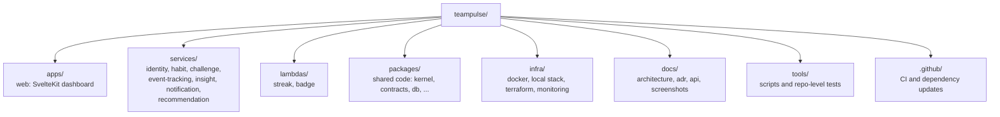

# TeamPulse

An internal wellness and consistency platform. Employees build healthy habits and compete in
team challenges; managers see only **aggregated** trends, never personal wellness data.

Based on `Case Study 2 - TeamPulse.pdf` (microservices, SvelteKit with runes, AWS deployment).

**Public GitHub repository:** <https://github.com/srikar2000sundram/TEAM_PULSE_ASSIGNMENT> (branch `main`)

## Submission index

| #   | Deliverable                                                 | Where                                                                                                                                                                                                                                                        |
| --- | ----------------------------------------------------------- | ------------------------------------------------------------------------------------------------------------------------------------------------------------------------------------------------------------------------------------------------------------ |
| 1   | Source code with commits                                    | this repository: <https://github.com/srikar2000sundram/TEAM_PULSE_ASSIGNMENT>                                                                                                                                                                                |
| 2   | Architecture overview, including the Recommendation service | this README, [01 System context](docs/architecture/01-system-context.md), [02 Microservices](docs/architecture/02-microservices.md), [18 Recommendation Service](docs/architecture/18-recommendation-service.md)                                             |
| 3   | Setup guide (Docker Compose)                                | [docs/SETUP.md](docs/SETUP.md)                                                                                                                                                                                                                               |
| 4   | API documentation (OpenAPI), including Recommendation       | [docs/api](docs/api) (an OpenAPI file and a guide per service), [Recommendation API](docs/api/recommendation.md)                                                                                                                                             |
| 5   | User walkthrough                                            | [docs/USER-WALKTHROUGH.md](docs/USER-WALKTHROUGH.md)                                                                                                                                                                                                         |
| 6   | Network architecture diagram                                | [19 Network architecture](docs/architecture/19-network-architecture.md)                                                                                                                                                                                      |
| 7   | Cloud deployment documentation                              | [17 Terraform](docs/architecture/17-terraform.md); [Deployment record with 59 screenshots](docs/DEPLOYMENT.md); [Build journey, problems and solutions (PDF)](docs/TeamPulse-Build-Journey-and-Challenges.pdf)                                               |
| 8   | Demo recording                                              | recorded from the live AWS deployment (login, dashboard, adding an activity, then the AWS console); video: <https://nagarro-my.sharepoint.com/:v:/p/srikar_sundram/IQCKk4Rb79Q6RZDs-ldHLh4YATPLMa0PSkZ5pIgZvszIZN4?e=dfiziP> (not stored in this repository) |

## Start here

| Read this                                                                             | To understand                                    |
| ------------------------------------------------------------------------------------- | ------------------------------------------------ |
| [01 System context](docs/architecture/01-system-context.md)                           | Actors, containers, overall shape                |
| [02 Microservices](docs/architecture/02-microservices.md)                             | Services, data ownership, internal layout        |
| [03 Event flow](docs/architecture/03-event-flow.md)                                   | How an activity becomes streaks and badges       |
| [04 Frontend](docs/architecture/04-frontend.md)                                       | Routes, components, runes patterns               |
| [05 AWS deployment](docs/architecture/05-aws-deployment.md)                           | Network, ECS, IAM, observability                 |
| [06 Security and privacy](docs/architecture/06-security-and-privacy.md)               | Auth, permissions, privacy, threats              |
| [07 Identity Service](docs/architecture/07-identity-service.md)                       | Login, sessions, tokens, lockout, rotation       |
| [Identity API](docs/api/identity.md)                                                  | Endpoints, errors, examples                      |
| [08 Habit Service](docs/architecture/08-habit-service.md)                             | Habits, visibility, reminders, events            |
| [Habit API](docs/api/habit.md)                                                        | Endpoints, errors, examples                      |
| [09 Event Tracking](docs/architecture/09-event-tracking.md)                           | Activities, idempotency, outbox relay, consumers |
| [Event Tracking API](docs/api/event-tracking.md)                                      | Endpoints, errors, examples                      |
| [10 Lambdas](docs/architecture/10-lambdas.md)                                         | Streak and badge Lambdas, retry safety           |
| [11 Notification Service](docs/architecture/11-notification-service.md)               | Notifications, preferences, reminders            |
| [Notification API](docs/api/notification.md)                                          | Endpoints, errors, examples                      |
| [18 Recommendation Service](docs/architecture/18-recommendation-service.md)           | Personalised timing recommendations              |
| [Recommendation API](docs/api/recommendation.md)                                      | Endpoints, errors, examples                      |
| [12 Insight Service](docs/architecture/12-insight-service.md)                         | Privacy-preserving analytics, K-anonymity        |
| [Insight API](docs/api/insight.md)                                                    | Endpoints, errors, examples                      |
| [13 Challenge Service](docs/architecture/13-challenge-service.md)                     | Challenges, scoring, leaderboards, badges        |
| [Challenge API](docs/api/challenge.md)                                                | Endpoints, errors, examples                      |
| [14 Local stack](docs/architecture/14-local-stack.md)                                 | Containers, LocalStack, one command              |
| [15 Continuous integration](docs/architecture/15-ci-cd.md)                            | Checks run on every change                       |
| [16 Observability and hardening](docs/architecture/16-observability-and-hardening.md) | Alarms, headers, rate limits, threat review      |
| [17 Terraform](docs/architecture/17-terraform.md)                                     | The AWS infrastructure as code (not yet applied) |
| [Decision records](docs/adr/README.md)                                                | Why each major choice was made                   |
| [Engineering guidelines](docs/engineering/guidelines.md)                              | SOLID, testing, git, API conventions             |
| [Shared packages](packages/README.md)                                                 | Kernel, contracts, logging, config               |
| [Roadmap](docs/roadmap.md)                                                            | Build steps and open questions                   |

## Repository layout



## Where everything is (folder by folder)

Read this section when you ask "which folder holds X?". Paths are relative to the repository root.

### The whole tree at a glance

```text
teampulse/
|-- README.md                      this file
|-- package.json, package-lock.json   npm workspaces and every npm script (build, test, verify, local:up ...)
|-- tsconfig.base.json, tsconfig.json TypeScript settings shared by all packages; tsconfig.json lists every project
|-- eslint.config.mjs              lint rules, including the architecture boundary rules
|-- vitest.config.ts               test projects: unit, frontend, integration (integration files run one by one)
|-- .prettierrc.json, .prettierignore, .editorconfig   formatting rules
|-- .gitattributes, .gitignore, .dockerignore, .nvmrc  git, docker and Node version (22) settings
|-- .github/                       CI workflow and dependabot settings
|-- apps/web/                      the SvelteKit web application
|-- services/                      the seven backend microservices
|-- lambdas/                       the two Lambda packages (three functions)
|-- packages/                      shared libraries used by services, lambdas and the web app
|-- infra/                         Dockerfile, local stack, Terraform, monitoring definitions
|-- tools/                         helper scripts and repo-level tests
`-- docs/                          architecture, decisions, API docs, guides, screenshots
```

### Root files

| File                                                   | What it is for                                                                                                                                                                                                                                                                                                                                                            |
| ------------------------------------------------------ | ------------------------------------------------------------------------------------------------------------------------------------------------------------------------------------------------------------------------------------------------------------------------------------------------------------------------------------------------------------------------- |
| `package.json`                                         | Declares the npm workspaces (`apps/*`, `services/*`, `lambdas/*`, `packages/*`) and the scripts: `build`, `typecheck`, `lint`, `format:check`, `docs:check`, `test` (unit, frontend, integration), `verify` (all checks), `local:env` / `local:up` / `local:down` / `local:reset` / `local:smoke` (the local stack), `load` / `load:burst` (load test), `bundle:lambdas`. |
| `package-lock.json`                                    | Exact dependency versions (needed for reproducible installs and the CI audit).                                                                                                                                                                                                                                                                                            |
| `tsconfig.base.json` / `tsconfig.json`                 | Strict TypeScript options shared by every project, and the list of project references so `tsc -b` builds in order.                                                                                                                                                                                                                                                        |
| `eslint.config.mjs`                                    | ESLint rules; includes the boundary rules that stop a service importing another service or the domain importing infrastructure.                                                                                                                                                                                                                                           |
| `vitest.config.ts`                                     | Defines the three test projects and keeps integration tests sequential (low memory use).                                                                                                                                                                                                                                                                                  |
| `.nvmrc`                                               | The Node.js version to use (22).                                                                                                                                                                                                                                                                                                                                          |
| `.editorconfig`, `.prettierrc.json`, `.prettierignore` | Editor and formatting rules; `npm run format:check` enforces them.                                                                                                                                                                                                                                                                                                        |
| `.gitattributes`                                       | Line-ending rules; marks the certificate bundle in `infra/docker/certs` as binary-safe text.                                                                                                                                                                                                                                                                              |
| `.gitignore`                                           | Keeps out `node_modules`, build output (`dist`, `build`, `.svelte-kit`), local secrets (`infra/local/.env`), and the personal `docs/guides/` folder.                                                                                                                                                                                                                      |
| `.dockerignore`                                        | What is left out of the container build context.                                                                                                                                                                                                                                                                                                                          |

### `.github/`

| Path                       | Content                                                                                                                                                                                                        |
| -------------------------- | -------------------------------------------------------------------------------------------------------------------------------------------------------------------------------------------------------------- |
| `.github/workflows/ci.yml` | The pipeline run on every push: **Verify** (format, lint, types, tests, docs), **Dependency audit** (production, high and above) and **Build and scan images**. See [15 CI/CD](docs/architecture/15-ci-cd.md). |
| `.github/dependabot.yml`   | Weekly dependency update pull requests.                                                                                                                                                                        |

### `apps/web/` (the web application)

| Path                                                            | Content                                                                                                                    |
| --------------------------------------------------------------- | -------------------------------------------------------------------------------------------------------------------------- |
| `apps/web/package.json`, `vite.config.ts`, `tsconfig.json`      | App settings (SvelteKit with Svelte 5 runes, static build).                                                                |
| `apps/web/src/app.html`, `app.css`, `app.d.ts`                  | Page shell, global styles, type declarations.                                                                              |
| `apps/web/src/routes/login/`                                    | The sign-in page.                                                                                                          |
| `apps/web/src/routes/(app)/dashboard/`                          | Dashboard: active days, activities completed, trend chart.                                                                 |
| `apps/web/src/routes/(app)/habits/`                             | Habits page: add a habit, "Done today", archive.                                                                           |
| `apps/web/src/routes/(app)/challenges/` and `challenges/[id]/`  | Challenge list and a single challenge with leaderboard and progress.                                                       |
| `apps/web/src/routes/(app)/analytics/me/` and `analytics/team/` | Personal analytics and the manager's aggregated team view (hidden below 5 people).                                         |
| `apps/web/src/routes/(app)/recommendations/`                    | The Recommendations page (accept or dismiss a suggested time).                                                             |
| `apps/web/src/routes/(app)/notifications/` and `(app)/admin/`   | Notification list and the administrator page.                                                                              |
| `apps/web/src/lib/api/`                                         | The typed API client and its HTTP layer (one client per service, shared error handling).                                   |
| `apps/web/src/lib/auth/`                                        | The session store (tokens, sign-in state, role).                                                                           |
| `apps/web/src/lib/features/`                                    | One store per feature (`habits`, `challenges`, `analytics`, `recommendations`, `notifications`, `admin`) with their tests. |
| `apps/web/src/lib/format.ts`, `context.ts`, `async.svelte.ts`   | Small shared helpers (date and number formatting, shared context, async state).                                            |

### `services/` (seven microservices)

Every service has the same layout, so once you know one you know all of them:

| Path inside a service                                  | Content                                                                                                     |
| ------------------------------------------------------ | ----------------------------------------------------------------------------------------------------------- |
| `src/domain/`                                          | Pure business rules and types (no frameworks, no AWS).                                                      |
| `src/application/`                                     | Use cases that orchestrate the domain through ports (interfaces).                                           |
| `src/adapters/`                                        | Implementations of the ports: HTTP routes, PostgreSQL repositories, event handlers, outbox and queue code.  |
| `src/config/`                                          | Reads and validates environment variables.                                                                  |
| `src/cli/`                                             | One-off commands: `migrate` (create the tables), plus `bootstrap-admin` in identity and the OpenAPI export. |
| `test/unit/`, `test/integration/`, `test/support/`     | Unit tests, integration tests against PostgreSQL (PGlite), and test fakes.                                  |
| `package.json`, `tsconfig.json`, `tsconfig.build.json` | Package and TypeScript settings. `README.md` explains the service.                                          |

| Service                    | Owns                                                                                                      | Read more                                                                               |
| -------------------------- | --------------------------------------------------------------------------------------------------------- | --------------------------------------------------------------------------------------- |
| `services/identity/`       | Users, sign-in (Argon2id), tokens and keys (JWKS), refresh-token rotation, roles, teams, audit log        | [07](docs/architecture/07-identity-service.md), [API](docs/api/identity.md)             |
| `services/habit/`          | Habits, visibility (private or team), reminders                                                           | [08](docs/architecture/08-habit-service.md), [API](docs/api/habit.md)                   |
| `services/event-tracking/` | Recording an activity once per day, outbox relay to EventBridge                                           | [09](docs/architecture/09-event-tracking.md), [API](docs/api/event-tracking.md)         |
| `services/challenge/`      | Challenges, scoring ledger, leaderboard, badges                                                           | [13](docs/architecture/13-challenge-service.md), [API](docs/api/challenge.md)           |
| `services/insight/`        | Privacy-preserving analytics (K-anonymity, pseudonymous aggregates, erasure)                              | [12](docs/architecture/12-insight-service.md), [API](docs/api/insight.md)               |
| `services/notification/`   | Notifications, preferences, reminder delivery                                                             | [11](docs/architecture/11-notification-service.md), [API](docs/api/notification.md)     |
| `services/recommendation/` | **New service:** best-time recommendations from a person's own completion times; accept sets the reminder | [18](docs/architecture/18-recommendation-service.md), [API](docs/api/recommendation.md) |

### `lambdas/`

| Path              | Content                                                                                                                                                                         |
| ----------------- | ------------------------------------------------------------------------------------------------------------------------------------------------------------------------------- |
| `lambdas/streak/` | The streak function: updates a person's streak in DynamoDB with conditional writes (safe to retry). `src/domain`, `src/application`, `src/adapters`, `src/handler.ts`, `test/`. |
| `lambdas/badge/`  | The two badge functions (streak milestones and total milestones). `src/domain/milestones.ts`, `src/application`, `src/handler.ts`, `test/`.                                     |

See [10 Lambdas](docs/architecture/10-lambdas.md).

### `packages/` (shared code)

Services share code only through these packages (see [packages/README.md](packages/README.md)).

| Package                   | Purpose                                                                                                          |
| ------------------------- | ---------------------------------------------------------------------------------------------------------------- |
| `packages/kernel/`        | Basic building blocks: clock, ids, deterministic ids, errors, result type, cursors, periodic tasks.              |
| `packages/contracts/`     | The shared data contracts (Zod schemas): request/response shapes and the 13 event types with the event envelope. |
| `packages/observability/` | JSON logger, correlation ids, redaction of personal data.                                                        |
| `packages/config/`        | Typed environment-variable reading.                                                                              |
| `packages/auth/`          | Token (JWT) verification and the authenticated principal.                                                        |
| `packages/http/`          | Fastify server setup, problem+json errors, route helpers, OpenAPI export.                                        |
| `packages/db/`            | PostgreSQL access and the migration runner.                                                                      |
| `packages/outbox/`        | The outbox table, the relay and the EventBridge publisher.                                                       |
| `packages/inbox/`         | SQS consumers, Lambda helpers and idempotent processing.                                                         |
| `packages/privacy/`       | The K-anonymity rule (minimum group of 5).                                                                       |
| `packages/testing/`       | Test support, including the PGlite (PostgreSQL-in-WASM) helper.                                                  |
| `packages/ui/`            | The web-component library (progress ring, trend chart, leaderboard ...) and the design tokens (`tokens.css`).    |

### `infra/` (infrastructure)

| Path                                                        | Content                                                                                                                                                                                                                                                                                                                                                                                                         |
| ----------------------------------------------------------- | --------------------------------------------------------------------------------------------------------------------------------------------------------------------------------------------------------------------------------------------------------------------------------------------------------------------------------------------------------------------------------------------------------------- |
| `infra/docker/Dockerfile`                                   | Builds the one backend image (all seven services) and the web image; checks the certificate bundle checksum; runs as a non-root user.                                                                                                                                                                                                                                                                           |
| `infra/docker/nginx.conf`, `security-headers.conf.template` | The web server settings and the security headers (CSP, HSTS) for the local web image.                                                                                                                                                                                                                                                                                                                           |
| `infra/docker/certs/`                                       | The Amazon RDS certificate bundle (`rds-global-bundle.pem`) and a README on where it comes from.                                                                                                                                                                                                                                                                                                                |
| `infra/local/compose.yaml`                                  | The local stack: PostgreSQL, LocalStack, the seven services, the Lambda runner and the web app. `infra/local/.env` (not in git) is created by `npm run local:env`.                                                                                                                                                                                                                                              |
| `infra/observability/monitoring.json`                       | The single definition of log metric filters, alarms and the dashboard (used by tests and by the AWS deployment).                                                                                                                                                                                                                                                                                                |
| `infra/terraform/`                                          | The AWS design as code: `network.tf`, `security_groups.tf`, `alb.tf`, `ecs.tf`, `data.tf` (RDS, DynamoDB), `messaging.tf` (EventBridge, SQS), `lambda.tf`, `frontend.tf` (S3, CloudFront), `waf.tf`, `secrets.tf`, `monitoring.tf`, `locals.tf`, `variables.tf`, `outputs.tf`, `versions.tf`, plus `backend.hcl.example` and `terraform.tfvars.example`. See [17 Terraform](docs/architecture/17-terraform.md). |

### `tools/` (scripts and repo-level tests)

| Path                                            | Purpose                                                                                                                    |
| ----------------------------------------------- | -------------------------------------------------------------------------------------------------------------------------- |
| `tools/check-mermaid.mjs`                       | Validates every Mermaid diagram in every Markdown file (`npm run docs:check`).                                             |
| `tools/local/make-env.mjs`                      | Creates `infra/local/.env` with fresh random secrets.                                                                      |
| `tools/local/compose.mjs`                       | Runs `docker compose` or `podman compose` for the local stack.                                                             |
| `tools/local/setup-aws.mjs`, `topology.mjs`     | Create the event bus, queues and rules inside LocalStack; `topology.mjs` is the single list of who listens to which event. |
| `tools/local/lambda-runner.mjs`                 | Runs the Lambda functions locally from a queue.                                                                            |
| `tools/local/smoke.mjs`                         | End-to-end check of the running local stack.                                                                               |
| `tools/local/seed-demo.mjs`, `seed-history.mjs` | Create demo people, a team, a challenge and some days of history (they can target a deployed stack too).                   |
| `tools/lambda/bundle.mjs`                       | Bundles each Lambda into one file for upload.                                                                              |
| `tools/docker/render-security-headers.mjs`      | Builds the Content-Security-Policy from the built web app.                                                                 |
| `tools/observability/log-filter.mjs`            | Evaluates CloudWatch filter patterns so tests can check the monitoring definitions.                                        |
| `tools/load/load-test.mjs`                      | A small load test against the local stack.                                                                                 |
| `tools/test/`                                   | Repo-level tests: monitoring, security headers, route inventory, Terraform text checks, topology.                          |

### `docs/` (documentation)

| Path                                              | Content                                                                                                                                                                                                                                                                                                                |
| ------------------------------------------------- | ---------------------------------------------------------------------------------------------------------------------------------------------------------------------------------------------------------------------------------------------------------------------------------------------------------------------- |
| `docs/SETUP.md`                                   | Deliverable 3: setup and run guide (Docker Compose).                                                                                                                                                                                                                                                                   |
| `docs/USER-WALKTHROUGH.md`                        | Deliverable 5: the user walkthrough (register, create an activity, analytics, Recommendations).                                                                                                                                                                                                                        |
| `docs/DEPLOYMENT.md`                              | Deliverable 7: the AWS deployment record, with all 59 screenshots, what was verified and the limits.                                                                                                                                                                                                                   |
| `docs/TeamPulse-Build-Journey-and-Challenges.pdf` | How the application and the AWS deployment were built, step by step, with every problem met and how it was solved (including the CloudFront verification).                                                                                                                                                             |
| `docs/roadmap.md`                                 | The 13 build steps and open questions.                                                                                                                                                                                                                                                                                 |
| `docs/architecture/`                              | Numbered architecture documents `01` to `19` (system context to the network diagram), each with Mermaid diagrams.                                                                                                                                                                                                      |
| `docs/adr/`                                       | 23 architecture decision records (`0001-...` to `0023-...`) and an index.                                                                                                                                                                                                                                              |
| `docs/api/`                                       | One guide (`<service>.md`) and one OpenAPI file (`<service>.openapi.json`) for each of the six API services, including `recommendation`.                                                                                                                                                                               |
| `docs/engineering/guidelines.md`                  | SOLID, testing, git and API conventions.                                                                                                                                                                                                                                                                               |
| `docs/screenshots/`                               | The evidence images used by `DEPLOYMENT.md`. Names: `01` and `22` ECS; `02`-`03` network; `04`-`05` load balancer; `06`-`07` containers; `08`-`09` data; `10`-`12` events; `13`-`14` security; `15`-`16` and `21` monitoring; `17`-`20` S3, CloudFront and the firewall; `app-01` to `app-11` the running application. |

### Not in this repository (kept local on purpose)

| Item                                               | Why                                                                                                                                                          |
| -------------------------------------------------- | ------------------------------------------------------------------------------------------------------------------------------------------------------------ |
| `Case Study 2 - TeamPulse.pdf`                     | The source assignment (kept locally; ignored by git).                                                                                                        |
| `docs/guides/`                                     | Personal guides, scripts and decks for the demonstration (git-ignored).                                                                                      |
| `infra/local/.env`                                 | Generated local secrets.                                                                                                                                     |
| `node_modules/`, `dist/`, `build/`, `.svelte-kit/` | Installed or generated files; recreated by `npm install` and `npm run build`.                                                                                |
| The demo video                                     | Not committed (too large). Watch it here: <https://nagarro-my.sharepoint.com/:v:/p/srikar_sundram/IQCKk4Rb79Q6RZDs-ldHLh4YATPLMa0PSkZ5pIgZvszIZN4?e=dfiziP>. |

## Technology

| Area          | Choice                                                                                                       |
| ------------- | ------------------------------------------------------------------------------------------------------------ |
| Language      | TypeScript (strict), Node.js 22+                                                                             |
| Backend       | Fastify, hexagonal architecture, PostgreSQL, DynamoDB                                                        |
| Frontend      | SvelteKit, Svelte 5 runes, custom-element UI library                                                         |
| Cloud         | S3 + CloudFront, ALB, ECS Fargate, ECR, RDS, DynamoDB, EventBridge, Lambda, SQS, Secrets Manager, CloudWatch |
| Infra as code | Terraform                                                                                                    |

## Getting started

```bash
nvm use            # Node 22
npm install
npm run build      # compile shared packages (TypeScript project references)
npm test           # unit tests (Vitest)
npm run lint       # ESLint, including architecture boundary rules
npm run docs:check # validates every Mermaid diagram
npm run verify     # all of the above plus formatting and typecheck
```

## Principles

1. **Privacy first**: aggregate before exposing, suppress small cohorts.
2. **Clean boundaries**: each service owns its data; the core never imports infrastructure.
3. **Everything documented**: diagrams live next to the code and are checked in CI.
4. **Decisions are recorded**: significant choices have an ADR.
