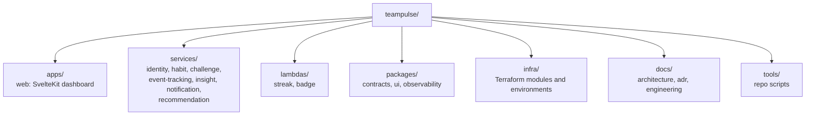

# TeamPulse

An internal wellness and consistency platform. Employees build healthy habits and compete in
team challenges; managers see only **aggregated** trends, never personal wellness data.

Based on `Case Study 2 - TeamPulse.pdf` (microservices, SvelteKit with runes, AWS deployment).

## Submission index

| #   | Deliverable                                                 | Where                                                                                                                                                                                                            |
| --- | ----------------------------------------------------------- | ---------------------------------------------------------------------------------------------------------------------------------------------------------------------------------------------------------------- |
| 1   | Source code with commits                                    | this repository                                                                                                                                                                                                  |
| 2   | Architecture overview, including the Recommendation service | this README, [01 System context](docs/architecture/01-system-context.md), [02 Microservices](docs/architecture/02-microservices.md), [18 Recommendation Service](docs/architecture/18-recommendation-service.md) |
| 3   | Setup guide (Docker Compose)                                | [docs/SETUP.md](docs/SETUP.md)                                                                                                                                                                                   |
| 4   | API documentation (OpenAPI), including Recommendation       | [docs/api](docs/api) (an OpenAPI file and a guide per service), [Recommendation API](docs/api/recommendation.md)                                                                                                 |
| 5   | User walkthrough                                            | [docs/USER-WALKTHROUGH.md](docs/USER-WALKTHROUGH.md)                                                                                                                                                             |
| 6   | Network architecture diagram                                | [19 Network architecture](docs/architecture/19-network-architecture.md)                                                                                                                                          |
| 7   | Cloud deployment documentation                              | [17 Terraform](docs/architecture/17-terraform.md); deployment record with screenshots: added after deployment                                                                                                    |
| 8   | Demo recording                                              | added after deployment                                                                                                                                                                                           |

## Start here

| Read this                                                                             | To understand                                    |
| ------------------------------------------------------------------------------------- | ------------------------------------------------ |
| [01 System context](docs/architecture/01-system-context.md)                           | Actors, containers, overall shape                |
| [02 Microservices](docs/architecture/02-microservices.md)                             | Services, data ownership, internal layout        |
| [03 Event flow](docs/architecture/03-event-flow.md)                                   | How an activity becomes streaks and badges       |
| [04 Frontend](docs/architecture/04-frontend.md)                                       | Routes, components, runes patterns               |
| [05 AWS deployment](docs/architecture/05-aws-deployment.md)                           | Network, ECS, IAM, observability                 |
| [06 Security and privacy](docs/architecture/06-security-and-privacy.md)               | Auth, permissions, privacy, threats              |
| [07 Identity Service](docs/architecture/07-identity-service.md)                       | Login, sessions, tokens, lockout, rotation       |
| [Identity API](docs/api/identity.md)                                                  | Endpoints, errors, examples                      |
| [08 Habit Service](docs/architecture/08-habit-service.md)                             | Habits, visibility, reminders, events            |
| [Habit API](docs/api/habit.md)                                                        | Endpoints, errors, examples                      |
| [09 Event Tracking](docs/architecture/09-event-tracking.md)                           | Activities, idempotency, outbox relay, consumers |
| [Event Tracking API](docs/api/event-tracking.md)                                      | Endpoints, errors, examples                      |
| [10 Lambdas](docs/architecture/10-lambdas.md)                                         | Streak and badge Lambdas, retry safety           |
| [11 Notification Service](docs/architecture/11-notification-service.md)               | Notifications, preferences, reminders            |
| [Notification API](docs/api/notification.md)                                          | Endpoints, errors, examples                      |
| [18 Recommendation Service](docs/architecture/18-recommendation-service.md)           | Personalised timing recommendations              |
| [Recommendation API](docs/api/recommendation.md)                                      | Endpoints, errors, examples                      |
| [12 Insight Service](docs/architecture/12-insight-service.md)                         | Privacy-preserving analytics, K-anonymity        |
| [Insight API](docs/api/insight.md)                                                    | Endpoints, errors, examples                      |
| [13 Challenge Service](docs/architecture/13-challenge-service.md)                     | Challenges, scoring, leaderboards, badges        |
| [Challenge API](docs/api/challenge.md)                                                | Endpoints, errors, examples                      |
| [14 Local stack](docs/architecture/14-local-stack.md)                                 | Containers, LocalStack, one command              |
| [15 Continuous integration](docs/architecture/15-ci-cd.md)                            | Checks run on every change                       |
| [16 Observability and hardening](docs/architecture/16-observability-and-hardening.md) | Alarms, headers, rate limits, threat review      |
| [17 Terraform](docs/architecture/17-terraform.md)                                     | The AWS infrastructure as code (not yet applied) |
| [Decision records](docs/adr/README.md)                                                | Why each major choice was made                   |
| [Engineering guidelines](docs/engineering/guidelines.md)                              | SOLID, testing, git, API conventions             |
| [Shared packages](packages/README.md)                                                 | Kernel, contracts, logging, config               |
| [Roadmap](docs/roadmap.md)                                                            | Build steps and open questions                   |

## Repository layout



The workspace folders appear as the steps in the [roadmap](docs/roadmap.md) create them.

## Technology

| Area          | Choice                                                                                                       |
| ------------- | ------------------------------------------------------------------------------------------------------------ |
| Language      | TypeScript (strict), Node.js 22+                                                                             |
| Backend       | Fastify, hexagonal architecture, PostgreSQL, DynamoDB                                                        |
| Frontend      | SvelteKit, Svelte 5 runes, custom-element UI library                                                         |
| Cloud         | S3 + CloudFront, ALB, ECS Fargate, ECR, RDS, DynamoDB, EventBridge, Lambda, SQS, Secrets Manager, CloudWatch |
| Infra as code | Terraform                                                                                                    |

## Getting started

```bash
nvm use            # Node 22
npm install
npm run build      # compile shared packages (TypeScript project references)
npm test           # unit tests (Vitest)
npm run lint       # ESLint, including architecture boundary rules
npm run docs:check # validates every Mermaid diagram
npm run verify     # all of the above plus formatting and typecheck
```

## Principles

1. **Privacy first**: aggregate before exposing, suppress small cohorts.
2. **Clean boundaries**: each service owns its data; the core never imports infrastructure.
3. **Everything documented**: diagrams live next to the code and are checked in CI.
4. **Decisions are recorded**: significant choices have an ADR.
