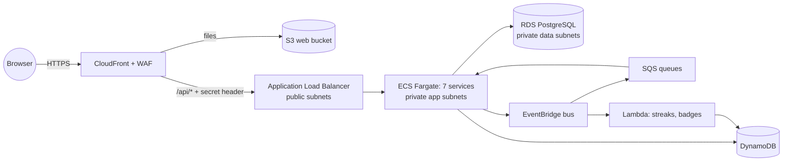

# Cloud deployment record (AWS, Mumbai)

This document records how TeamPulse was deployed to AWS and what was checked afterwards. It is the
deployment evidence for the submission (item 7). The infrastructure is also written as Terraform in
[`infra/terraform`](../infra/terraform) (see [17 Terraform](architecture/17-terraform.md)); the
environment described here was built step by step with the AWS Management Console and the AWS CLI,
using the same names, sizes and rules as the Terraform files.

- **Region:** Asia Pacific (Mumbai), `ap-south-1`. CloudFront and the web firewall are global
  services (their API lives in `us-east-1`).
- **Environment name:** `teampulse-dev`. Every resource name starts with this prefix.
- **Lifetime:** a short-lived environment, built for the demonstration and deleted the same day to
  avoid cost.

## 1. Status at the time of writing

| Area                                       | Status                                                                                                    |
| ------------------------------------------ | --------------------------------------------------------------------------------------------------------- |
| Network, security groups, database, queues | Built and checked                                                                                         |
| Container image, ECS services, scaling     | Built; all seven services running and healthy behind the load balancer                                    |
| Lambda functions, event bus, rules         | Built                                                                                                     |
| Monitoring (logs, metrics, alarms)         | Built                                                                                                     |
| Website files in the S3 bucket             | Uploaded                                                                                                  |
| CloudFront distribution                    | **Pending.** AWS requires a new account to be verified before it allows the first CloudFront distribution |

CloudFront was refused with the message "Your account must be verified before you can add new
CloudFront resources" and a support case was opened. Until the account is verified the application
has no public HTTPS address, so the sign-in and the end-to-end flow could not yet be tested on AWS.
This section is updated when that changes. The end-to-end flow itself is covered by the automated
tests in this repository and by the local stack ([Setup guide](SETUP.md)).

## 2. How the assignment's AWS services map to this deployment

| Assignment asks for                                 | What was built                                                                                                                                                      |
| --------------------------------------------------- | ------------------------------------------------------------------------------------------------------------------------------------------------------------------- |
| Amazon S3 for the frontend, delivered globally      | Private bucket `teampulse-dev-web-<account>` (versioned, encrypted) holding the compiled web app; CloudFront with origin access control in front of it              |
| HTTPS/TLS                                           | CloudFront redirects HTTP to HTTPS; response-header policy adds HSTS and a Content-Security-Policy computed from the built page; RDS requires TLS (`rds.force_ssl`) |
| Separate VPC segments (public, application, data)   | VPC `10.0.0.0/16`, six subnets in two Availability Zones, three route tables                                                                                        |
| Application Load Balancer in public subnets         | Internet-facing ALB `teampulse-dev`; path rules `/api/v1/<service>/*` to seven target groups; default answer 403                                                    |
| Amazon ECS for the microservices, with auto scaling | Fargate cluster `teampulse-dev`; seven services; 1 to 4 tasks per service at 60% CPU; deployment circuit breaker with rollback                                      |
| Amazon RDS for transactional data                   | PostgreSQL 16 `db.t4g.micro`, in the data subnets, not public, encrypted, one schema per service                                                                    |
| Amazon DynamoDB                                     | Three on-demand tables: streaks and two Insight tables (with time-to-live)                                                                                          |
| EventBridge and Lambda                              | Event bus `teampulse-dev-bus`; nine rules; three Node.js 22 Lambda functions (streak, two badge functions)                                                          |
| Queues with dead-letter handling                    | Six service queues and nine dead-letter queues (SQS), encrypted, five receives before a message is parked                                                           |
| Secrets Manager                                     | Five secrets (database URL, token-signing key, log salt, Insight key, first administrator password); injected into containers at start                              |
| IAM roles with least privilege                      | Per service: an execution role and a task role, and one role per Lambda; every policy names its resources                                                           |
| Security groups and network ACLs                    | Three security groups chained by group; a network ACL around the data subnets                                                                                       |
| CloudWatch for logs, metrics, alerts                | Log group per service; 75 log metric filters; 87 alarms; one dashboard; two SNS topics                                                                              |
| Web application firewall                            | WAF web ACL: rate limit of 2000 requests per 5 minutes per address on `/api/`, plus two AWS managed rule sets                                                       |

## 3. The network

| Tier   | Subnets (two zones)            | Route to the internet             | What lives there                  |
| ------ | ------------------------------ | --------------------------------- | --------------------------------- |
| Public | `10.0.0.0/24`, `10.0.1.0/24`   | Internet gateway                  | Load balancer, NAT gateway        |
| App    | `10.0.10.0/24`, `10.0.11.0/24` | Out only, through the NAT gateway | The seven services (no public IP) |
| Data   | `10.0.20.0/24`, `10.0.21.0/24` | None (only the local route)       | The database                      |

Free gateway endpoints connect the app subnets to S3 and DynamoDB without using the NAT gateway.
The data subnets have a network ACL that allows only PostgreSQL (port 5432) from the two app subnets.

Security groups reference each other, not address ranges:

| Group                | Inbound                                               | Outbound                                   |
| -------------------- | ----------------------------------------------------- | ------------------------------------------ |
| `teampulse-dev-alb`  | HTTP 80 from the CloudFront origin-facing prefix list | TCP 3000 to the app group                  |
| `teampulse-dev-app`  | TCP 3000 from the load balancer group                 | HTTPS 443 anywhere, 5432 to the data group |
| `teampulse-dev-data` | PostgreSQL 5432 from the app group                    | none                                       |

## 4. Compute and the container image

- One backend image serves all seven services (the command picks which one runs). It is built from
  [`infra/docker/Dockerfile`](../infra/docker/Dockerfile), stored in a private ECR repository
  (`teampulse-dev/backend`, immutable tags, scan on push) and tagged with the build date.
- The image contains the AWS RDS certificate bundle, and the build checks its SHA-256, so the
  services can verify the database's TLS certificate.
- Each task is 0.25 vCPU and 512 MB, runs as a non-root user with a read-only root file system and
  a container health check on `/healthz`.
- Secrets are not in the image or in plain settings: the task definition lists Secrets Manager
  secrets, and ECS injects them when a task starts.
- Database tables and the first administrator are created by a one-off migrate task, run on demand
  (not on every start).

## 5. Events

The Identity, Habit, Event Tracking and Challenge services publish events to the bus. Rules route event types
to queues (one per consuming service) and to the three Lambda functions. A message that fails five
times moves to the queue's dead-letter queue; a Lambda rule retries twice within an hour and then
parks the event in its own dead-letter queue. An alarm fires for any message in a dead-letter queue.

## 6. Monitoring

Every service logs one JSON line per request (method, path, status, duration, correlation id) with
pseudonymised identifiers and no names or e-mail addresses. Metric filters turn those lines into
metrics; alarms cover latency, API failures, sign-in problems, dead-letter queues, unhealthy targets,
CPU and memory, Lambda errors, database load and storage, and DynamoDB throttling. They notify two
SNS topics (urgent and ticket). The exact definitions are in
[`infra/observability/monitoring.json`](../infra/observability/monitoring.json).

There is no alarm that counts container restarts directly, because that needs ECS Container
Insights, which is off to save cost. The "no healthy target" alarm and the running-task count on the
dashboard are the closest signals.

## 7. Evidence

Console screenshots (the account menu in the header is masked). More are added as they are captured.

_ECS cluster `teampulse-dev`: seven services, one task each, all Active._

## 8. Verified

- The seven ECS services each reached a steady state with one running task, and all seven target
  groups reported the task healthy.
- The migrate task exited with code 0, created the tables for the six database-backed services and
  the first administrator.
- The container image's certificate bundle matched its pinned checksum during the build.
- Monitoring was created: 75 log metric filters, 87 alarms and one dashboard; two SNS topics exist.

## 9. Not verified, and known limits

- No end-to-end test on AWS yet (waiting for CloudFront, see section 1). The Lambda functions have
  not yet been triggered by a real event.
- The Terraform in `infra/terraform` has not been applied or validated by Terraform itself.
- The services start with a placeholder public address in two settings (`CORS_ORIGINS`,
  `IDENTITY_JWKS_URL`); new task definition revisions with the real CloudFront address are needed
  once the distribution exists.
- The load balancer listens on HTTP only; CloudFront connects to it over HTTP inside AWS. A header
  secret and the security group stop other callers.
- No secret rotation; the Lambda log salt is a plain environment variable (a limit of the Lambda
  console). Alarm thresholds are first guesses and untuned.
- The ECR image scan reported findings (6 high, 7 medium, 4 low, 1 undefined) that were not yet
  triaged; they are most likely in the base operating-system image.
- The environment uses a single NAT gateway and a single-zone database, which is acceptable for a
  demonstration and noted as a risk for production.

## 10. Cost and teardown

A running environment costs roughly 0.25 US dollars per hour (NAT gateway, database, load balancer,
seven Fargate tasks, firewall and alarms). It is deleted the same day: services and cluster, load
balancer, NAT gateway and Elastic IP, database, queues, functions, tables, buckets, firewall, secrets
and roles. Budget alerts are set at 20 and 100 US dollars.
