# User walkthrough: one person's journey, end to end

A sample scenario that follows one employee, Ada, from her account being created to accepting a
personalised timing recommendation, and then what her manager sees. Every step says what to do, what
you should see, and which part of the system did the work behind the scenes.

Use the [local stack](SETUP.md) (`http://localhost:8080`) or the deployed address. The demo people come
from `node tools/local/seed-demo.mjs`.

```mermaid
flowchart LR
    s1["1 Account created"] --> s2["2 Sign in"]
    s2 --> s3["3 Create a habit"]
    s3 --> s4["4 Mark it done"]
    s4 --> s5["5 Join a challenge"]
    s5 --> s6["6 View analytics"]
    s6 --> s7["7 Recommendations"]
    s7 --> s8["8 Accept: reminder set"]
    s8 --> s9["9 Notifications"]
    s9 --> s10["10 Manager's view"]
```

## 1. An account is created for Ada

TeamPulse is an internal platform, so people do not sign themselves up: an administrator adds them.

Sign in as the administrator, open **Administration**, fill **Add a person** (e-mail, name, role
_Employee_, a first password of 12 or more characters) and press **Add person**. Then, under **Add to
team**, add Ada to a team.

_Expect:_ a confirmation message, and Ada appears under **People** and in the team.
_Behind the scenes:_ the Identity Service stores a salted Argon2id hash of the password, never the
password, and publishes `TeamMembershipChanged`.

## 2. Ada signs in

Open the app, enter Ada's e-mail and password, press **Sign in**.

_Expect:_ the **Dashboard**: "Hello, Ada", a progress ring for the last 7 days and a trend chart.
_Behind the scenes:_ Identity issues a short-lived signed access token and a rotating refresh token
(an httpOnly cookie). Every other service verifies the token with Identity's public keys.

## 3. Ada creates a habit (an "activity" to track)

**Habits** > **New habit**: name _Walk after lunch_, type _Walking_, **Add habit**.

_Expect:_ the habit is listed under **Your habits**, private to Ada.
_Behind the scenes:_ the Habit Service stores it and publishes `HabitCreated`; Event Tracking and
Notification learn about it.

## 4. Ada marks the habit done

Press **Done today** on the habit. Press it again.

_Expect:_ "Nice work! Recorded for today." The second press says "Already recorded for today."
_Behind the scenes:_ Event Tracking stores the activity once per habit and day (idempotent) and
publishes `ActivityCompleted` through the outbox to the event bus. A day with **no** completion simply
counts as not done; there is no separate "missed" action in this version.

## 5. Ada joins a challenge and earns points

**Challenges** > _November steps_ > **Join**. Mark the habit done again on later days.

_Expect:_ Ada appears on the **Standings** with points. After enough activity, the badge rules (for
example _3 activities_ or _a 3-day streak_) award a badge, and the bell shows a new notification.
_Behind the scenes:_ the Challenge Service scores each `ActivityCompleted` once; the streak Lambda
updates her streak in DynamoDB; the badge Lambda announces milestones; Notification tells her.

## 6. Ada views her analytics

**My activity**. Change the period or the activity filter.

_Expect:_ totals, a per-day chart and a breakdown by type, updating without a page reload. Only Ada's
own numbers appear.
_Behind the scenes:_ the Insight Service keeps personal counters per person; filters call its API.

## 7. Ada visits the Recommendations page

**Recommendations**. (To see one straight away, run `node tools/local/seed-history.mjs`, which records a
week of history for Ada. Normally a pattern builds up over several days of use.)

_Expect:_ a card per habit with a clear pattern, for example _Walk after lunch: Best time **13:00**
(Europe/Berlin). Strong pattern, 6 of your last 6 were around this time_, with **Accept** and
**Dismiss**. A habit with fewer than 5 completions, or no clear hour, shows nothing, and the page says so.
_Behind the scenes:_ the Recommendation Service stored the time of each completion from the
`ActivityCompleted` events and counts completions per local hour in the browser's time zone.

## 8. Ada accepts the recommendation

Press **Accept**.

_Expect:_ "Reminder set for 13:00 every day", and the card now shows _Accepted_.
_Behind the scenes:_ the decision is stored by the Recommendation Service; the web app then sets the
habit's reminder through the Habit API, which publishes `HabitUpdated`; the Notification Service sends
Ada a reminder at that time every day. **Dismiss** records the choice and changes nothing else.

## 9. Ada reads her notifications

Open the bell (**Notifications**). Press **Mark as read**.

_Expect:_ badge and milestone messages, and later the reminder; the unread count drops.

## 10. Maria, Ada's manager, sees only the team

Sign in as Maria. Open **Team**.

_Expect:_ with fewer than five people taking part, **Not enough participants**. Once five people have
recorded activity, team totals and a trend appear, with no names and no individual rows. Maria cannot
open the organisation-wide report (administrators only), and she never sees Ada's recommendations.
_Behind the scenes:_ the Insight Service enforces K-anonymity (at least 5 people) before it shows any
group figure.
