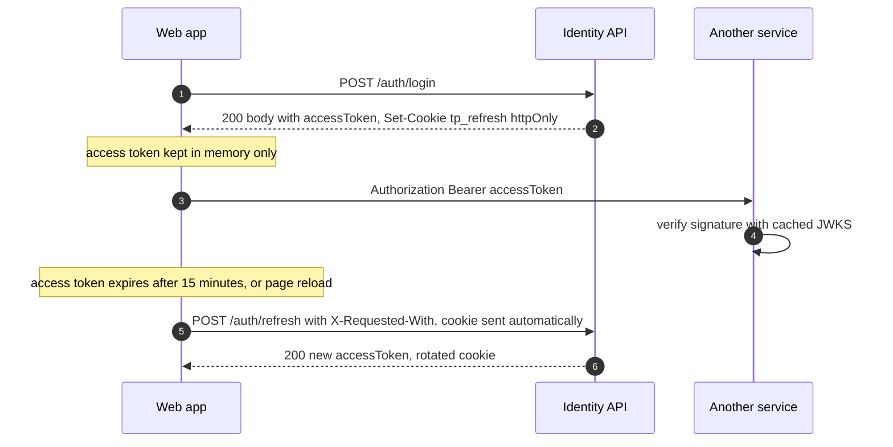

# Identity API

Base path: `/api/v1/identity`. All bodies are JSON (`Content-Type: application/json`); other
content types get `415`. Errors are [RFC 9457](https://www.rfc-editor.org/rfc/rfc9457) problem
details (`application/problem+json`).

The machine-readable description is generated from the code and committed as
[`identity.openapi.json`](identity.openapi.json); a test fails if it drifts. A running service also
serves it at `/api/v1/identity/openapi.json`.

## Authentication model



| Credential    | Lifetime                     | Where it lives                                                                       | Sent how                         |
| ------------- | ---------------------------- | ------------------------------------------------------------------------------------ | -------------------------------- |
| Access token  | 15 min                       | JavaScript memory                                                                    | `Authorization: Bearer <token>`  |
| Refresh token | 7 days, 30 day cap per login | `tp_refresh` cookie: `HttpOnly; Secure; SameSite=Strict; Path=/api/v1/identity/auth` | Automatically, only to `/auth/*` |

## Endpoints

Roles: **public** needs no token, **any** is any signed-in user, **admin** is administrators only.

| Method | Path                               | Access | Purpose                                                                                                           | Success |
| ------ | ---------------------------------- | ------ | ----------------------------------------------------------------------------------------------------------------- | ------- |
| POST   | `/auth/login`                      | public | Sign in with email and password. Limit: 10 per minute per client                                                  | 200     |
| POST   | `/auth/refresh`                    | public | Exchange the refresh cookie for a new access token. Needs `X-Requested-With: teampulse-web`. Limit: 30 per minute | 200     |
| POST   | `/auth/logout`                     | public | End the session and clear the cookie. Needs `X-Requested-With: teampulse-web`                                     | 204     |
| GET    | `/.well-known/jwks.json`           | public | Public keys for verifying access tokens (cacheable 5 min)                                                         | 200     |
| GET    | `/me`                              | any    | The signed-in user                                                                                                | 200     |
| POST   | `/me/password`                     | any    | Change your password; signs you out everywhere. Limit: 10 per minute                                              | 204     |
| POST   | `/users`                           | admin  | Create a user                                                                                                     | 201     |
| GET    | `/users`                           | admin  | List users, cursor paginated                                                                                      | 200     |
| PATCH  | `/users/{userId}`                  | admin  | Change role and/or status (disable or enable)                                                                     | 200     |
| DELETE | `/users/{userId}`                  | admin  | Erase a user and all their identity data                                                                          | 204     |
| POST   | `/teams`                           | admin  | Create a team with a manager                                                                                      | 201     |
| GET    | `/teams`                           | any    | Teams visible to you (admins see all)                                                                             | 200     |
| GET    | `/teams/{teamId}/members`          | any    | Roster, names only: admin, the manager, or a member                                                               | 200     |
| POST   | `/teams/{teamId}/members`          | admin  | Add a member (idempotent)                                                                                         | 204     |
| DELETE | `/teams/{teamId}/members/{userId}` | admin  | Remove a member                                                                                                   | 204     |

Operational endpoints (no `/api/v1` prefix, used by the load balancer): `GET /healthz` (liveness)
and `GET /readyz` (readiness, checks the database; `503` names the failing check).

## Examples

### Sign in

```http
POST /api/v1/identity/auth/login
Content-Type: application/json

{ "email": "erin@example.com", "password": "a-good-passphrase-1" }
```

```http
HTTP/1.1 200 OK
Set-Cookie: tp_refresh=...; Path=/api/v1/identity/auth; HttpOnly; Secure; SameSite=Strict
X-Correlation-Id: 6c2f0c3e-5d5d-4f7b-9a53-2f0d3a1c9b11

{
  "accessToken": "eyJhbGciOiJSUzI1NiIs...",
  "tokenType": "Bearer",
  "expiresIn": 900,
  "user": { "id": "...", "email": "erin@example.com", "displayName": "Erin Employee",
            "role": "employee", "status": "active" }
}
```

### A validation error

```http
HTTP/1.1 400 Bad Request
Content-Type: application/problem+json

{
  "type": "urn:teampulse:problem:request.invalid",
  "title": "Bad Request",
  "status": 400,
  "detail": "The request is invalid",
  "code": "request.invalid",
  "correlationId": "6c2f0c3e-5d5d-4f7b-9a53-2f0d3a1c9b11",
  "errors": [{ "field": "body.password", "message": "Too small: expected string to have >=12 characters" }]
}
```

### Paging through users

`GET /users?limit=50` returns `{ "items": [...], "nextCursor": "..." }`. Pass `nextCursor` back as
`?cursor=...`. The cursor is opaque and stable; a missing `nextCursor` means the last page.

## Error codes

Clients should branch on `code`, never on `detail`. Every error body carries a `correlationId` to
quote when asking for help; it is also the `X-Correlation-Id` response header.

| Status | `code`                                                                 | Meaning                                                                      |
| ------ | ---------------------------------------------------------------------- | ---------------------------------------------------------------------------- |
| 400    | `request.invalid`                                                      | Body, query or path failed validation; see `errors[]`                        |
| 400    | `user.password_weak`                                                   | New password breaks the policy; `errors[]` lists each reason                 |
| 400    | `user.email_invalid`, `user.display_name_invalid`, `user.update_empty` | Field-level business validation                                              |
| 400    | `team.manager_role`, `team.name_invalid`, `cursor.invalid`             | Field-level business validation                                              |
| 400    | `http.bad_request`                                                     | Malformed JSON                                                               |
| 401    | `auth.missing_token`                                                   | No bearer token                                                              |
| 401    | `auth.invalid_token`                                                   | Token is expired, forged, or for another audience                            |
| 401    | `auth.invalid_credentials`                                             | Wrong email or password. Identical for unknown, locked and disabled accounts |
| 401    | `auth.invalid_refresh_token`                                           | Session is over; sign in again (the cookie is cleared)                       |
| 403    | `auth.forbidden`                                                       | Your role cannot do this                                                     |
| 403    | `auth.client_header_required`                                          | `X-Requested-With: teampulse-web` is missing on a cookie endpoint            |
| 404    | `user.not_found`, `team.not_found`                                     | Does not exist **or you may not know it exists**                             |
| 404    | `route.not_found`                                                      | No such endpoint                                                             |
| 409    | `auth.refresh_race`                                                    | Another tab just refreshed; retry with the new cookie                        |
| 409    | `user.email_taken`, `team.name_taken`                                  | Already in use                                                               |
| 409    | `user.cannot_modify_self`, `user.cannot_delete_self`                   | Administrators cannot change or delete their own account                     |
| 409    | `user.admin_exists`                                                    | The one-time bootstrap administrator already exists                          |
| 409    | `user.manages_teams`                                                   | Reassign the manager's teams first                                           |
| 409    | `user.disabled`                                                        | A disabled user cannot join a team                                           |
| 409    | `user.too_many_teams`, `manager.too_many_teams`                        | Limit of 20 teams (token size)                                               |
| 415    | `http.unsupported_media_type`                                          | Send `application/json`                                                      |
| 429    | `rate_limited`                                                         | Slow down; see `Retry-After`                                                 |
| 500    | `internal_error`                                                       | A bug; nothing internal is revealed. Quote the `correlationId`               |
| 503    | `service.unavailable`                                                  | A dependency is down; retry after `Retry-After` seconds                      |

## Rules worth knowing

- **Passwords:** at least 12 and at most 128 characters; must not contain the email name, be one or
  two repeated characters, or be a very common choice. There are no "must contain a symbol" rules.
- **Lockout:** 5 consecutive failures lock the account for 15 minutes. The response is the same
  `auth.invalid_credentials`, so a locked account is indistinguishable from a wrong password.
- **Disabling** an account revokes its refresh tokens at once. Its current access token keeps
  working for other services for up to 15 minutes; administrative actions in this service check the
  database and stop immediately.
- **Deleting** a user also emits `UserDeleted` so every other service erases their data.
- **Teams:** a manager must have the `manager` role; a person can belong to at most 20 teams and a
  manager can manage at most 20.
