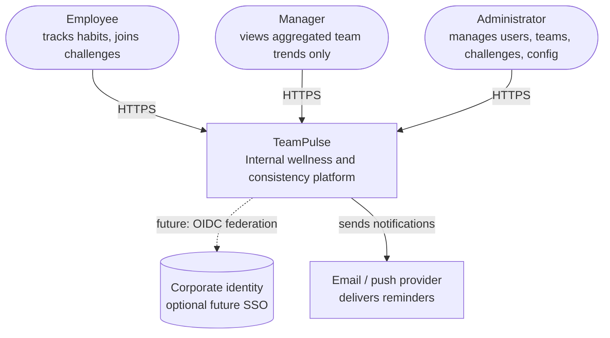
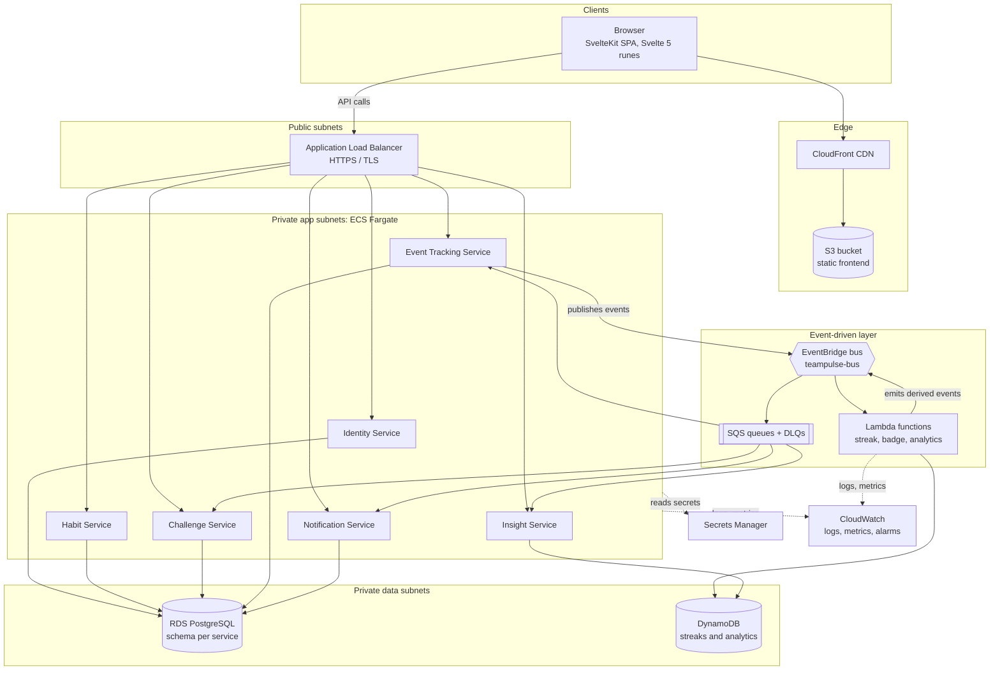

# 01. System Context and Containers

This document follows the C4 model: **Level 1** (system context) and **Level 2** (containers).
Source requirements: `Case Study 2 - TeamPulse.pdf`.

## Goal

Help employees build healthy habits and compete in team challenges **without exposing personal
data broadly across the organization**. Privacy is the central architectural constraint, not a
feature added later (see [ADR-0005](../adr/0005-privacy-by-design.md)).

## Level 1: System context

| Actor         | Can do                                                         | Must never see                  |
| ------------- | -------------------------------------------------------------- | ------------------------------- |
| Employee      | Own habits, team-shared habits, challenges, own analytics      | Another person's private habits |
| Manager       | Aggregated team trends, challenge management for their teams   | Any individual's wellness data  |
| Administrator | Users, roles, teams, challenge catalog, platform configuration | Individual wellness data        |

## Level 2: Containers

## Container responsibilities

| Container         | Technology                | Responsibility                                               |
| ----------------- | ------------------------- | ------------------------------------------------------------ |
| Web app           | SvelteKit, Svelte 5, TS   | Role-based UI, reactive filters, reusable UI components      |
| Identity Service  | Node, Fastify, PostgreSQL | Login, JWT issuing, roles, teams and memberships             |
| Habit Service     | Node, Fastify, PostgreSQL | Private and team-shared habit definitions                    |
| Challenge Service | Node, Fastify, PostgreSQL | Challenges, participation, leaderboards, badge rules         |
| Event Tracking    | Node, Fastify, PostgreSQL | Records activity completions, publishes events, streak reads |
| Insight Service   | Node, Fastify, DynamoDB   | Aggregated team analytics and self-only individual analytics |
| Notification      | Node, Fastify, PostgreSQL | Reminders, challenge updates, milestone messages             |
| Lambdas           | Node, TypeScript          | Streaks, badge evaluation, analytics aggregation             |

## Key architectural rules

1. **Database per service.** No service reads another service's tables. Cross-service data
   moves through APIs or events ([ADR-0003](../adr/0003-database-per-service.md)).
2. **Asynchronous by default** for anything derived from an activity completion
   ([ADR-0004](../adr/0004-event-driven-integration.md)).
3. **Aggregate before exposing.** Manager-facing endpoints return only aggregates that meet a
   minimum cohort size ([ADR-0005](../adr/0005-privacy-by-design.md)).
4. **Stateless services.** Any state lives in RDS, DynamoDB or the event bus, so ECS can scale
   tasks freely.
