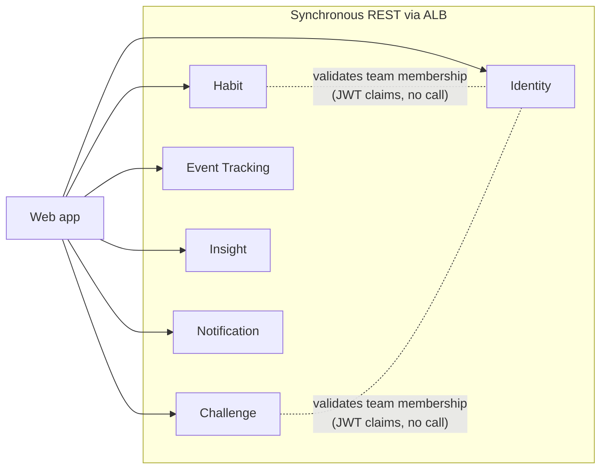
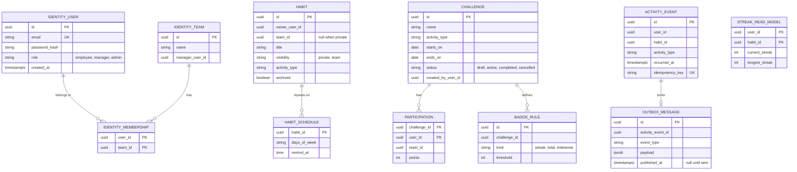
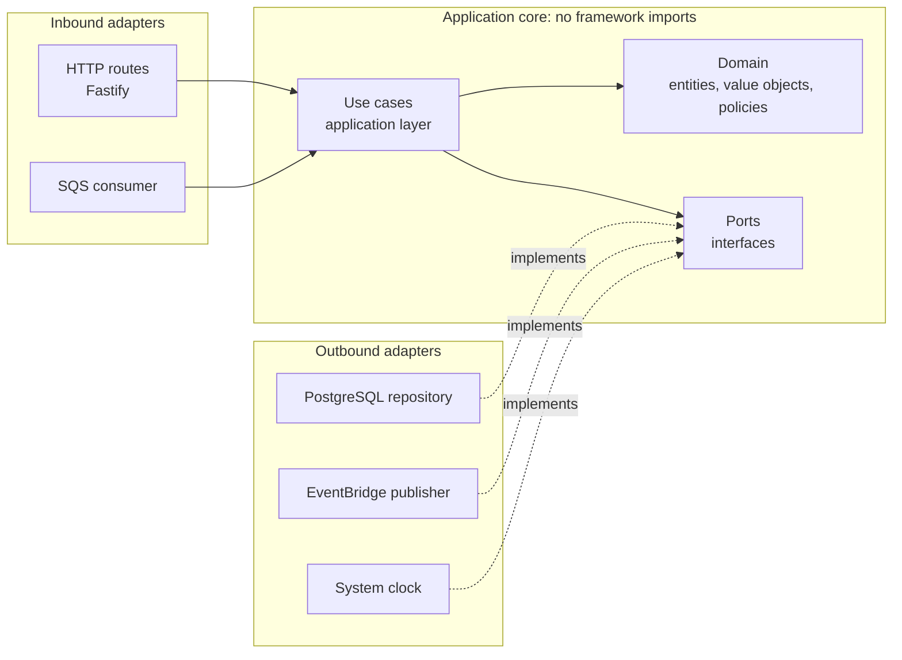
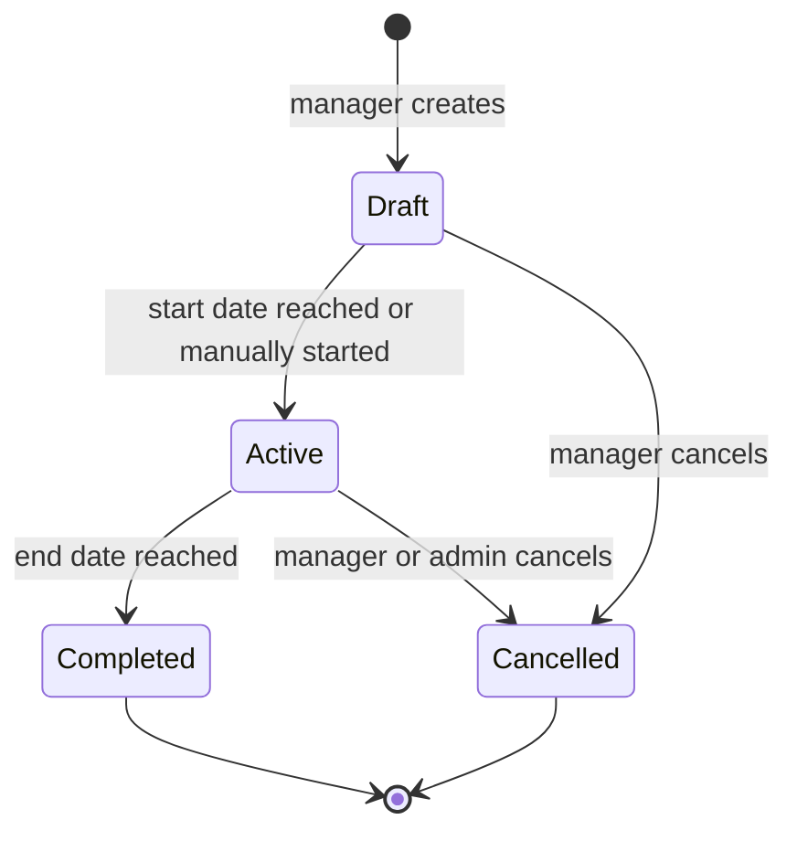
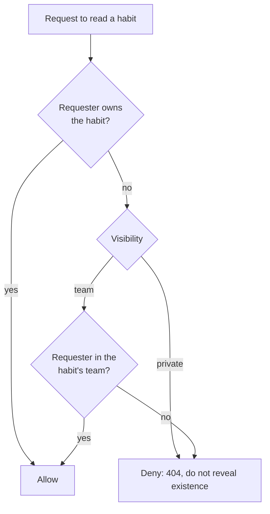

# 02. Microservices Design (Session 1)

## Service map



Services trust **signed JWT claims** (user id, roles, team ids) so the hot path does not call
Identity on every request ([ADR-0006](../adr/0006-authentication-and-authorization.md)).

## Bounded contexts and data ownership



> Foreign keys across services (for example `owner_user_id`) are **plain identifiers with no
> database constraint**. Each service owns its schema and may only enforce integrity inside it.

The Identity Service is described in detail in [07 Identity Service](07-identity-service.md) , the
Habit Service in [08 Habit Service](08-habit-service.md) Event Tracking with the event plumbing in
[09 Event Tracking](09-event-tracking.md), the Lambdas in [10](10-lambdas.md), Notification in
[11](11-notification-service.md), Insight in [12](12-insight-service.md) and Challenge in
[13](13-challenge-service.md).

## Service catalogue

| Service        | Owns                                                               | Store                | Publishes                                                                           | Consumes                                                                                                                                    |
| -------------- | ------------------------------------------------------------------ | -------------------- | ----------------------------------------------------------------------------------- | ------------------------------------------------------------------------------------------------------------------------------------------- |
| Identity       | Users, roles, teams, memberships                                   | RDS `identity`       | `UserRegistered`, `TeamMembershipChanged`                                           | none                                                                                                                                        |
| Habit          | Habits, reminders, visibility                                      | RDS `habit`          | `HabitCreated`, `HabitUpdated`, `HabitArchived`                                     | `UserDeleted`, `TeamMembershipChanged`                                                                                                      |
| Challenge      | Challenges, participation, scoring ledger, leaderboard, badges     | RDS `challenge`      | `ChallengeJoined`, `ChallengeCompleted`, `ChallengeProgressUpdated`, `BadgeAwarded` | `ActivityCompleted`, `TeamMembershipChanged`, `UserDeleted`                                                                                 |
| Event Tracking | Activity log, outbox, streak read model                            | RDS `eventtracking`  | `ActivityCompleted`                                                                 | `StreakUpdated`, `HabitCreated`, `HabitUpdated`, `HabitArchived`, `UserDeleted`                                                             |
| Insight        | Aggregated analytics: team cells (pseudonymous), personal counters | DynamoDB, two tables | none                                                                                | `ActivityCompleted`, `UserDeleted`                                                                                                          |
| Notification   | Preferences, notification log                                      | RDS `notification`   | none                                                                                | `MilestoneReached`, `BadgeAwarded`, `ChallengeJoined`, `ChallengeCompleted`, `HabitCreated`, `HabitUpdated`, `HabitArchived`, `UserDeleted` |

## Internal architecture of every service

All services use the same **hexagonal (ports and adapters)** layout so engineers can move
between them without relearning structure ([ADR-0002](../adr/0002-hexagonal-architecture-and-solid.md)).



Dependencies point **inward only**: adapters know the core, the core never knows adapters.

### Folder layout (each service)

```text
services/<name>/
  src/
    domain/            entities, value objects, domain errors, policies (pure TypeScript)
    application/       use cases and port interfaces
    adapters/
      http/            Fastify routes, request/response schemas, mappers
      persistence/     repositories, migrations
      messaging/       EventBridge publisher, SQS consumers
    config/            typed, validated configuration
    main.ts            composition root: the only place that wires concrete classes
  test/
    unit/              domain and use cases, no I/O
    integration/       adapters against real dependencies
  Dockerfile
  README.md
```

## Challenge lifecycle



## Habit visibility rules



A denied read returns **404, not 403**, so private habits cannot be discovered by probing.
