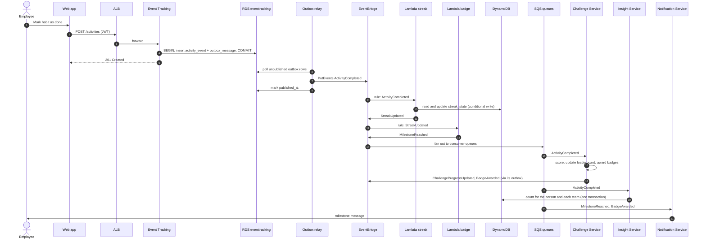
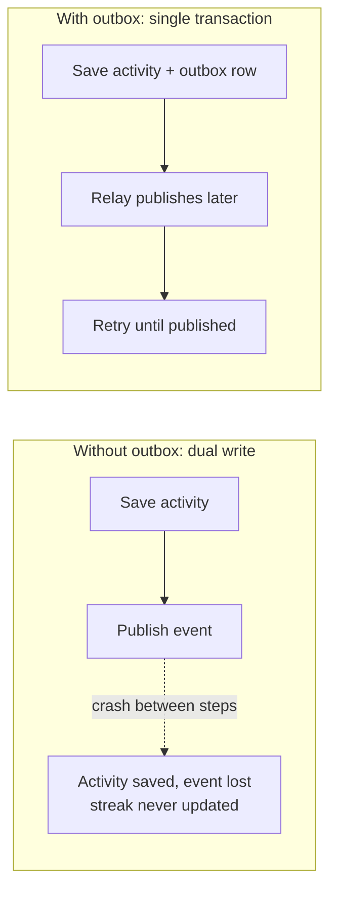
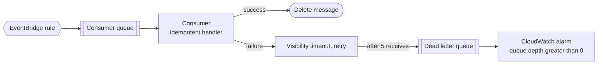
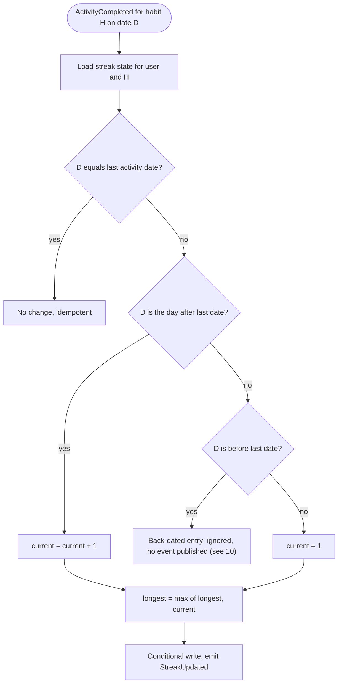

# 03. Event Flow and Integration

The nine-step end-to-end flow from the case study, made concrete.

## Sequence: employee completes an activity



Reading the diagram:

- **Steps 4 to 7** make the API call fast and safe: the activity row and its outbox row are
  written in **one database transaction**, so an event is never lost and never published for an
  activity that was not saved.
- The **outbox relay** (shared code in `packages/outbox`, a loop inside each publishing service)
  publishes to EventBridge and marks rows as sent. If it crashes, it resumes from the unpublished
  rows (at-least-once delivery). Retrying the API call is safe without a header: one completion
  exists per user, habit and day, enforced by a unique key. See [09](09-event-tracking.md).
- Every consumer is **idempotent** (see below), because at-least-once delivery means duplicates.

## Why an outbox



## Event envelope

Every event shares one envelope, defined once in the shared `contracts` package and validated
at both producer and consumer.

```json
{
  "eventId": "6c2f0c3e-5d5d-4f7b-9a53-2f0d3a1c9b11",
  "eventType": "ActivityCompleted",
  "schemaVersion": 1,
  "occurredAt": "2026-11-20T08:15:00Z",
  "correlationId": "b1f4c5a8-0c1d-4a8b-8b6f-9f7f3b8f1a22",
  "producer": "event-tracking",
  "payload": {
    "userId": "uuid",
    "habitId": "uuid",
    "teamIds": ["uuid"],
    "activityType": "walking",
    "activityDate": "2026-11-20",
    "totalCompleted": 42
  }
}
```

## Event catalogue

| Event                      | Producer       | Consumers                                                                                         | Purpose                                        |
| -------------------------- | -------------- | ------------------------------------------------------------------------------------------------- | ---------------------------------------------- |
| `ActivityCompleted`        | Event Tracking | Streak Lambda, Badge Lambda (totals), Challenge, Insight, Recommendation                          | A habit was completed                          |
| `StreakUpdated`            | Streak Lambda  | Badge Lambda, Event Tracking                                                                      | New current and longest streak                 |
| `BadgeAwarded`             | Challenge      | Notification                                                                                      | A challenge badge rule was met                 |
| `ChallengeProgressUpdated` | Challenge      | none yet                                                                                          | A participant scored a point                   |
| `MilestoneReached`         | Badge Lambda   | Notification                                                                                      | Streak or total milestone message              |
| `ChallengeJoined`          | Challenge      | Notification                                                                                      | User joined a challenge                        |
| `ChallengeCompleted`       | Challenge      | Notification                                                                                      | Final standings are available                  |
| `HabitCreated`             | Habit          | Notification, Event Tracking                                                                      | Schedule a reminder; learn the habit           |
| `HabitUpdated`             | Habit          | Notification, Event Tracking                                                                      | Replace or drop the reminder; new type         |
| `HabitArchived`            | Habit          | Notification, Event Tracking                                                                      | Cancel the reminder; stop accepting activities |
| `UserRegistered`           | Identity       | none yet                                                                                          | New account exists                             |
| `TeamMembershipChanged`    | Identity       | Habit, Challenge                                                                                  | Keep team-scoped data consistent               |
| `UserDeleted`              | Identity       | every service (Habit, Event Tracking, Notification, Challenge, Insight, Recommendation handle it) | Erase or anonymise the user                    |

Naming rules: past-tense, `PascalCase`, versioned through `schemaVersion`. Breaking changes
add a new version and run both until consumers migrate.

### How the contracts are enforced

The schemas live in `packages/contracts` (`src/events/`) and are the single source of truth.
They are executable, not just documentation:

- **Strict objects.** Unknown fields in the envelope or payload are rejected. A producer that
  tries to attach a habit title fails validation instead of leaking it onto the bus
  ([ADR-0005](../adr/0005-privacy-by-design.md)).
- **Producer pinning.** Each event type has exactly one legal `producer`. The Habit Service cannot
  publish `ActivityCompleted`.
- **`totalCompleted` is a count.** The number of activities the person has recorded, including this
  one, counted by Event Tracking in the transaction that stored it. It lets the badge Lambda announce
  total milestones without keeping state.
- **`teamIds` is a snapshot.** `ActivityCompleted` carries the user's team memberships at the
  moment of the activity, so Insight can aggregate per team without calling Identity.
- **Producers use `createEvent()`**, which assembles and validates the envelope. Consumers use
  `parseEvent()`, which returns a typed event or a validation error to dead-letter.
- **Time and ids are passed in**, never generated inside the helper, so tests are deterministic.

## Reliability patterns



| Concern            | Mechanism                                                                                                                                                            |
| ------------------ | -------------------------------------------------------------------------------------------------------------------------------------------------------------------- |
| Duplicate delivery | Idempotent handlers (upserts by id, newest event wins); DynamoDB conditional writes in the Lambdas. [ADR-0014](../adr/0014-outbox-relay-and-idempotent-consumers.md) |
| Ordering           | Not assumed. Streak logic uses `activityDate`, not arrival order                                                                                                     |
| Poison messages    | 5 receive attempts, then dead letter queue plus alarm                                                                                                                |
| Tracing            | `correlationId` copied from the HTTP request id into every event and log line                                                                                        |
| Schema drift       | Producer and consumer validate with the same schema from `packages/contracts`                                                                                        |

## Streak algorithm (rules, implemented in step 6)


