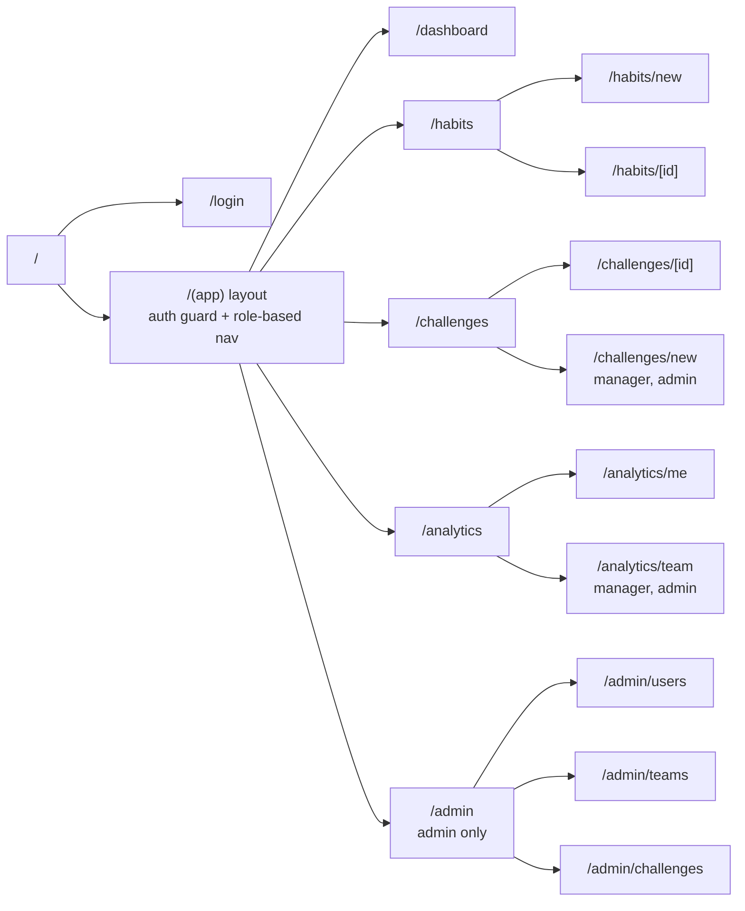
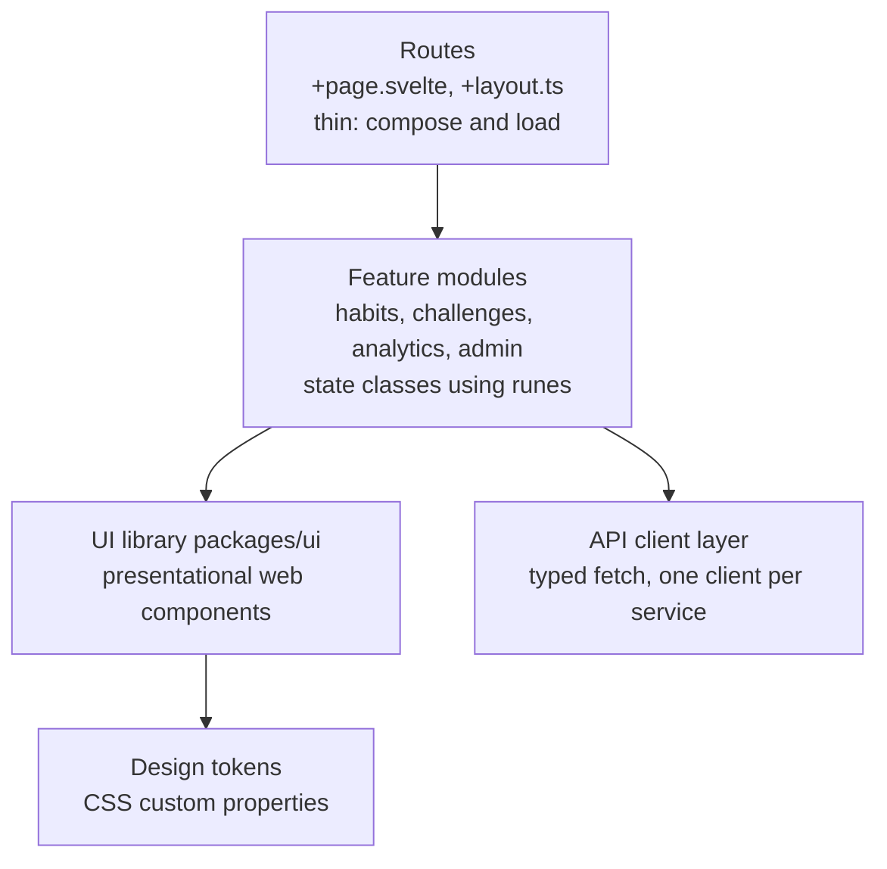
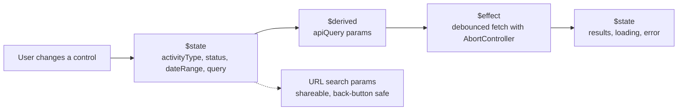
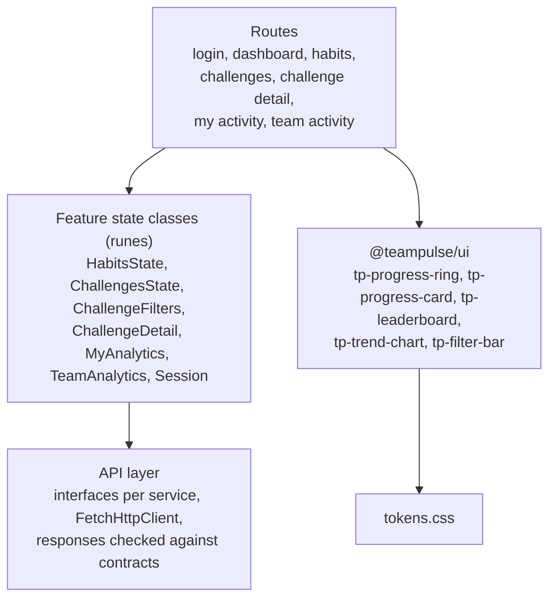

# 04. Frontend Design (Session 2)

SvelteKit dashboard for employees, managers and administrators, built entirely with
**Svelte 5 runes** (`$state`, `$derived`, `$effect`, `$props`, `$bindable`). No legacy
`let`-reactivity, `$:` statements or stores for local state.

## Route map (file-based routing)



| Route             | Employee           | Manager                | Admin         |
| ----------------- | ------------------ | ---------------------- | ------------- |
| `/dashboard`      | yes                | yes (team view)        | yes           |
| `/habits`         | yes                | own only               | no            |
| `/challenges`     | join               | create and manage      | manage        |
| `/analytics/me`   | yes                | own only               | no            |
| `/analytics/team` | own team aggregate | their teams, aggregate | org aggregate |
| `/admin/*`        | no                 | no                     | yes           |

Route guards run in `+layout.ts` using the role in the access token. **This is a usability
feature only**: the real enforcement is in the backend ([ADR-0006](../adr/0006-authentication-and-authorization.md)).

## Layered frontend structure



Rules:

- **UI components are presentational**: props in, events out, no fetching, no stores.
- **Feature modules own state** with rune-based classes (for example `ChallengeFilters`).
- **API clients are interfaces**, so tests inject fakes (Dependency Inversion).
- Routes stay thin and contain no business rules.

## Reusable components (packages/ui)

| Component          | Purpose                           | Key props                           | Events        |
| ------------------ | --------------------------------- | ----------------------------------- | ------------- |
| `tp-progress-ring` | Circular progress                 | `value`, `max`, `label`, `size`     | none          |
| `tp-progress-card` | Goal and progress summary         | `title`, `value`, `target`, `trend` | `select`      |
| `tp-leaderboard`   | Ranked table of teams or people   | `rows`, `highlightId`, `metric`     | `rowselect`   |
| `tp-trend-chart`   | Time series line chart (SVG)      | `series`, `from`, `to`              | `pointselect` |
| `tp-filter-bar`    | Activity type, status, date range | `value` (bindable), `options`       | `change`      |

Components are compiled as **custom elements** so any host can reuse them
([ADR-0008](../adr/0008-web-components-and-design-tokens.md)). Styling goes only through
design tokens (`--tp-color-*`, `--tp-space-*`, `--tp-radius-*`), governed in one file, which
addresses the trade-off "design tokens must be governed centrally".

## Reactive search and filters with runes



Pattern (illustrative, implemented in step 8):

```ts
// features/challenges/filters.svelte.ts
export class ChallengeFilters {
  activityType = $state<ActivityType | 'all'>('all');
  status = $state<ChallengeStatus | 'all'>('all');
  range = $state<DateRange>({ from: null, to: null });
  query = $state('');

  params = $derived({
    activityType: this.activityType,
    status: this.status,
    from: this.range.from,
    to: this.range.to,
    q: this.query.trim(),
  });
}
```

## Hosting model

The frontend is built with `adapter-static` (SPA mode with a fallback page) and served from S3
behind CloudFront. There is **no server-side rendering**, which matches the case study's
"S3 for hosting" requirement. Consequences are recorded in [ADR-0007](../adr/0007-frontend-static-spa.md).

## Accessibility and quality bar

- Semantic HTML first, ARIA only where needed; keyboard operable; visible focus.
- Colour is never the only signal (progress rings also show numbers).
- Respect `prefers-reduced-motion` and `prefers-color-scheme`.
- Charts provide a text or table alternative.

## Implementation status (roadmap step 8)

Code: [`packages/ui`](../../packages/ui) (components and tokens) and [`apps/web`](../../apps/web)
(the app). Guides: [local run and testing](../guides/01-run-locally.md).



| Decision                   | What was built                                                                                                                      |
| -------------------------- | ----------------------------------------------------------------------------------------------------------------------------------- |
| Static single-page app     | `adapter-static` with an `index.html` fallback, `ssr = false`                                                                       |
| Access token in memory     | The `Session` class holds it; a reload gets a new one from the httpOnly refresh cookie (`restore()`)                                |
| One request-level contract | Every response is parsed with the zod schema from `@teampulse/contracts`; a drifted server fails loudly as `response.invalid`       |
| Silent token refresh       | One 401 triggers one refresh and one retry; simultaneous 401s share the refresh                                                     |
| Filters in the address bar | `ChallengeFilters` reads and writes URL parameters, so a filtered view can be shared and the back button works                      |
| Latest response wins       | `AsyncValue` drops an older response that arrives after a newer request                                                             |
| Names                      | Challenge returns ids; the page shows names from the Identity team roster                                                           |
| Small groups               | The team analytics page says "not enough participants" and leaves hidden days out of the chart instead of drawing them as zero      |
| Accessibility              | Skip link, labelled controls, visible focus, numbers beside every ring, trend in words, a "show as table" alternative for the chart |

Tests: the 29 component and geometry tests in `packages/ui/test`, and 47 tests of the HTTP client,
session and state classes in `apps/web/src`, all in the `frontend` Vitest project (jsdom).

Not built yet, and honest about it:

- **Admin screens** (`/admin/users`, `/admin/teams`, `/admin/challenges`) and a **notifications page**
  (the header shows the unread count only).
- **Page-level tests.** The pages are thin and type-checked, but no test mounts them: that needs the
  SvelteKit runtime. A browser test (Playwright) against the local stack is the right tool and
  belongs with step 9, when the stack can run.
- **Editing a habit**, setting reminders and sharing a habit with a team from the interface (the API
  supports them).
- Never opened in a real browser by me: type checking, the production build and the tests passed,
  but nobody has looked at the screens yet.
