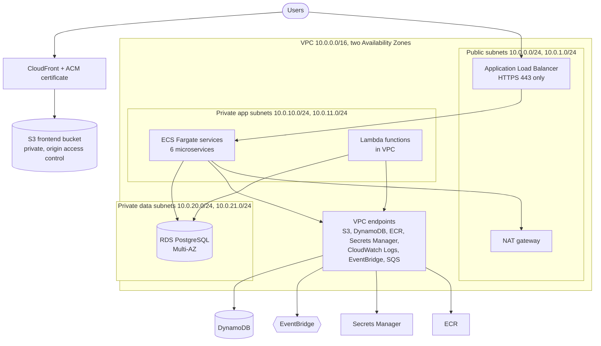
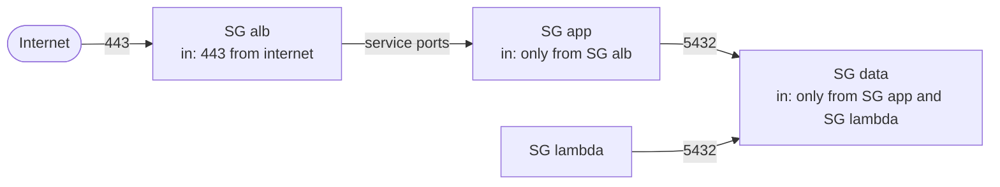
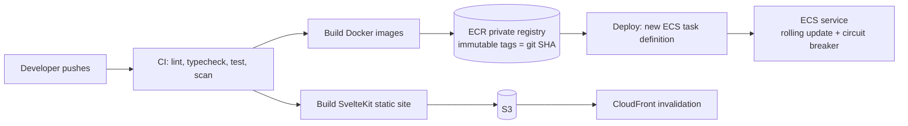
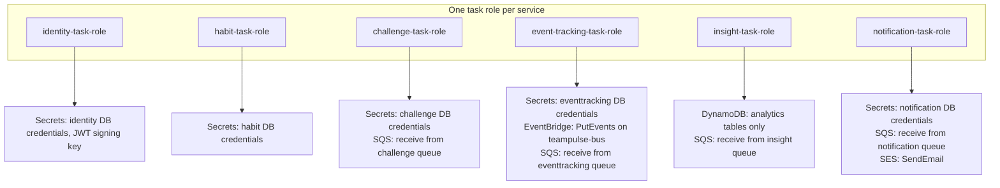
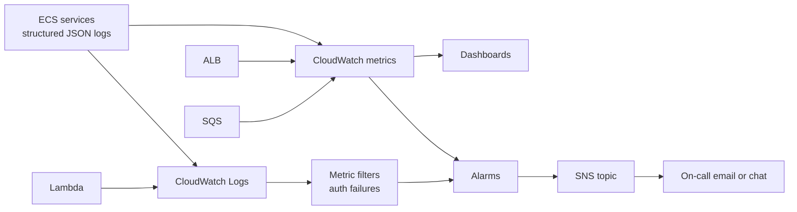

# 05. AWS Deployment and Security (Session 3)

All infrastructure is defined as code with Terraform ([ADR-0009](../adr/0009-infrastructure-as-code.md)).

## Network topology

The data subnets have **no route to the internet**. Services reach AWS APIs through VPC
endpoints, which keeps traffic off the public internet and reduces NAT cost.

## Layered network controls

| Control         | Rule                                                                        |
| --------------- | --------------------------------------------------------------------------- |
| Security groups | Reference other security groups, never CIDR ranges, between tiers           |
| Network ACLs    | Data subnets allow 5432 only from app subnets; deny everything else inbound |
| TLS             | HTTPS at CloudFront and ALB (TLS 1.2 minimum); RDS `rds.force_ssl = 1`      |
| Encryption      | KMS at rest for RDS, DynamoDB, S3, SQS and logs                             |
| Public exposure | Only CloudFront and the ALB are internet reachable                          |

## Compute and delivery

| Concern     | Decision                                                                  |
| ----------- | ------------------------------------------------------------------------- |
| Compute     | ECS on Fargate, one service per microservice, no servers to patch         |
| Scaling     | Target tracking on CPU 60 percent, plus request count per target for HTTP |
| Deployments | Rolling update, minimum healthy 100 percent, deployment circuit breaker   |
| Images      | Multi-stage, non-root user, read-only root filesystem, scanned on push    |
| Health      | `/healthz` (liveness) and `/readyz` (readiness, checks dependencies)      |

## IAM: least privilege per service

Separate **execution role** (pull image, write logs, read secrets at start) from **task role**
(what the application code may do). Policies name exact resource ARNs; no wildcard resources.

## Secrets and configuration

| Kind                 | Where it lives                           | How the app gets it                               |
| -------------------- | ---------------------------------------- | ------------------------------------------------- |
| Database credentials | Secrets Manager, auto-rotated            | ECS injects as environment variable at start      |
| JWT signing key      | Secrets Manager                          | Identity Service only; others use the public JWKS |
| Non-secret settings  | Task definition environment variables    | Parsed and validated by `config/`                 |
| Local development    | `.env` (git-ignored) from `.env.example` | Same parser as production                         |

Rule: **no secret in source control, container images or logs.** The config loader fails fast at
startup when a required value is missing or invalid.

## Observability

| Signal from the case study | Alarm                                                        |
| -------------------------- | ------------------------------------------------------------ |
| Latency                    | ALB target response time p95 above 800 ms for 5 minutes      |
| API failures               | ALB 5xx rate above 2 percent for 5 minutes                   |
| Authentication issues      | Metric filter on `auth.login.failed` above 20 per 5 minutes  |
| Queue depth                | DLQ visible messages above 0; main queue age above 5 minutes |
| Service restarts           | ECS running task count below desired, or task stopped events |
| Lambda errors              | Errors above 0 for 5 minutes; throttles above 0              |

Every log line is JSON with `service`, `level`, `correlationId`, `userId` (hashed) and never
contains habit titles or other wellness content.

## Cost and complexity notes

The case study asks for private networking, Multi-AZ and per-service roles. That is the right
shape for production but it is expensive for a learning project. The Terraform in step 11 will
have an `environment` variable: `dev` uses a single NAT gateway, single-AZ RDS and smaller tasks.
