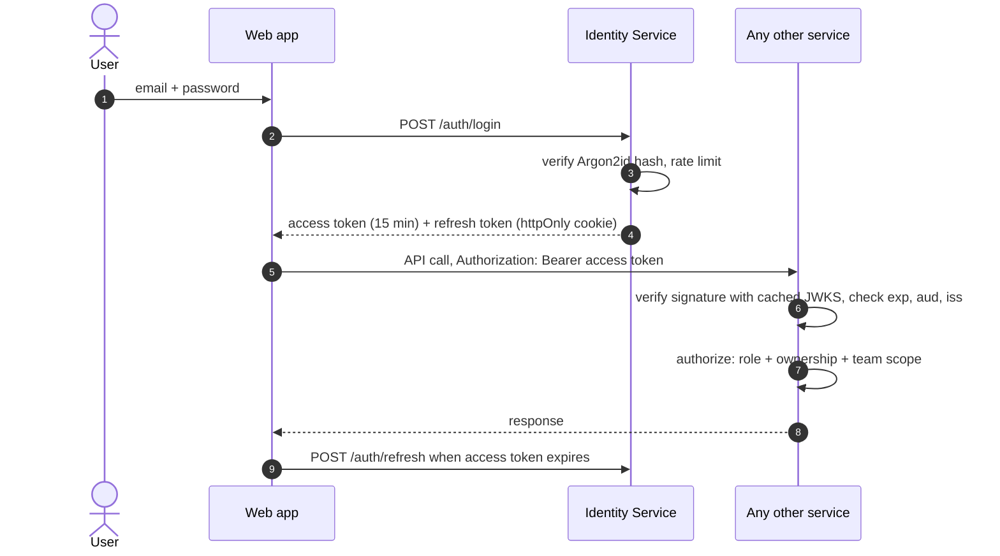
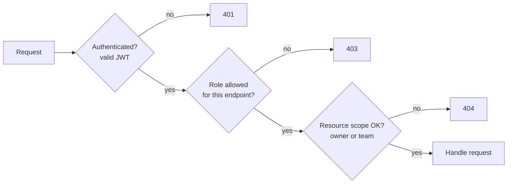
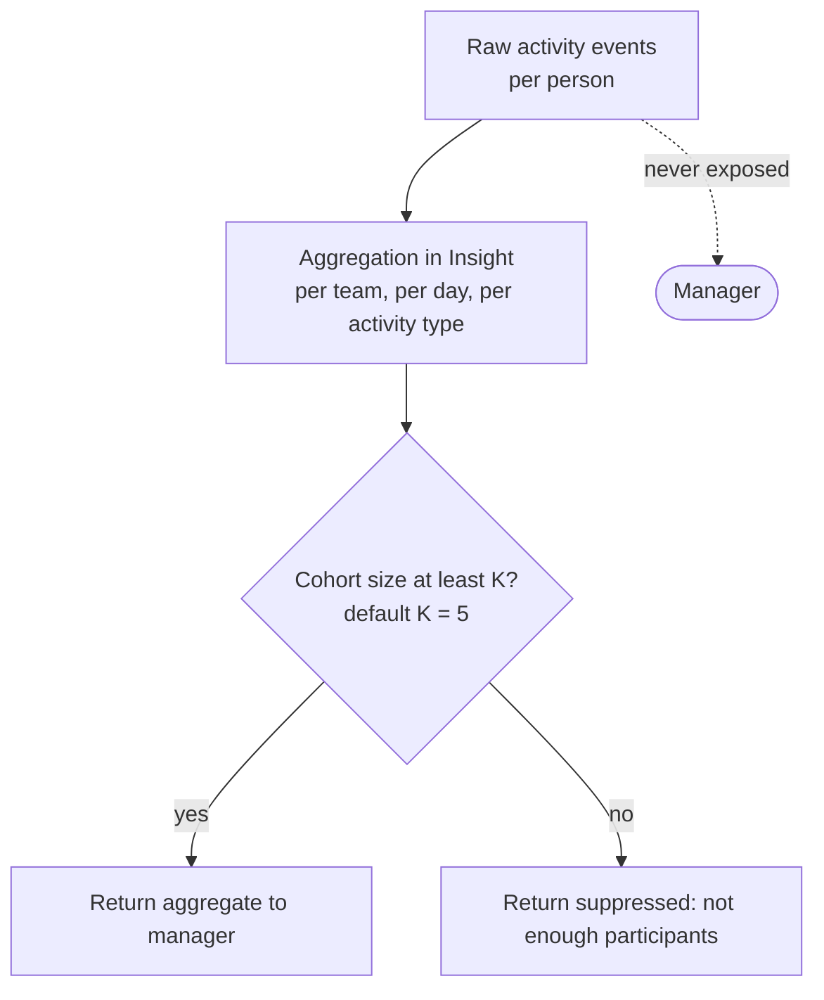
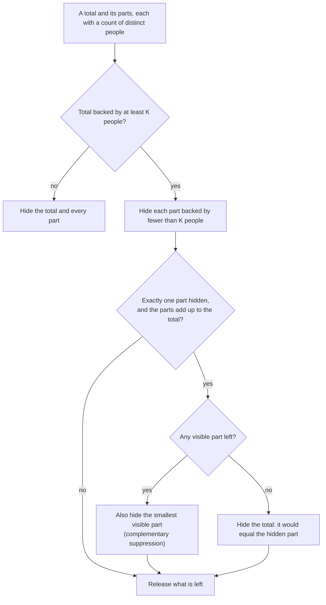

# 06. Security and Privacy Model

The business goal is a privacy promise: **managers see aggregated trends, never personal
wellness information.** This document turns that promise into enforceable rules.

## Authentication and authorization flow



Access token claims: `sub` (user id), `role`, `teams` (team ids), `managedTeams` (teams the user
manages), `iat`, `exp`, `iss`, `aud`, `jti`. The full design is in
[Identity Service](07-identity-service.md).
Details and alternatives are in [ADR-0006](../adr/0006-authentication-and-authorization.md).

## Authorization matrix

| Resource and action                   | Employee     | Manager                            | Admin    |
| ------------------------------------- | ------------ | ---------------------------------- | -------- |
| Read own private habit                | yes          | yes                                | n/a      |
| Read another user's private habit     | no           | no                                 | no       |
| Read team-shared habit                | same team    | same team                          | no       |
| Create challenge                      | no           | yes, for own teams                 | yes      |
| Join challenge                        | yes          | yes                                | no       |
| Leaderboard (points)                  | participants | participants, managers of the team | yes      |
| Own individual analytics              | yes          | yes                                | no       |
| Another person's individual analytics | no           | no                                 | no       |
| Team analytics (aggregate)            | own team     | own teams                          | org-wide |
| Manage users, teams, roles            | no           | no                                 | yes      |

Three independent checks run on every request, in this order:



## Privacy by design



| Rule                           | Mechanism                                                                         |
| ------------------------------ | --------------------------------------------------------------------------------- |
| No individual data to managers | Manager endpoints read only the aggregate tables, which hold no user ids          |
| Small-group re-identification  | Suppress any aggregate whose cohort is smaller than `MIN_COHORT_SIZE` (default 5) |
| Private habits stay private    | `visibility = private` is enforced in the Habit Service query itself              |
| Data minimisation              | Events carry ids and counts, never habit titles or free text                      |
| Logs                           | No wellness content and no raw user ids in logs                                   |
| Right to erasure               | `UserDeleted` event; each service removes or anonymises its data                  |

### Hiding a small group is not enough: the subtraction attack

Suppressing cells below K is the first rule, and on its own it can be defeated. A manager who sees
a team total together with its breakdown by activity type can compute the one hidden cell:

```text
total completions 100   walking 60   cycling 25   yoga hidden (fewer than 5 people)
yoga = 100 - 60 - 25 = 15      <- the suppressed number, recovered
```

The rules live in [`@teampulse/privacy`](../../packages/privacy/src/k-anonymity.ts), so the Insight
Service cannot forget them:



After this at least two cells are unknown, so subtraction no longer pins down either. A hidden cell
carries no number and no cohort size. The configured K must be a whole number of at least 3.
A test searches every combination of small cohort sizes and confirms a released total never sits
next to exactly one hidden part.

Known limits: two overlapping reports can be subtracted to learn a day that was hidden, which fixed
reporting periods would close, and overlapping parts (a person who did both yoga and walking) need
`exhaustive: false` and a separate review. The Insight Service and its remaining limits are described
in [12](12-insight-service.md).

## Threat model (STRIDE summary)

| Threat                 | Example                                    | Mitigation                                                        |
| ---------------------- | ------------------------------------------ | ----------------------------------------------------------------- |
| Spoofing               | Stolen token replayed                      | Short expiry, refresh rotation, TLS only, httpOnly refresh cookie |
| Tampering              | Edited event payload                       | Private bus, IAM-restricted `PutEvents`, schema validation        |
| Repudiation            | "I never changed that role"                | Audit log for admin actions with actor and correlation id         |
| Information disclosure | Manager infers one person from a tiny team | K-anonymity threshold, aggregate-only tables                      |
| Information disclosure | Probing for private habit ids              | 404 instead of 403, non-guessable UUIDs                           |
| Denial of service      | Login brute force                          | Rate limiting, lockout backoff, ALB and WAF limits                |
| Elevation of privilege | Employee calls admin endpoint              | Server-side role checks, tested per endpoint                      |
| Supply chain           | Malicious dependency                       | Lockfile, `npm audit` in CI, image scanning, minimal base images  |

## Secure coding checklist (applies to every pull request)

- [ ] Input validated at the boundary with a schema; unknown fields rejected
- [ ] Authorization checked in the use case, not only in the route
- [ ] Parameterised queries only; no string-built SQL
- [ ] No secrets, tokens or wellness content in logs
- [ ] Errors do not leak internals; stack traces never reach clients
- [ ] New dependency reviewed; lockfile updated
