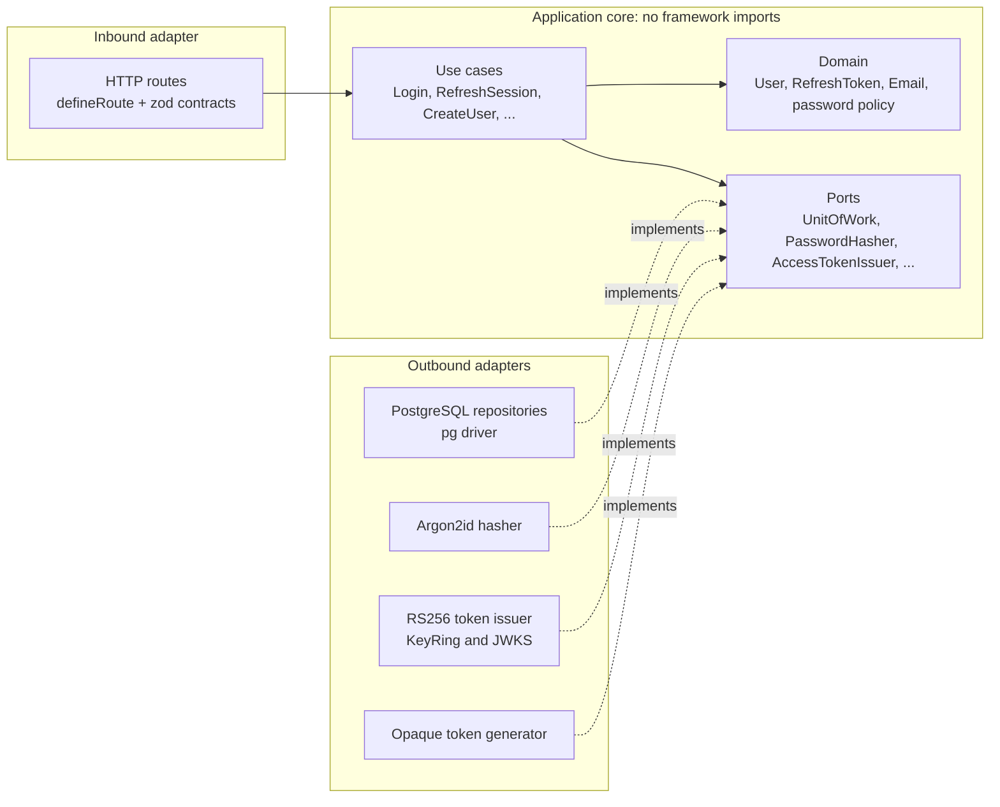
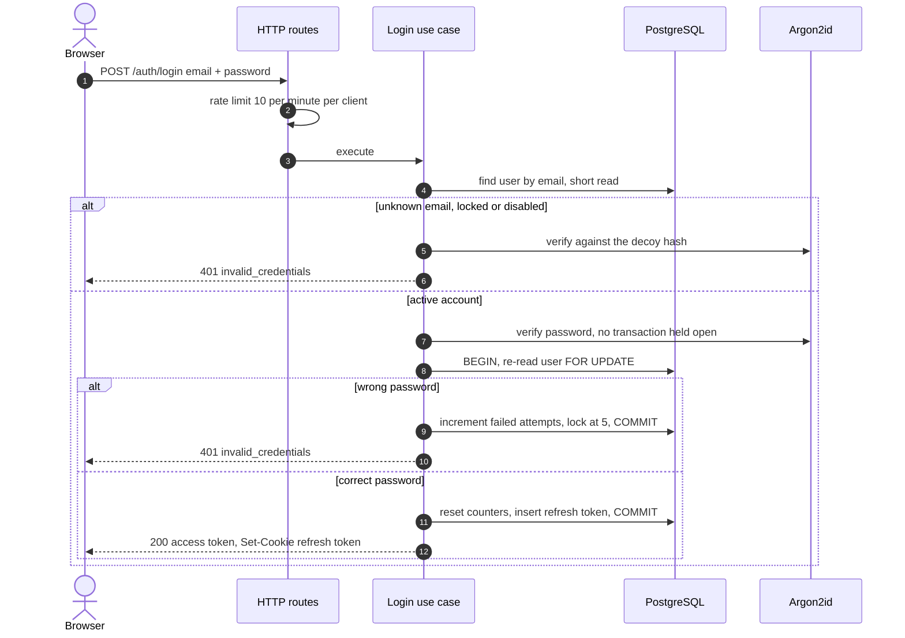
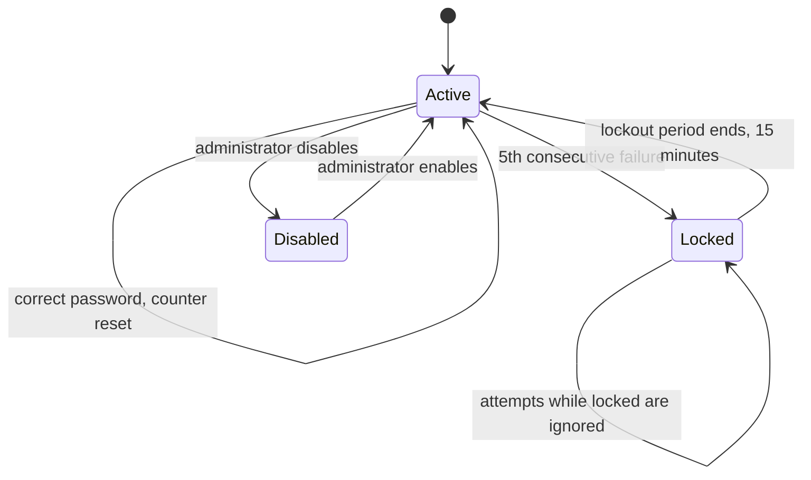
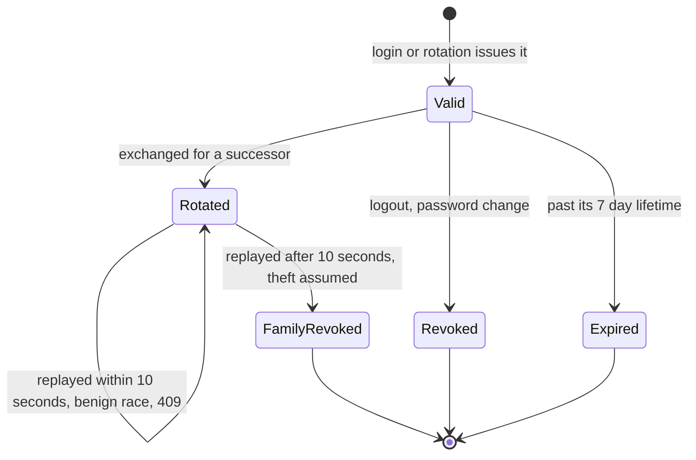
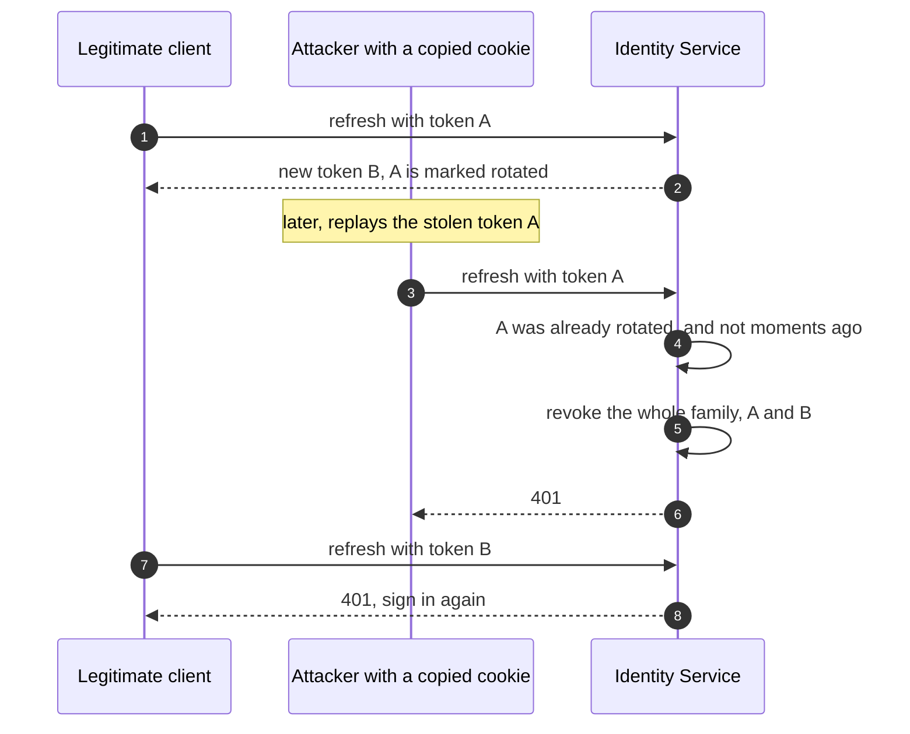
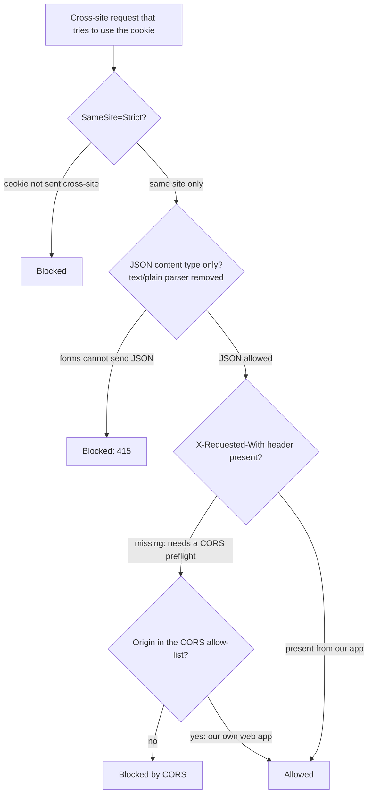
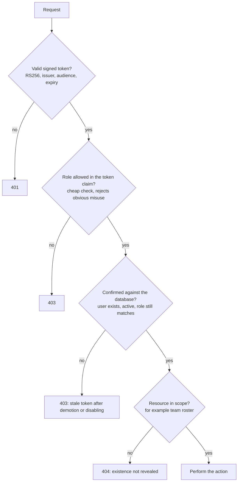
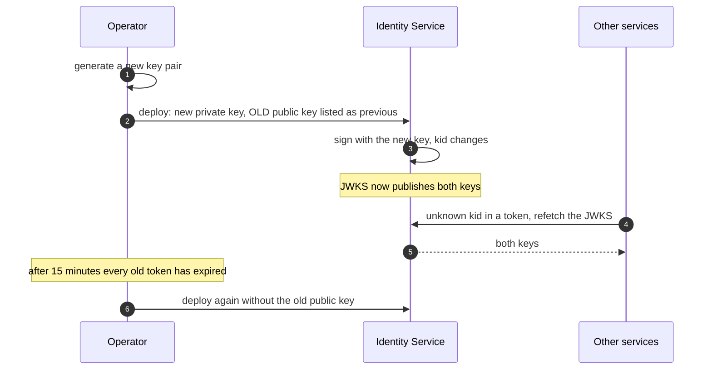
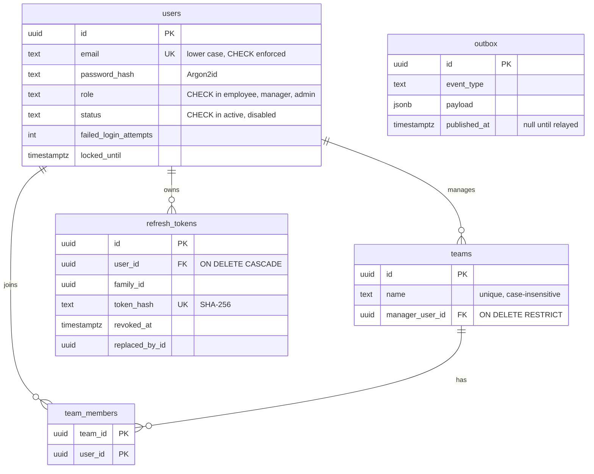

# 07. Identity Service

Sign-in, sessions, users, teams and memberships. Every other service trusts the access tokens it
issues, so this is the most security-critical service in the platform.

- Code: [`services/identity`](../../services/identity/README.md)
- API reference: [docs/api/identity.md](../api/identity.md) and the generated
  [`identity.openapi.json`](../api/identity.openapi.json)

## Layers

ESLint fails the build if `domain/` or `application/` import Fastify, `pg`, the AWS SDK or anything
under `adapters/`.

## Login

Design points:

- **Identical failures.** Unknown email, wrong password, locked and disabled accounts return the
  same status, code and message, so responses reveal nothing about which accounts exist.
- **No timing oracle.** When there is no usable account the server still performs one Argon2 verify
  against a decoy hash, so all failures take about the same time.
- **Lockout cannot be bypassed in parallel.** The failure counter is updated under a row lock
  (`SELECT ... FOR UPDATE`) on fresh state, so simultaneous guesses are counted one after another.
- **Hashing happens outside the transaction**, so no connection or lock is held during the
  slow CPU work.

## Account lockout

## Refresh tokens: rotation and theft detection

Each login starts a **family** of refresh tokens. Every refresh exchanges the current token for a
new one in the same family.

| Rule                                            | Why                                                                                       |
| ----------------------------------------------- | ----------------------------------------------------------------------------------------- |
| Secrets are 256-bit random, hashed with SHA-256 | A database leak does not reveal usable tokens; slow hashing adds nothing for random input |
| Rotation locks the row (`FOR UPDATE`)           | Two simultaneous refreshes of one token cannot both succeed and fork the family           |
| 10 second grace for a rotated token             | Two browser tabs refreshing together are a race, not theft: answered 409, family kept     |
| 30 day absolute family age                      | Constant use cannot keep one login alive forever                                          |
| Password change revokes every family            | Signs out whoever else had access                                                         |
| Cookie `Path=/api/v1/identity/auth`             | The browser sends it only to the endpoints that need it                                   |

## Cookie and CSRF defences

The refresh cookie is the only credential the browser stores. It is protected in layers:

The access token never touches storage: the SPA keeps it in memory and refreshes through the cookie
on page load.

## Authorization

A token can be up to 15 minutes old, so for administrative actions the role is **re-checked against
the database**. An administrator who is demoted or disabled stops working immediately, not 15
minutes later.

## Access token

| Claim          | Meaning                                |
| -------------- | -------------------------------------- |
| `sub`          | User id                                |
| `role`         | `employee`, `manager` or `admin`       |
| `teams`        | Teams the user belongs to (at most 20) |
| `managedTeams` | Teams the user manages (at most 20)    |
| `iss`, `aud`   | Must match on every verifying service  |
| `iat`, `exp`   | 15 minute lifetime                     |
| `jti`          | Unique token id                        |

The 20 team limit is enforced when a membership is created, so a token that other services would
reject can never be issued.

## Signing key rotation

No downtime and nobody is signed out.

## Events

Identity writes events to its **outbox table in the same transaction** as the change that caused
them. Relaying them to EventBridge is built in step 5 as a shared component.

| Event                   | Written when                               |
| ----------------------- | ------------------------------------------ |
| `UserRegistered`        | An account is created                      |
| `TeamMembershipChanged` | A member is actually added or removed      |
| `UserDeleted`           | An account is erased; every service reacts |

## Data model

The tables behind this service (all in the `identity` schema):

The database repeats the important invariants as constraints (lower-case email, valid role and
status, unique token hash, restricted manager deletion), so a bug in application code cannot
silently corrupt identity data. Migration tests verify each one.
