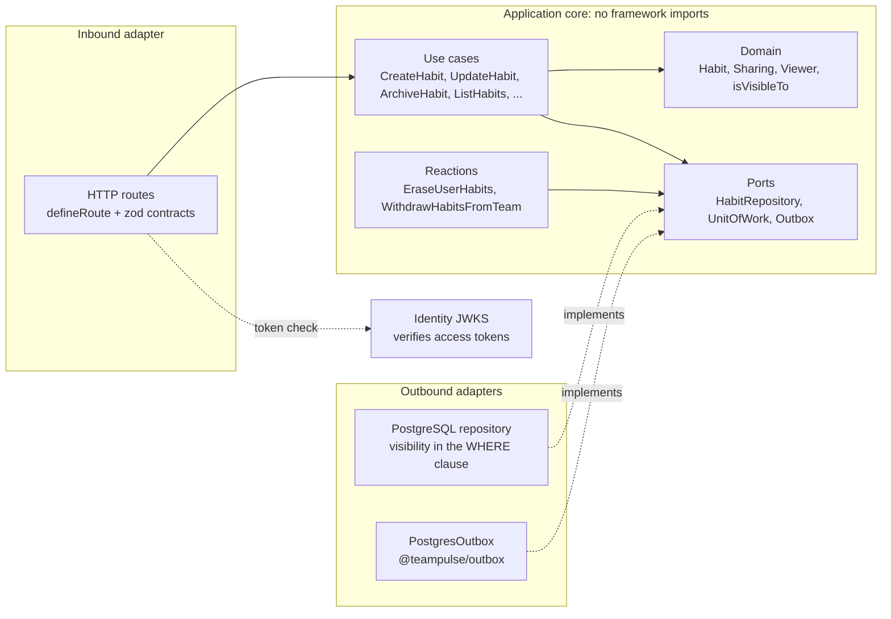
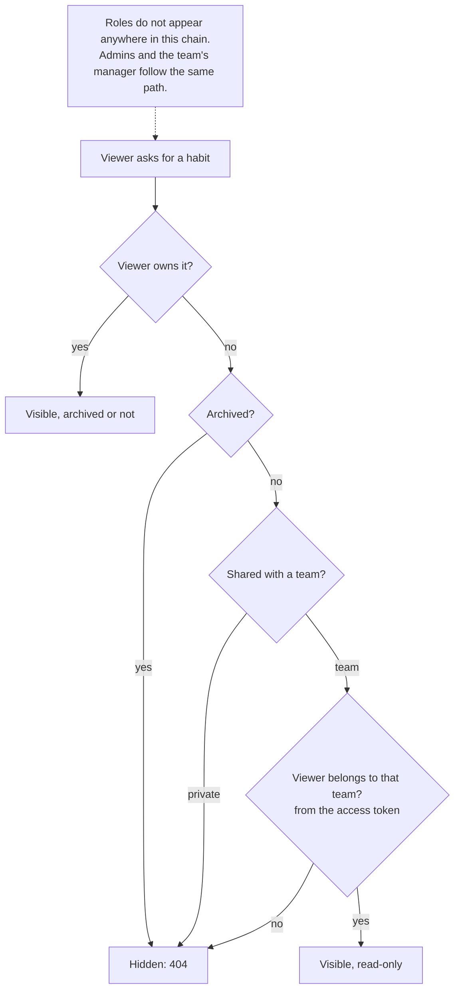
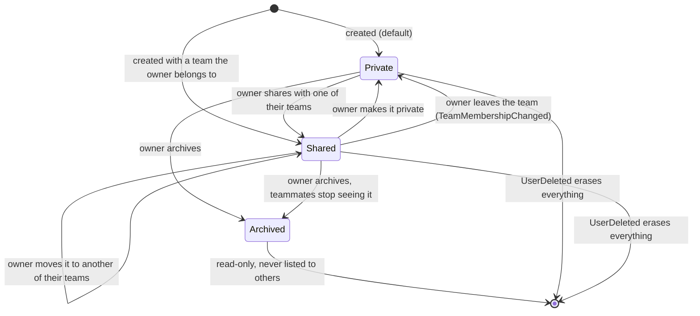
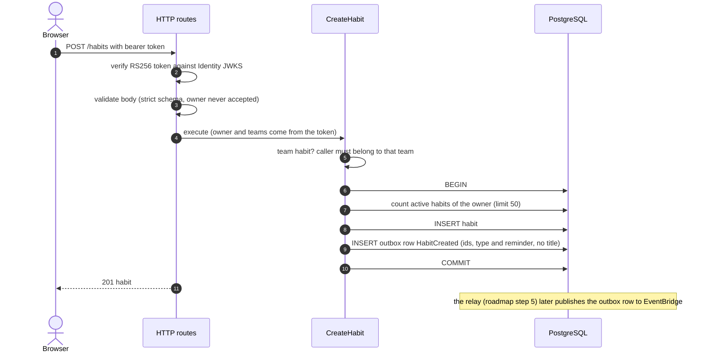
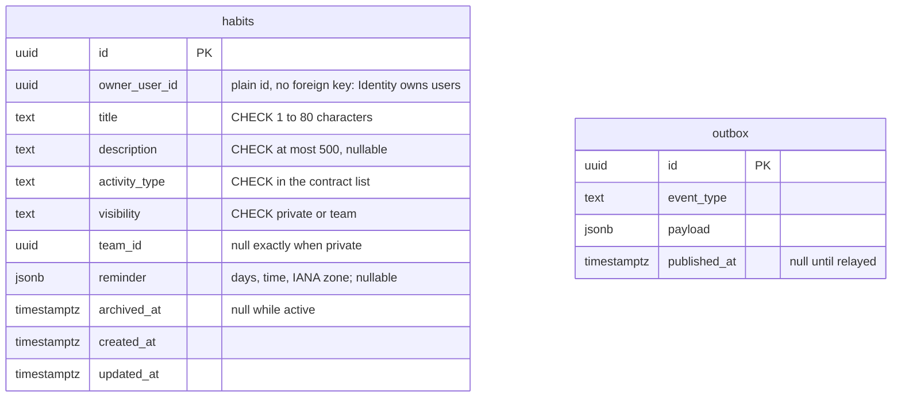

# 08. Habit Service

Habits, who may see them, and reminders. This service holds personal wellness data, so its main job
besides CRUD is to make sure a habit is never shown to someone who should not see it.

- Code: [`services/habit`](../../services/habit/README.md)
- API reference: [docs/api/habit.md](../api/habit.md) and the generated
  [`habit.openapi.json`](../api/habit.openapi.json)
- Decision: [ADR-0012](../adr/0012-visibility-enforced-in-the-query.md)

## Layers

## Who sees which habit

One rule, `Habit.isVisibleTo`, written once in the domain and repeated as SQL in the repository.

| Situation                                         | Result                            |
| ------------------------------------------------- | --------------------------------- |
| Owner reads, edits or archives their habit        | Allowed                           |
| Teammate reads a shared, active habit             | Allowed, `isOwner: false`         |
| Teammate edits or archives it                     | 403 `habit.not_owner`             |
| Anyone reads a private habit that is not theirs   | 404, identical to a missing habit |
| Manager of the team, not a member, reads anything | 404                               |
| Admin reads someone else's habit                  | 404                               |
| Teammate reads an archived shared habit           | 404                               |

Because the rule lives in the query, a hidden habit is never loaded into memory, and a new endpoint
cannot forget the check.

## Sharing lifecycle

## Creating a habit

## Events

| Event           | Written when                                                                        | Payload                                              |
| --------------- | ----------------------------------------------------------------------------------- | ---------------------------------------------------- |
| `HabitCreated`  | A habit is created                                                                  | habit id, owner, visibility, activity type, reminder |
| `HabitUpdated`  | Visibility, activity type or reminder changed, or a habit was withdrawn from a team | the same shape, as it is now. No reminder means none |
| `HabitArchived` | A habit is archived (once; archiving again is silent)                               | habit id, owner                                      |

Titles and descriptions are never in an event ([ADR-0005](../adr/0005-privacy-by-design.md)), so a
rename publishes nothing. The Notification Service replaces its reminder schedule from each
`HabitCreated` or `HabitUpdated`, and cancels it on `HabitArchived`.

### Events the service reacts to

| Event                               | Reaction                                                                             |
| ----------------------------------- | ------------------------------------------------------------------------------------ |
| `UserDeleted`                       | Delete every habit the user owned (right to erasure). Idempotent                     |
| `TeamMembershipChanged` (`removed`) | Make that person's habits shared with that team private, publish updates. Idempotent |

Both are wired to the service queue by the shared consumer
([09](09-event-tracking.md), [ADR-0014](../adr/0014-outbox-relay-and-idempotent-consumers.md)) and are tested
end to end through it, including redelivery.

## Data model

All tables live in the `habit` schema.

The database repeats the invariants as constraints, so a bug in application code cannot store a
half-shared habit (`(visibility = 'team') = (team_id IS NOT NULL)`), an empty title or an unknown
activity type. Two partial-order indexes serve the two lists: `(owner_user_id, created_at DESC, id
DESC)` for "mine" and a partial index on active team habits for the team feed. A unit test fails if
the activity type list in the migration differs from the contracts, so adding a type forces a new
migration.

## Rules worth knowing

- **Limits:** 80 characters for a title, 500 for a description, 50 active habits per user (soft: two
  simultaneous creations could both pass the check). Archiving frees a slot.
- **Reminders** carry an IANA time zone, because "07:30" means nothing to a scheduler without one.
  Days are stored in calendar order, so equal reminders compare equal.
- **Archived habits are read-only** (`409 habit.archived`) and are never listed to anyone but the
  owner.
- **Team membership comes from the token**, so it can be up to 15 minutes stale. Disabled or deleted
  users keep working until their token expires (a known limit shared with all non-Identity services).
