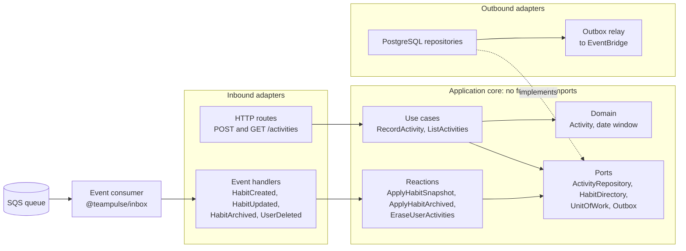
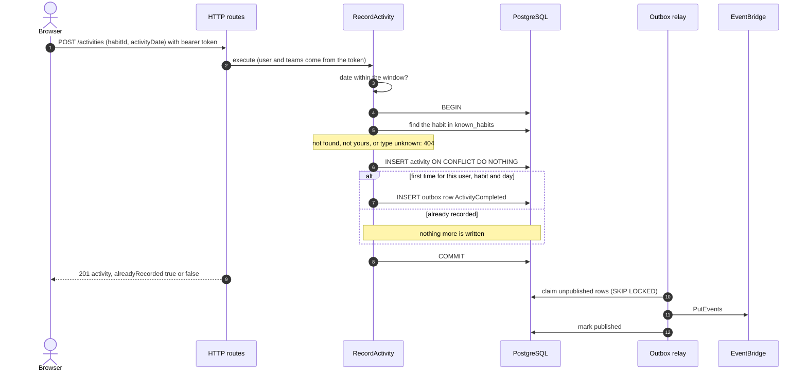
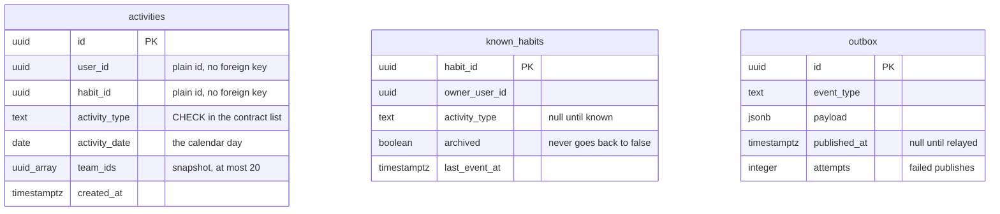

# 09. Event Tracking Service and the event plumbing

Event Tracking records that someone completed a habit on a day and tells the rest of the platform.
It is the entry point of the case study's nine-step flow, so it is also where the shared **outbox
relay** and **event consumer** are used for the first time.

- Code: [`services/event-tracking`](../../services/event-tracking/README.md), plus the shared
  packages [`outbox`](../../packages/outbox) (relay) and [`inbox`](../../packages/inbox) (consumer)
- API reference: [docs/api/event-tracking.md](../api/event-tracking.md) and the generated
  [`event-tracking.openapi.json`](../api/event-tracking.openapi.json)
- Decision: [ADR-0014](../adr/0014-outbox-relay-and-idempotent-consumers.md)

## Layers

## Recording an activity

### Why it is safe to retry

Marking a habit done is the call most likely to be repeated: a flaky connection, a double click, a
mobile app that retries after a timeout. Counting the day twice would corrupt every streak, so the
design makes the repeat harmless instead of asking clients to avoid it:

- The natural key **(user, habit, day)** is a `UNIQUE` constraint, and the insert is
  `ON CONFLICT DO NOTHING`. The database decides, so two simultaneous requests cannot both create
  the activity (a test fires four at once and gets one activity and one event).
- The event is written **only when a row was really created**. A retry returns the original
  activity with `alreadyRecorded: true` and publishes nothing.
- Because retries look like first calls, the response is `201` both times. Clients do not need to
  branch on the status.

## What the service knows about habits

Habits belong to the Habit Service. To check that a habit is yours and to copy its activity type,
Event Tracking keeps a small local copy built from Habit events, so recording an activity needs no
call to another service (and works when the Habit Service is down).

Events are delivered at least once and in no guaranteed order, so the copy is built to tolerate both:

```mermaid
stateDiagram-v2
    [*] --> Unknown
    Unknown --> Active: HabitCreated or HabitUpdated
    Unknown --> ArchivedNoType: HabitArchived arrives first
    Active --> Active: newer HabitUpdated changes the type; older ones are ignored
    Active --> Archived: HabitArchived
    ArchivedNoType --> Archived: HabitCreated fills in the type
    Archived --> Archived: nothing can revive it
    Archived --> [*]: UserDeleted erases it
    Active --> [*]: UserDeleted erases it
```

| Property               | How                                                                             |
| ---------------------- | ------------------------------------------------------------------------------- |
| Redelivery is harmless | The upsert gives the same result however often it runs                          |
| Order does not matter  | The activity type comes from the newest `occurredAt`; archiving is permanent    |
| Archive before create  | A placeholder row with no type; recording stays refused until the type is known |
| Not yet known = 404    | A client retry a moment later succeeds once the event has arrived               |

A habit created a second ago may therefore be "not found" for a moment: eventual consistency, stated
in the [API doc](../api/event-tracking.md).

## The outbox relay and the event consumer

Both are shared code, used by every service that publishes or consumes events.

```mermaid
stateDiagram-v2
    [*] --> Pending: written with the change, in its transaction
    Pending --> Published: bus accepted it, published_at set
    Pending --> Pending: bus rejected it, attempts + 1, retried next cycle
    Pending --> Parked: attempts reach the limit, or the row is not a valid event
    Published --> [*]: purged after the retention period
    Parked --> [*]: an operator investigates; an alarm fires on parked rows
```

| Concern                  | Mechanism                                                                                                    |
| ------------------------ | ------------------------------------------------------------------------------------------------------------ |
| No lost events           | The event is written in the same transaction as the change (outbox)                                          |
| At-least-once publishing | A row is marked published only after EventBridge accepted that entry                                         |
| Several instances        | Rows are claimed with `FOR UPDATE SKIP LOCKED`, so instances do not fight over a batch                       |
| One bad event            | Failures are per event; the rest of the batch is published. After 10 attempts it is parked                   |
| Invalid rows             | Parked immediately and logged (ids only, never the content)                                                  |
| Consumer retries         | A failing handler leaves the message on the queue; SQS redelivers and, after N receives, moves it to the DLQ |
| Invalid messages         | Left on the queue (so they reach the DLQ), logged by field name only                                         |
| Unrouted events          | Deleted with a warning: a routing mistake, not an error                                                      |
| Tracing                  | Each handler runs inside the event's `correlationId`                                                         |

## Data model

All tables live in the `event_tracking` schema.

`UNIQUE (user_id, habit_id, activity_date)` is the idempotency guarantee. The activity type lists
are `CHECK` constraints, and a unit test fails if they differ from the contracts, so adding an
activity type forces a migration.

## Rules worth knowing

- **Date window.** An activity can be recorded for today, up to 7 days back (configurable, 0 to 30),
  and for tomorrow's UTC date, because people east of UTC are already there. Anything else is
  rejected (`activity.date_in_future`, `activity.date_too_old`).
- **One completion per habit per day.** Hydration-style counts are not modelled yet.
- **No undo.** Removing a recorded activity would need an `ActivityRetracted` event so streaks could
  be corrected; it is not built.
- **Running total.** `ActivityCompleted` carries `totalCompleted`, the number of activities the person
  has recorded including this one, counted in the same transaction that stores the activity. The badge
  Lambda uses it for total milestones.
- **Team snapshot.** `ActivityCompleted` carries the teams in the caller's token at that moment, so
  Insight can aggregate per team without asking Identity. Membership can be up to 15 minutes stale.
- **Erasure.** `UserDeleted` removes the user's activities and habit facts here. Events already
  published stay on the bus; every consumer erases on the same `UserDeleted`.
