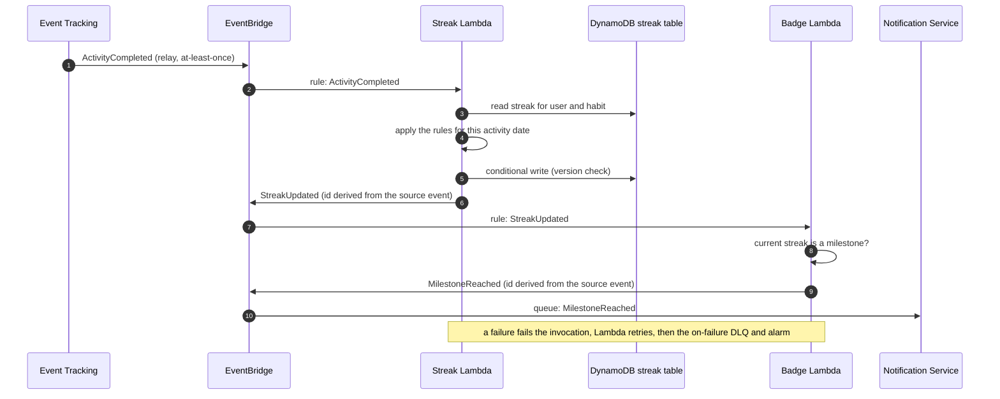
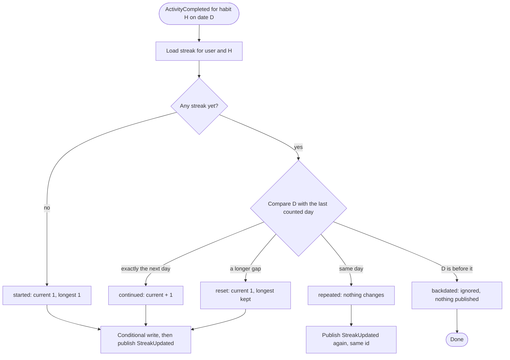
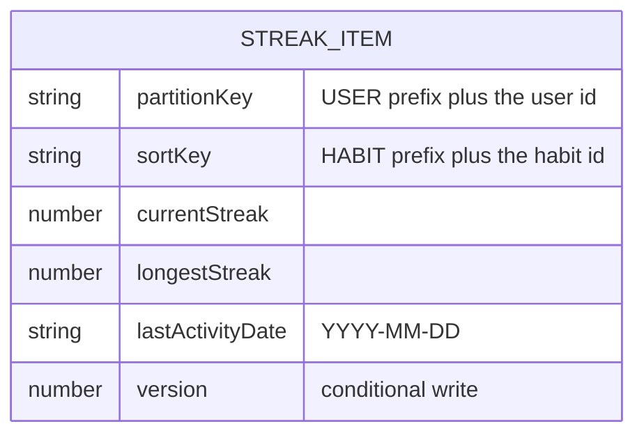
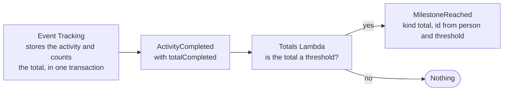

# 10. Streak and badge Lambdas

Small functions that turn one event into the next in the chain:

```text
ActivityCompleted  --streak Lambda-->  StreakUpdated  --badge Lambda-->  MilestoneReached (streak)
ActivityCompleted  --badge Lambda (totals)------------------------------>  MilestoneReached (total)
```

- Code: [`lambdas/streak`](../../lambdas/streak/README.md) and [`lambdas/badge`](../../lambdas/badge/README.md)
- Decisions: [ADR-0014](../adr/0014-outbox-relay-and-idempotent-consumers.md) (delivery),
  [ADR-0015](../adr/0015-deterministic-ids-for-derived-events.md) (retry-safe derived events)

## The chain



## Streak rules

A pure function of the stored streak and the activity date. Arrival order never matters, only the
dates.



| Outcome     | Stored state            | `StreakUpdated`                                   |
| ----------- | ----------------------- | ------------------------------------------------- |
| `started`   | new item, version 1     | published                                         |
| `continued` | streak + 1, version + 1 | published                                         |
| `reset`     | streak 1, longest kept  | published                                         |
| `repeated`  | unchanged               | published again with the same id (crash recovery) |
| `backdated` | unchanged               | **not** published                                 |

Known limit: filling in a missed day _after_ a later day was recorded does not repair the streak.
Rebuilding it would need the full activity history in this function, and Event Tracking allows at
most a week of back-filling.

## Why a retry is always safe

Events are delivered at least once and Lambda retries failed invocations, so every step has to
tolerate running again.

| Risk                                      | Defence                                                                                               |
| ----------------------------------------- | ----------------------------------------------------------------------------------------------------- |
| Same event delivered twice                | The streak depends on the date, so the second run changes nothing                                     |
| Two invocations update one streak at once | The write is conditional on the version that was read; the loser re-reads and recomputes (5 attempts) |
| Crash after saving, before publishing     | The retry sees "repeated" and still publishes, so the update is never lost                            |
| Retry publishes a "second" update         | The event id is derived from the source event id, so the retry sends the _same_ event                 |
| A milestone awarded twice                 | Same derivation: the same `StreakUpdated` always gives the same `MilestoneReached` id                 |
| A bad or unexpected message               | The invocation fails (field names logged, never content) and goes to the retry policy and the DLQ     |

## State in DynamoDB

One item per user and habit. In the table the two key attributes are named `pk` and `sk`.



Reads are strongly consistent (the next write depends on them). The table, IAM and alarms are
defined with Terraform in roadmap step 11.

## Badge Lambda scope

One package, two entry points, both stateless:

| Entry point     | Input               | Announces                                                        |
| --------------- | ------------------- | ---------------------------------------------------------------- |
| `handler`       | `StreakUpdated`     | a streak of 7, 14, 30, 60, 100 or 365 days                       |
| `totalsHandler` | `ActivityCompleted` | a total of 10, 25, 50, 100, 250, 500 or 1000 recorded activities |

A milestone is announced when the count equals one exactly, so it is announced when reached and not
on every later step.

**Total milestones need no counter.** Event Tracking counts the person's activities inside the
transaction that stores each one and puts the number in `ActivityCompleted` (`totalCompleted`). The
Lambda only compares it with the thresholds. Its published id is derived from the person and the
threshold, not from the source event: if two activities were stored at the same moment and both
saw the same total, both announcements are the same event and the person is notified once.



Not here, on purpose:

- **Challenge badges and progress** (`BadgeAwarded`, `ChallengeProgressUpdated`) belong to the
  Challenge Service, which holds the rules and the participants and scores activities itself
  ([ADR-0018](../adr/0018-challenge-scoring-in-the-service.md)).
- **An analytics Lambda.** The Insight Service consumes `ActivityCompleted` and writes its aggregates
  itself ([ADR-0017](../adr/0017-insight-aggregates-in-the-service.md)).

## Testing

Domain rules, the use cases (retries, conflicts, crash recovery, redelivery) and the handlers run
against in-memory fakes. The DynamoDB adapter is tested with a fake client that checks the exact
conditions it sends. **Nothing here has been run against real DynamoDB or EventBridge**; that needs
LocalStack or an AWS account (roadmap step 9).
