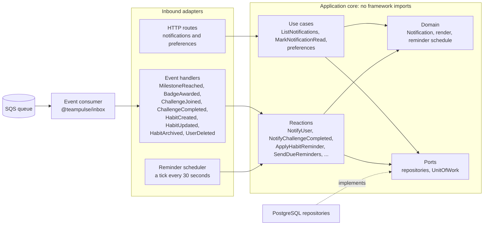
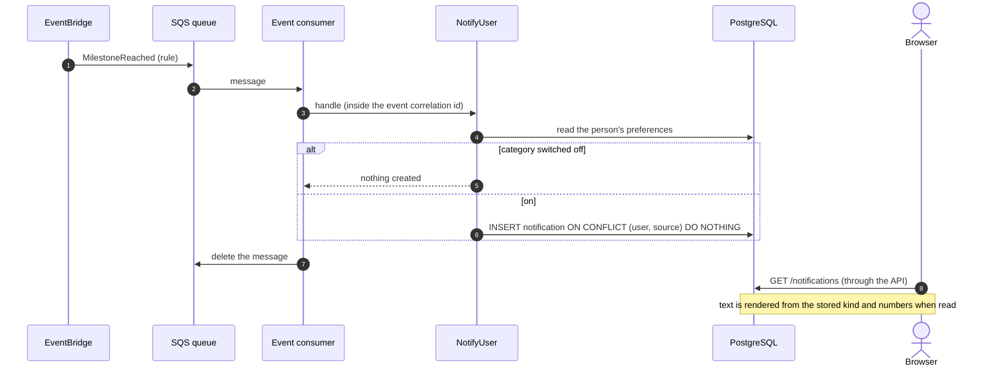
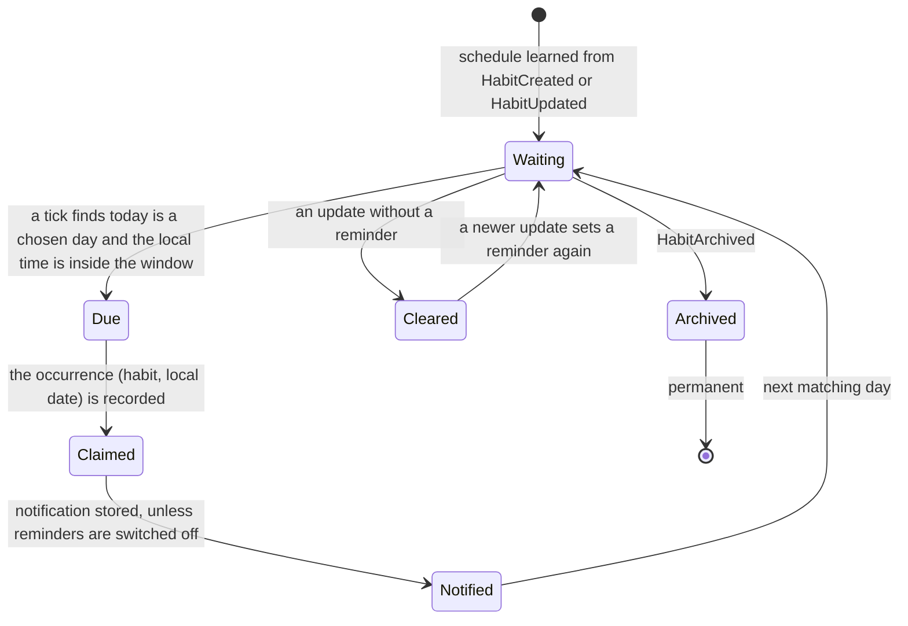
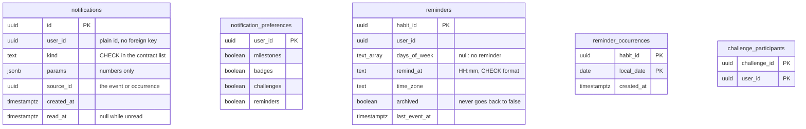

# 11. Notification Service

Turns events into in-app notifications, sends habit reminders on schedule, and lets each person
choose what they receive.

- Code: [`services/notification`](../../services/notification/README.md)
- API reference: [docs/api/notification.md](../api/notification.md) and the generated
  [`notification.openapi.json`](../api/notification.openapi.json)
- Decision: [ADR-0016](../adr/0016-reminders-by-claimed-ticks.md)

## Layers

## From event to notification

| Event                              | What happens                                                  |
| ---------------------------------- | ------------------------------------------------------------- |
| `MilestoneReached`, `BadgeAwarded` | One notification for that person                              |
| `ChallengeJoined`                  | Remember the participant (no notification)                    |
| `ChallengeCompleted`               | One notification for every remembered participant             |
| `HabitCreated`, `HabitUpdated`     | Replace the habit's reminder schedule, or clear it            |
| `HabitArchived`                    | The reminder stops, permanently                               |
| `UserDeleted`                      | Erase notifications, preferences, reminders and participation |

`ChallengeCompleted` carries no list of people (events hold ids and counts only), so the service
learns who took part from `ChallengeJoined`. Everything is keyed so that delivering the same event
twice, or in a different order, gives the same result.

## What a notification contains

Only a **kind** and **numbers**: a milestone and its threshold, a badge kind, nothing else. The
wording is produced when the notification is read, so texts can change or be translated without
touching stored data, and nothing a person wrote can appear in one. In particular a reminder says
"It is time to do one of your habits", never the habit's title, because no event carries titles
([ADR-0005](../adr/0005-privacy-by-design.md)).

| Kind                  | Preference category | Example text                                                  |
| --------------------- | ------------------- | ------------------------------------------------------------- |
| `milestone`           | `milestones`        | You kept a habit going for 7 days in a row. Well done!        |
| `badge`               | `badges`            | You earned a streak badge in a challenge.                     |
| `challenge_completed` | `challenges`        | A challenge you joined has finished. See the final standings. |
| `reminder`            | `reminders`         | It is time to do one of your habits.                          |

## Reminders

- **Time zones.** A schedule is a day set, a local time `HH:mm` and an IANA zone, so "07:30" means
  07:30 where the person is. The platform's time zone database does the conversion, which is why
  daylight saving changes just work (a test covers Berlin's spring change).
- **Window.** A reminder is due from its time until 15 minutes later (configurable). A short outage
  or a slow tick still delivers it; one from hours ago is not sent late. It does not carry over
  midnight.
- **Once per day.** The occurrence is claimed in the database, so several instances ticking at once,
  or a tick repeated after a failure, send it once. Switching reminders off still claims the
  occurrence, so turning them back on does not deliver a stale reminder.
- **Order.** The newest event decides the schedule, including clearing it; an archive that arrives
  before the creation event is remembered.

## Data model

All tables live in the `notification` schema.

`UNIQUE (user_id, source_id)` on notifications is the idempotency guarantee. A `CHECK` keeps a
half-defined schedule out of the table, and a unit test fails if the kind list in the migration
differs from the contracts.

## Rules worth knowing

- **Own data only.** There is no way to ask for another person's notifications; marking someone
  else's as read returns the same 404 as a missing one.
- **Reminder lookup scans active reminders** on every tick. That is fine for an internal tool with a
  few thousand habits; a large deployment would index by time zone and day.
- **In-app only.** There is no email or push yet; a `NotificationSender` port would be added in front
  of SES when needed.
- **Erasure.** `UserDeleted` removes everything held about the person here.
