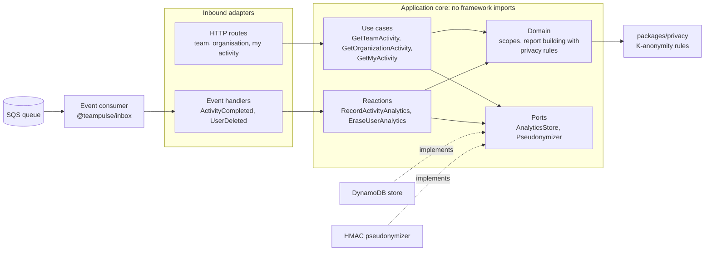
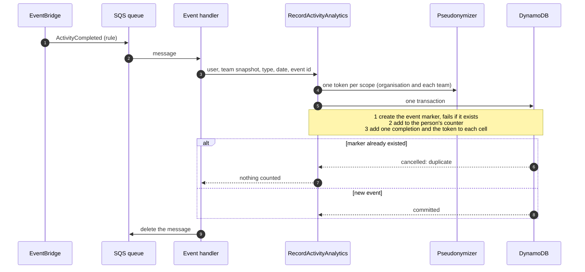
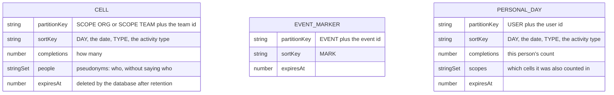
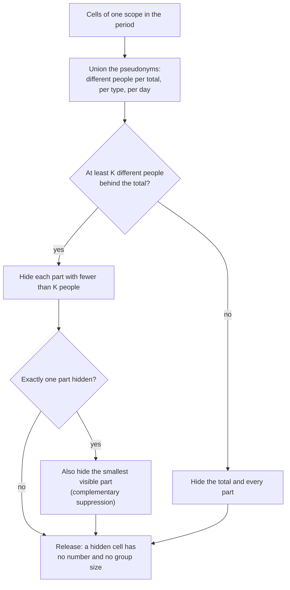
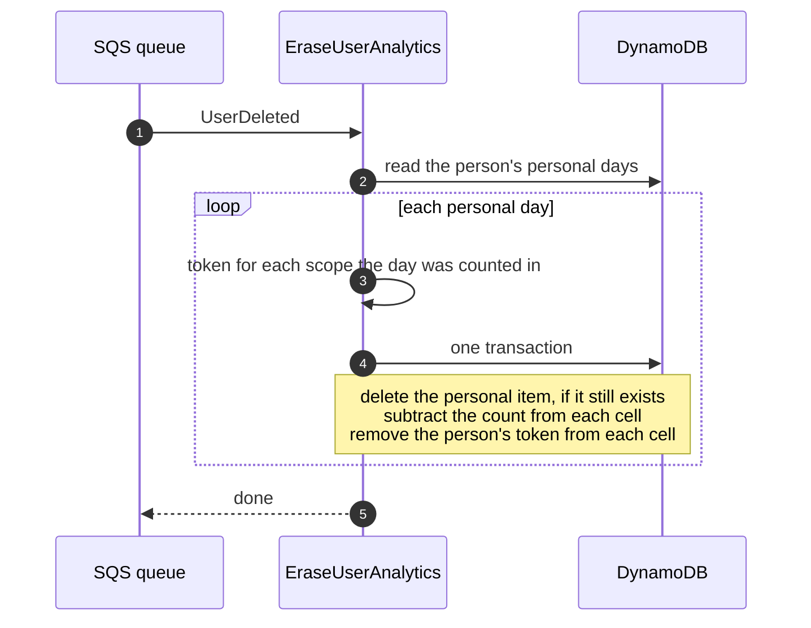

# 12. Insight Service

Counts activity per team and per person, and shows managers only what cannot identify anyone.

- Code: [`services/insight`](../../services/insight/README.md)
- API reference: [docs/api/insight.md](../api/insight.md) and the generated
  [`insight.openapi.json`](../api/insight.openapi.json)
- Decisions: [ADR-0005](../adr/0005-privacy-by-design.md) (privacy by design),
  [ADR-0017](../adr/0017-insight-aggregates-in-the-service.md) (how the aggregates are stored)

## Layers

There is no separate analytics Lambda: the service consumes the event and writes the aggregates
itself ([ADR-0017](../adr/0017-insight-aggregates-in-the-service.md)).

## Counting an activity

## Two tables

| Table      | Holds                        | Read by                            | Contains user ids |
| ---------- | ---------------------------- | ---------------------------------- | ----------------- |
| aggregates | cells and event markers      | manager and administrator requests | **no**            |
| personal   | one item per user, day, type | the person themselves, and erasure | yes               |

The two tables are separate so that IAM can say which code may touch which. A bug in the manager
endpoints cannot reach personal data, because those endpoints' store calls only name the aggregates
table.

## From stored cells to what a manager sees

K defaults to 5 and cannot be configured below 3. The rules live in
[`@teampulse/privacy`](../../packages/privacy/src/k-anonymity.ts); this service builds the measures
and applies them, and a test sweeps every combination of small group sizes to confirm a shown total
is never next to exactly one hidden part.

| Rule                                 | Why                                                                                                           |
| ------------------------------------ | ------------------------------------------------------------------------------------------------------------- |
| Count different people, not events   | One very active person must not make a group of one look like a group of five                                 |
| Only parts with data are listed      | A missing type is not a hidden zero: counting it as hidden would let subtraction recover the real hidden part |
| A hidden total hides every part      | Visible parts would add up to it                                                                              |
| A hidden cell carries no size        | The size is itself a clue                                                                                     |
| Employees and managers see own teams | Anyone else gets the same 404 as for a team that does not exist                                               |

## Who can read what

| Request                      | Employee  | Manager           | Administrator |
| ---------------------------- | --------- | ----------------- | ------------- |
| `GET /teams/{id}/activity`   | own teams | teams they manage | any team      |
| `GET /organization/activity` | 403       | 403               | yes           |
| `GET /me/activity`           | yes, own  | yes, own          | yes, own      |
| Another person's numbers     | no route  | no route          | no route      |

Team reports use the same privacy rules for every role, administrators included: nobody gets
numbers about a small group. "My activity" is about one person, so nothing is hidden from them.

## Failure and retry

| Situation                                 | What happens                                                                                                  |
| ----------------------------------------- | ------------------------------------------------------------------------------------------------------------- |
| The same event is delivered twice         | The marker already exists: the transaction is cancelled, nothing is counted twice                             |
| The transaction is throttled or conflicts | The error is thrown, the message stays on the queue and is retried, then goes to the DLQ                      |
| DynamoDB is down during a request         | 503 with `Retry-After`, nothing internal revealed; `/readyz` reports `database` as failing                    |
| `UserDeleted` is delivered twice          | The personal day is already gone: the conditional delete cancels the transaction, nothing is subtracted again |
| A crash during erasure                    | Each personal day is erased in its own transaction; the retry finds what is left and continues                |

## Erasing a person

After this nothing in the Insight data refers to the person, and the remaining cohort sizes are
correct (a cell that loses its last person disappears from reports).

## Configuration

| Variable                | Default  | Notes                                                                        |
| ----------------------- | -------- | ---------------------------------------------------------------------------- |
| `AGGREGATES_TABLE_NAME` | required | Cells and markers                                                            |
| `PERSONAL_TABLE_NAME`   | required | Personal counters                                                            |
| `MIN_COHORT_SIZE`       | `5`      | Between 3 and 100. A policy value for HR and legal to confirm                |
| `RETENTION_DAYS`        | `400`    | Counters are deleted this long after the day they describe (31 to 3650)      |
| `INSIGHT_PSEUDONYM_KEY` | dev key  | At least 32 characters. Production refuses to start with the development key |
| `EVENTS_QUEUE_URL`      | none     | Required in production                                                       |

## Known limits

- **Comparing reports over time.** Reports for 1 to 7 November and 1 to 8 November can be
  subtracted to reveal the 8th, even if the 8th alone was hidden. Fixed reporting periods (calendar
  weeks or months) would close this; not built.
- **A cell is one DynamoDB item**, at most 400 KB: about 20,000 people per scope and day and type.
  Far above a team, a limit to revisit for the organisation scope of a very large company.
- **Team snapshots.** A person is counted in the teams they belonged to when the activity happened.
  Someone who changes team keeps their past in the old one.
- **Time to live is approximate.** DynamoDB deletes expired items within a couple of days of the
  expiry time, so data may outlive its retention by that long.
- **Events after erasure.** An `ActivityCompleted` that arrives after the person's `UserDeleted`
  would count them again.
- **Never run against real DynamoDB.** Tests use a small fake that executes the exact expressions the
  store sends and refuses ones it does not understand, and a contract suite that runs the same
  behavioural tests against the fake and the in-memory store. Real throttling, item size limits and
  consistency need LocalStack or an AWS account (roadmap step 9).
