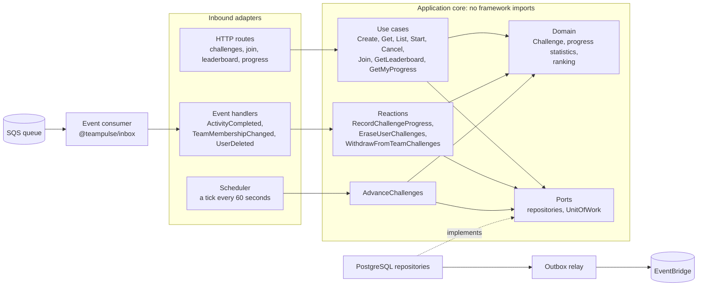
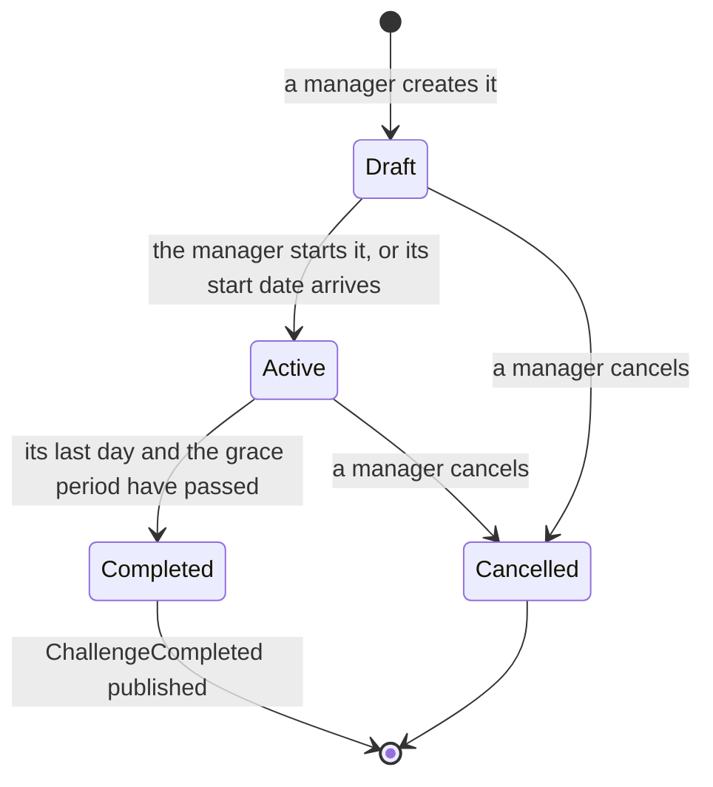
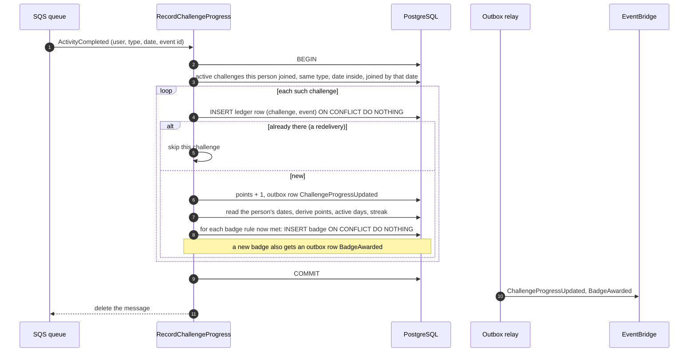
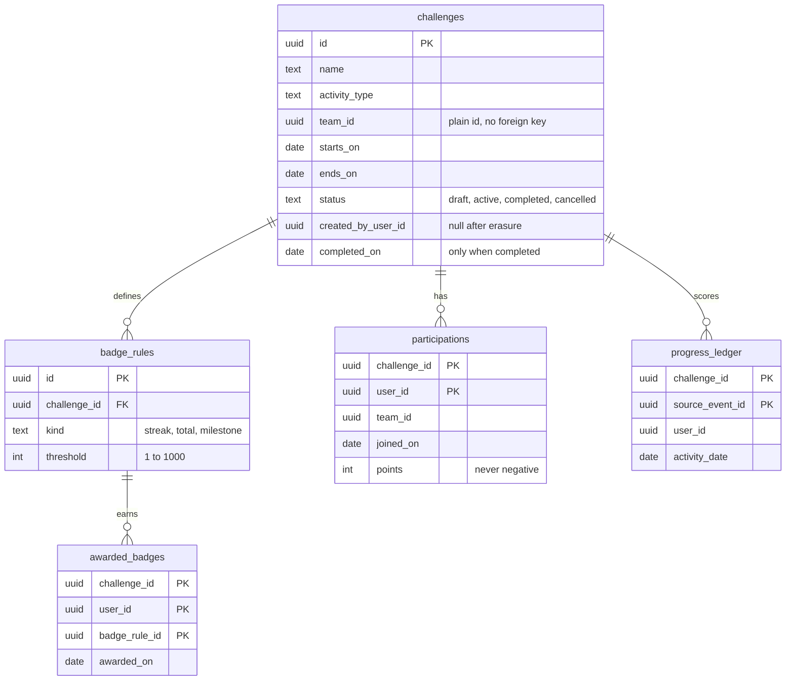

# 13. Challenge Service

Team challenges: a manager sets one up, team members join, activities score points, and the
standings and badges follow.

- Code: [`services/challenge`](../../services/challenge/README.md)
- API reference: [docs/api/challenge.md](../api/challenge.md) and the generated
  [`challenge.openapi.json`](../api/challenge.openapi.json)
- Decision: [ADR-0018](../adr/0018-challenge-scoring-in-the-service.md)

## Layers

## Lifecycle

- A **draft** is visible only to the managers of its team, its creator and administrators. Nobody can
  join it, and the team cannot see that it exists.
- **Starting** is allowed before the start date (a manual start) and not after the last day.
- The scheduler starts a draft whose start date has come (and whose last day has not passed) and
  completes an active challenge once `today > last day + grace` (default one day). Every instance
  ticks; each change is conditional on the status that was read, so one wins and only the winner
  publishes.
- A draft whose end date passes without being started is left alone.

## Scoring an activity

### What counts

| Rule                    | Detail                                                                            |
| ----------------------- | --------------------------------------------------------------------------------- |
| One point per activity  | A qualifying activity is one `ActivityCompleted` event                            |
| Type matches            | Only activities of the challenge's activity type score                            |
| Inside the dates        | The activity's own calendar date is between the start and the last day, inclusive |
| From the day you joined | Activities dated before the day you joined do not count                           |
| Only while active       | A draft, cancelled or completed challenge scores nothing                          |
| Several challenges      | One activity scores in every challenge where it qualifies, separately             |

### Badges

A manager lists up to ten rules when creating a challenge. Each is a kind and a threshold, and is met
once and for good:

| Kind        | Met when                                                                   |
| ----------- | -------------------------------------------------------------------------- |
| `streak`    | the longest run of consecutive days with an activity reaches the threshold |
| `total`     | the number of qualifying activities reaches the threshold                  |
| `milestone` | the number of different days with an activity reaches the threshold        |

Progress is derived from the ledger's dates, so the order events arrive in never matters.

## Data model

The primary keys of `participations`, `progress_ledger` and `awarded_badges` are the idempotency
guarantees: joining twice, scoring one event twice and awarding one badge twice each hit a key and
do nothing. `CHECK` constraints keep invalid states out (a completion date on an active challenge, a
badge threshold of zero), and a test fails if a list in the migration differs from the contracts.

## Who can do what

| Action                  | Employee            | Manager                                | Administrator |
| ----------------------- | ------------------- | -------------------------------------- | ------------- |
| Create a challenge      | no (403)            | for teams they manage                  | any team      |
| See a draft             | no (404)            | of teams they manage, own ones         | yes           |
| See a started challenge | own team, else 404  | own team and teams they manage         | yes           |
| Start or cancel         | no (403)            | for teams they manage                  | yes           |
| Join                    | members of the team | members of the team                    | no            |
| Leaderboard             | participants only   | participants, and managers of the team | yes           |
| Own progress and badges | participants        | participants                           | participants  |

A challenge the caller may not see gives the same 404 as one that does not exist. Visibility is
enforced inside the SQL query (the same idea as [ADR-0012](../adr/0012-visibility-enforced-in-the-query.md))
and a contract test checks the SQL against the domain rule for every combination of status and
viewer.

The leaderboard is for the people taking part; another member of the team learns that the challenge
exists (403) but not who is winning. Managers of the team can also read it, which extends the
authorization matrix in [06](06-security-and-privacy.md) slightly: someone who runs a challenge needs
to see how it is going.

## Events

| Event                      | Direction | When                                                                      |
| -------------------------- | --------- | ------------------------------------------------------------------------- |
| `ActivityCompleted`        | consumed  | scores the activity                                                       |
| `TeamMembershipChanged`    | consumed  | `removed`: the person leaves the team's unfinished challenges, points too |
| `UserDeleted`              | consumed  | erases participation, ledger and badges; unlinks challenges they created  |
| `ChallengeJoined`          | published | first join only                                                           |
| `ChallengeProgressUpdated` | published | each scored activity (`pointsDelta` 1)                                    |
| `BadgeAwarded`             | published | a badge rule is met for the first time                                    |
| `ChallengeCompleted`       | published | the scheduler completes the challenge                                     |

## Failure and retry

| Situation                                  | What happens                                                                               |
| ------------------------------------------ | ------------------------------------------------------------------------------------------ |
| The same activity event is delivered twice | The ledger key is already there: nothing scored, nothing published                         |
| A crash while scoring                      | One transaction: nothing is committed, the redelivery does all of it                       |
| Two joins at once                          | One insert wins; only the winner publishes `ChallengeJoined`                               |
| Two instances complete a challenge at once | The conditional update lets one win; only the winner publishes                             |
| Events arrive in a different order         | Progress is derived from the ledger's dates, so the result is the same                     |
| The database is down                       | 503 with `Retry-After` for requests; the consumer retries; the tick is logged and repeated |

## Configuration

| Variable                 | Default     | Notes                                                                    |
| ------------------------ | ----------- | ------------------------------------------------------------------------ |
| `DATABASE_URL`           | required    | PostgreSQL connection string                                             |
| `DATABASE_SCHEMA`        | `challenge` | Simple lower-case name                                                   |
| `DATABASE_SSL`           | `false`     | Must be `true` in production                                             |
| `IDENTITY_JWKS_URL`      | required    | Public keys that verify access tokens; `https` in production             |
| `EVENT_BUS_NAME`         | none        | Required in production (publishes events)                                |
| `EVENTS_QUEUE_URL`       | none        | Required in production (consumes events)                                 |
| `CHALLENGE_TICK_SECONDS` | `60`        | How often challenges are started and completed (10 to 3600)              |
| `CHALLENGE_GRACE_DAYS`   | `1`         | Days after the last day during which its activities still count (0 to 7) |

## Known limits

- **UTC calendar days.** Start and end dates, the scheduler and "joined on" use UTC days. A team spread
  across many time zones sees some activities dated a day off the challenge's UTC day; the grace
  period covers the end, not the start.
- **Late events.** An activity that arrives after the challenge completed does not score.
- **No names in the API.** The leaderboard returns user ids and points. The web app looks names up in
  the team roster of the Identity Service (`GET /teams/{id}/members`) and shows "A teammate" when it
  cannot.
- **No leaving.** A participant cannot leave a challenge on their own (it would change standings others
  rely on); leaving the team does it.
- **Edits.** A challenge's name, dates and badge rules cannot be changed after creation; cancel and
  create a new one.
- **Never run against real SQS or a real PostgreSQL server.** Tests use PGlite and the real `pg`
  driver against it; row-lock contention between instances is untested because PGlite serves one
  connection.
