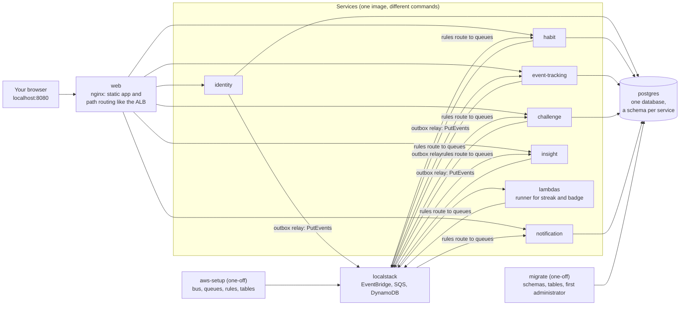
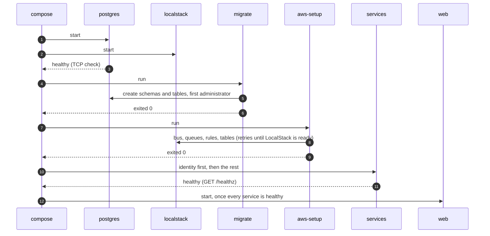
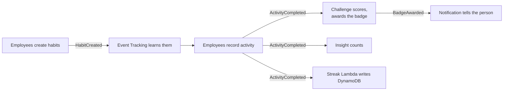

# 14. The local stack (containers)

The whole platform on one computer with one command, using **Docker or Podman**. It is the same
code and the same settings as in AWS; only the place changes.

- Files: [`infra/docker`](../../infra/docker) (the images), [`infra/local`](../../infra/local) (the
  stack), [`tools/local`](../../tools/local) (helper scripts)
- Decision: [ADR-0019](../adr/0019-local-aws-with-localstack.md)

## What runs

| Container                | Image                         | What it does                                                                    |
| ------------------------ | ----------------------------- | ------------------------------------------------------------------------------- |
| `postgres`               | `postgres:16-alpine`          | The database. Host port 5433, so it never clashes with one you installed        |
| `localstack`             | `localstack/localstack:3.8.1` | A pretend AWS: the event bus, queues and DynamoDB                               |
| `migrate`                | `teampulse/backend:local`     | Creates every schema and table, then the first administrator, then exits        |
| `aws-setup`              | `teampulse/backend:local`     | Creates the bus, queues (with dead-letter queues), rules and tables, then exits |
| `identity` ... `insight` | `teampulse/backend:local`     | The six services; each listens on port 3000 inside its container                |
| `lambdas`                | `teampulse/backend:local`     | Runs the streak and badge functions by reading their queues                     |
| `web`                    | `teampulse/web:local`         | nginx: serves the app and routes `/api/v1/<service>/` to the right service      |

## Start-up order

## Images

One Dockerfile ([`infra/docker/Dockerfile`](../../infra/docker/Dockerfile)), two targets:

- `backend`: installs exactly what `package-lock.json` says (`npm ci`), compiles everything, removes
  development tools (`npm prune --omit=dev`), runs as the unprivileged `node` user. Every service,
  both Lambdas and the helper scripts live in it; the **command** chooses what runs
  (`node services/habit/dist/main.js`). The base is Debian "slim" because the password hashing
  library ships prebuilt binaries for it, so no compiler is needed.
- `web`: the compiled static app behind `nginx-unprivileged`, with the routing in
  [`nginx.conf`](../../infra/docker/nginx.conf).

One backend image keeps local builds to about four minutes and guarantees the services are tested
together. For AWS (step 11) each service gets its own image from the same Dockerfile so that a task
only contains what it runs; that is a build argument away and not done yet.

## What stands in for what

| In AWS                                  | Locally                                                                        |
| --------------------------------------- | ------------------------------------------------------------------------------ |
| Application Load Balancer, path routing | nginx in the `web` container                                                   |
| CloudFront and S3                       | nginx serving the static files                                                 |
| RDS PostgreSQL                          | One PostgreSQL container                                                       |
| EventBridge, SQS, DynamoDB              | LocalStack (same API; the AWS SDK's standard `AWS_ENDPOINT_URL` points at it)  |
| Lambda invoked by an EventBridge rule   | A small runner that reads the rule's queue and calls the same handler function |
| Secrets Manager and task roles          | `infra/local/.env` (random secrets, created by `make-env`, never committed)    |
| TLS, WAF, private subnets               | Not present: this is for development only                                      |

## Helper scripts

| Command                          | What it does                                                                  |
| -------------------------------- | ----------------------------------------------------------------------------- |
| `npm run local:env`              | Creates `infra/local/.env` with fresh random secrets (never overwrites)       |
| `npm run local:up`               | Builds and starts everything. Picks `docker` if installed, otherwise `podman` |
| `npm run local:smoke`            | An end-to-end check through the web address (see below)                       |
| `node tools/local/seed-demo.mjs` | Demo people, a team, a challenge and habits                                   |
| `npm run local:down`             | Stops everything, keeps the data                                              |
| `npm run local:reset`            | Stops everything and **deletes the data**                                     |

### The smoke test

`tools/local/smoke.mjs` signs in as the administrator, creates a manager, five employees and a team,
then follows real activity through the whole system and waits for each asynchronous step:

It checks: idempotent recording, one point each on the leaderboard, the badge notification, the team
report (five different people reach the privacy threshold), that a manager is refused the
organisation report, the personal report, and a streak of 1 per person in DynamoDB. On its first run
all 17 checks passed.

## Honest limits

- **LocalStack is not AWS.** It checks the logic and the wiring, not IAM permissions, real
  throttling, item size limits or timing. The first deployment to AWS will still teach something.
- **LocalStack is pinned to 3.8.1**, the last community release that starts without an account
  token. It will not receive updates.
- **The Lambda runner** reads a queue and calls the handler; it does not reproduce Lambda's memory
  limits, timeouts or cold starts.
- **Images are large** (the backend image contains the sources and every service's dependencies).
  Step 10 and step 11 slim them per service.
- **No TLS and a Secure cookie turned off** (`COOKIE_SECURE=false`): the stack is on `http` locally.
- **Podman needs memory.** The default Podman machine (2 GB) built and ran the stack, but with little
  headroom; 4 GB is more comfortable (`podman machine set --memory 4096`).
