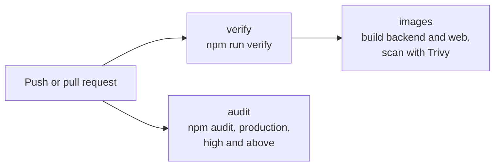

# 15. Continuous integration

Every change is checked automatically before it is accepted. The pipeline is
[`.github/workflows/ci.yml`](../../.github/workflows/ci.yml) (GitHub Actions). It runs on every push
to `main` and on every pull request.

| Job      | What it runs                                     | Fails when                                               |
| -------- | ------------------------------------------------ | -------------------------------------------------------- |
| `verify` | `npm ci`, then `npm run verify`                  | formatting, lint, types, any test, or a diagram fails    |
| `audit`  | `npm audit --omit=dev --audit-level=high`        | a shipped dependency has a high or critical advisory     |
| `images` | builds both image targets, scans them with Trivy | a build fails, or a fixable high/critical finding exists |

`npm run verify` is the same command a developer runs locally, so "green on my machine" and "green in
CI" mean the same thing.

**Dependabot** ([`.github/dependabot.yml`](../../.github/dependabot.yml)) opens weekly pull requests
for npm packages, the actions used above, and the base images, so updates arrive as small reviewed
changes.

## Honest limits

- **The workflow has never run.** There was no repository to run it in. It uses the same commands that
  pass locally, but expect to fix small things on the first run (for example Trivy's output or the
  Docker socket mount).
- **The images job does not run the compose smoke test**, because it needs a few GB of memory and
  several minutes. It can be added as a separate job later.
- **One backend image** is still built for all services. Per-service slim images are a step 11
  concern.
- **No deployment yet.** CI checks and builds; it does not push images or touch AWS. That arrives with
  the Terraform step.
