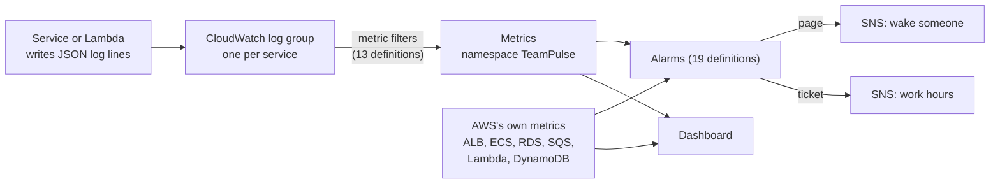
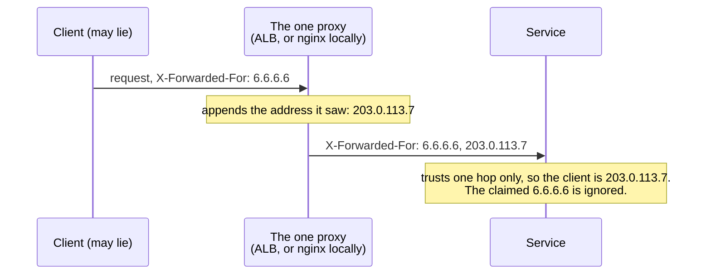

# 16. Observability and hardening (roadmap step 12)

How we will know the platform is healthy, how it resists misuse, and what a review of both found.

- Monitoring definitions: [`infra/observability/monitoring.json`](../../infra/observability/monitoring.json)
- Tests: [`monitoring.test.ts`](../../tools/test/monitoring.test.ts),
  [`route-inventory.test.ts`](../../tools/test/route-inventory.test.ts),
  [`render-security-headers.test.ts`](../../tools/test/render-security-headers.test.ts)
- Load test: [`tools/load/load-test.mjs`](../../tools/load/load-test.mjs)
- Decision: [ADR-0021](../adr/0021-log-based-metrics-and-hardening.md)

## 1. Observability

### How a log line becomes an alarm

Every service already writes one JSON line per request and per notable event (see
[05](05-aws-deployment.md) and the logger in `packages/observability`). Rather than add a metrics
library to six services, CloudWatch reads those lines and counts them.

Nothing here is applied yet: the definitions are data, and **Terraform (step 11) turns them into
CloudWatch resources**. What is verified now is that each filter really matches what the code logs.

### The metrics (from log lines)

| Metric                                     | Counts                                        | Why                                      |
| ------------------------------------------ | --------------------------------------------- | ---------------------------------------- |
| `Requests`, `ServerErrors`, `Latency`      | every request, 5xx answers, request time      | traffic, error rate, speed               |
| `Unauthorized`, `Forbidden`, `RateLimited` | 401, 403, 429 answers                         | probing and abuse                        |
| `EventHandlerFailures`, `InvalidMessages`  | an event handler threw; an unreadable message | events that will end up in a dead letter |
| `OutboxPublishFailures`                    | the relay could not put an event on the bus   | events are piling up in the outbox       |
| `SchedulerFailures`                        | a background tick failed                      | challenges not advancing, reminders late |
| `LoginFailures`, `RefreshTokenReuse`       | failed sign-ins; a refresh token used twice   | password guessing; a stolen session      |
| `InvalidLambdaEvents`                      | a Lambda received an event it cannot read     | a producer and a consumer disagree       |

Each is recorded per service (the `service` field of the log line becomes a CloudWatch dimension).

### The alarms

19 alarm definitions, each with a **severity** (`page` = wake someone, `ticket` = look in work hours)
and an **action** line saying what the person should do first.

| Group          | Alarms                                                                                                                                             |
| -------------- | -------------------------------------------------------------------------------------------------------------------------------------------------- |
| Each service   | 5xx rate above 5%, slow responses (p95 over 1 s), failing event handlers, events not reaching the bus, failing schedulers, CPU and memory over 80% |
| Event pipeline | A message in any **dead-letter queue** (page), a Lambda failing, a Lambda throttled                                                                |
| Front door     | Load balancer 5xx, a target group with no healthy task                                                                                             |
| Data           | Database CPU, less than 5 GiB of free storage (page), DynamoDB throttling                                                                          |
| Security       | Many failed sign-ins, **refresh token reuse (page)**, spikes of forbidden and rate-limited requests                                                |

### What the tests prove (and do not)

- Every filter pattern is **evaluated against log lines produced by the real HTTP server** (a request
  for each of 200, 401, 403, 404, 429 and 500) and counts exactly the right ones. Health checks are
  not counted.
- Every event name in a filter appears in the sources as a logged `event`, so renaming a log event
  without updating the monitoring breaks a test. Two deliberately broken filters were confirmed to fail.
- Alarms refer only to metrics that exist; their placeholders are filled by the expansion they name;
  no alarm asks for more breaching points than it has; every alarm has an action.
- **Not proven:** that CloudWatch accepts these definitions (Terraform has not been applied), the
  thresholds themselves (they are starting points from the load test, to be tuned on real traffic),
  and the AWS-provided metrics' names beyond reading the documentation.

## 2. Hardening

### Who is calling? The client address and the rate limits

Rate limits are per client address. That only works if the service knows the real address.

Two defects were found and fixed:

1. **The services trusted the leftmost forwarded address**, which the client writes. Behind the ALB a
   client could invent a new address for every request and never hit a limit. Now only the directly
   connected proxy is trusted (`packages/http`, tested with a spoofed header).
2. **nginx did not forward the client address at all**, so locally every person looked like nginx and
   shared one set of limits (this is why the smoke test hit 429 earlier). nginx now writes
   `X-Forwarded-For` from the real connection and never from the request.

### The route inventory

`route-inventory.test.ts` lists what can be called without signing in and fails if it changes:

- **Public:** `POST /auth/login`, `POST /auth/refresh`, `POST /auth/logout`, `GET /.well-known/jwks.json`.
  Everything else in all six services requires an access token.
- **Every state-changing route has a rate limit.** The review found **seven that had none**: the
  public logout and six administrator routes (create, change and delete users; create teams; add
  and remove members). All now have limits (30 and 60 a minute).
- Sign-in and password change are limited to 10 a minute because they can be used to guess secrets.

### Browser security headers and the Content-Security-Policy

The web container sends on every page and asset: a Content-Security-Policy, `X-Content-Type-Options`,
`X-Frame-Options: DENY`, `Referrer-Policy`, `Permissions-Policy` and `Cross-Origin-Opener-Policy`.
The policy lets scripts run **only from the app itself plus the one inline bootstrap script
SvelteKit writes, allowed by its SHA-256 hash**. The hash is computed at image build time because
it changes with every build.

Things found while doing this, all fixed:

- nginx drops inherited `add_header` lines in any location that sets its own, so the long-cache
  `/_app/` files had no security headers. The headers now live in one snippet included wherever needed.
- The first template had the hash placeholder in a comment too, so only the comment was replaced and
  the real policy kept the literal placeholder (it would have blocked the app). Found by looking at
  the served headers; a test of the real template now prevents it.
- A strict `style-src` blocked the web components' styles (found in a real browser: the rings had no
  styling). Styles are therefore allowed inline. This is a **deliberate compromise**: injected CSS can
  restyle a page but cannot run code, and scripts, the dangerous part, remain locked to one hash.

`Strict-Transport-Security` is not set by the container (it speaks plain http behind the load
balancer or CloudFront). It must be set at CloudFront or the ALB; Terraform (step 11) owns that.

## 3. Load test

`node tools/load/load-test.mjs` (realistic traffic) and `--burst` (limiter check) against the local stack.

| Run                                         | Result                                                                                              |
| ------------------------------------------- | --------------------------------------------------------------------------------------------------- |
| 5 users, 1 s think time, 40 s (second run)  | 200 requests, 4.9 requests/s, 0 errors, 0 rate limited; p95 between 12 and 26 ms for every endpoint |
| Same, first run right after a restart       | Identical except the first calls to **Insight took about 4 s** (cold start); then 21 ms median      |
| Burst: 150 writes in 0.8 s from one address | Exactly 120 accepted, 30 answered 429 from request 121, **0 server errors**, normal service after   |

**Read these numbers carefully.** This is one computer running the load generator and every container,
at about 5 requests a second. It shows the code and the limiter behave; it says **nothing about how
AWS performs** (network, RDS, DynamoDB, Lambda and ECS limits differ), and it is not a capacity test:
the per-address limits stop one address long before the services strain. The cold-start finding is
real: the first Insight call after a start is slow, so readiness should exercise DynamoDB before a
task takes traffic (not done yet).

## 4. Threat-model review

Each claim in the STRIDE table of [06](06-security-and-privacy.md) was checked against the code.

| Threat                              | Claim in 06                                     | What the code does                                                                                                                                                                                       | Status                                                          |
| ----------------------------------- | ----------------------------------------------- | -------------------------------------------------------------------------------------------------------------------------------------------------------------------------------------------------------- | --------------------------------------------------------------- |
| Spoofing: stolen token              | short expiry, rotation, httpOnly cookie         | Access token 15 min by default; refresh tokens rotate with reuse detection that revokes the family (and now alarms); cookie `httpOnly`, `SameSite=Strict`, limited to the auth paths                     | **Holds**                                                       |
| Spoofing: TLS only                  | TLS only                                        | The `Secure` cookie flag is configured on; TLS itself is at the ALB and CloudFront. Local runs are http by design                                                                                        | **Planned** (step 11)                                           |
| Spoofing: address forging           | (not in 06)                                     | Was exploitable (see above)                                                                                                                                                                              | **Fixed here**                                                  |
| Tampering: events                   | private bus, IAM `PutEvents`, schema validation | Every consumer validates each event against its schema and rejects what it cannot read. The bus and IAM are Terraform                                                                                    | **Code holds; AWS planned**                                     |
| Repudiation                         | audit log for admin actions                     | Admin actions are written as structured log lines with the actor (pseudonymised) and correlation id. **There is no separate audit store**, and logs are not tamper-evident                               | **Partly**: needs log retention and write protection in step 11 |
| Information disclosure: small teams | K-anonymity, aggregate-only tables              | Implemented with complementary suppression and tests ([12](12-insight-service.md))                                                                                                                       | **Holds**                                                       |
| Information disclosure: id probing  | 404 not 403, UUIDs                              | Habit and Challenge answer 404 for things you may not see                                                                                                                                                | **Holds**                                                       |
| Information disclosure: scripts     | (not in 06)                                     | No `{@html}`, `innerHTML` or `eval` in the app; Svelte escapes output; CSP restricts scripts to one hash                                                                                                 | **Holds**                                                       |
| Denial of service: guessing         | rate limiting, lockout, ALB and WAF limits      | Limits on sign-in (10/min) and every write; account lockout after 5 failures for 15 minutes. Limits are **per task**, so N tasks allow N times the limit; the WAF rule that makes it global is Terraform | **Holds locally; WAF planned**                                  |
| Denial of service: big requests     | (not in 06)                                     | Request body limited to 100 KiB                                                                                                                                                                          | **Holds**                                                       |
| Elevation of privilege              | server-side role checks, "tested per endpoint"  | Authentication is now proven for every route by the inventory test. Role checks are in the use cases and covered by each service's tests, but **no single test proves every route's role rule**          | **Partly**                                                      |
| CSRF                                | (not in 06)                                     | JSON only (the plain-text parser is removed), a required `X-Requested-With` header on the cookie endpoints, `SameSite=Strict`                                                                            | **Holds**                                                       |
| Supply chain                        | lockfile, audit, image scan, minimal images     | All run in CI (verified on GitHub); npm removed from the runtime image; runs as a non-root user                                                                                                          | **Holds**                                                       |

## 5. Not done, and why

- **WAF, TLS, HSTS, IAM, the bus policy:** AWS resources, so step 11.
- **Alarm thresholds are untested on real traffic.** They are reasonable starting points only.
- **A role-matrix test** for every route (who may call what) would close the "Partly" for elevation of
  privilege. It needs a table of intended rules from you or the case study, which does not give one.
- **A tamper-evident audit store** for administrator actions.
- **A warm-up in readiness** for the first slow Insight call.
- **Distributed rate limiting** (a shared counter) is not built; the WAF is the intended global limit.
