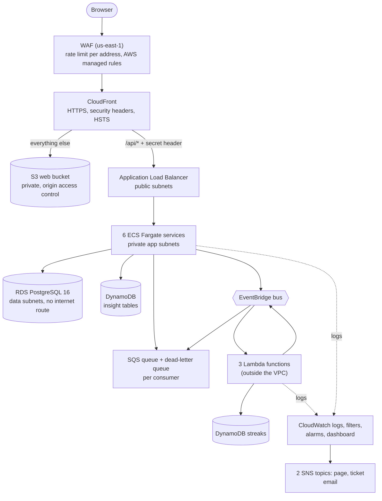
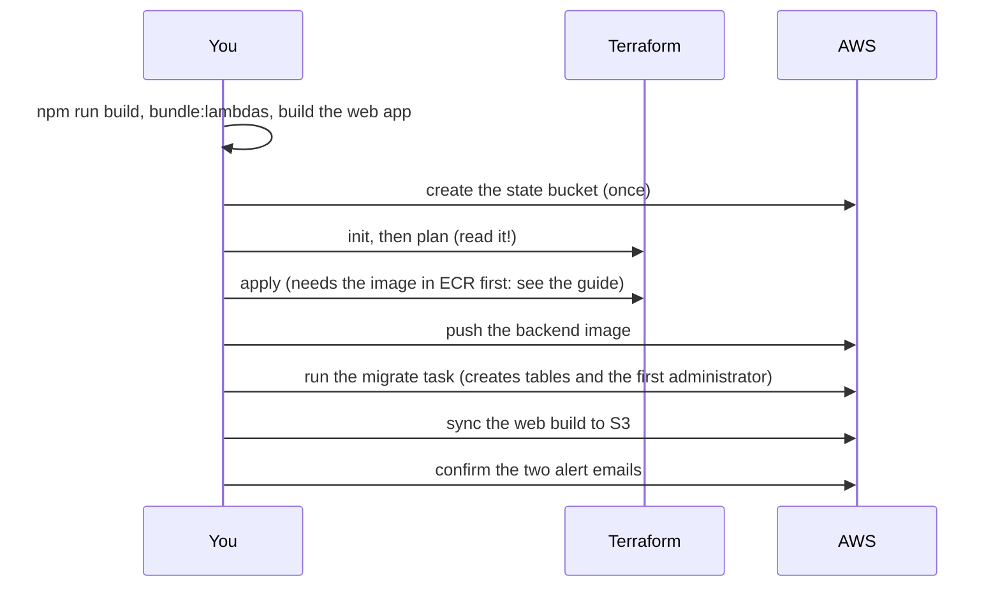

# 17. Terraform: the AWS infrastructure (roadmap step 11)

Everything in [05 AWS deployment](05-aws-deployment.md) as code, in [`infra/terraform`](../../infra/terraform).

> **Status: written and tested as text; never run.** Nothing has been applied to AWS, and `terraform
validate` has not been run because Terraform is not installed on the development machine. The
> tests in [`terraform.test.ts`](../../tools/test/terraform.test.ts) check the facts that must agree
> with the rest of the repository. Expect to fix small syntax or provider-argument errors on the first
> real `terraform validate` and `plan`. See [open items](#open-items).

## What it creates

| File                 | Contents                                                                                          |
| -------------------- | ------------------------------------------------------------------------------------------------- |
| `versions.tf`        | Providers (aws, random, tls, archive), S3 state backend, a us-east-1 provider for the WAF         |
| `variables.tf`       | Inputs; `environment` = `dev` (cheap) or `prod` (resilient)                                       |
| `locals.tf`          | The service table, event routing, Lambda table, names                                             |
| `network.tf`         | VPC, 3 subnet tiers x 2 zones, NAT, routes, data-tier network ACL, VPC endpoints                  |
| `security_groups.tf` | Layered groups; the load balancer accepts only CloudFront's address list                          |
| `data.tf`            | RDS (encrypted, TLS forced, private), three DynamoDB tables                                       |
| `secrets.tf`         | Generated database URL, JWT key, salts, first administrator password, in Secrets Manager          |
| `messaging.tf`       | Event bus, a queue and dead-letter queue per consumer, rules, queue policies, Lambda rules        |
| `ecs.tf`             | ECR, cluster, a task definition, service, autoscaling and two IAM roles per service; migrate task |
| `alb.tf`             | Load balancer, target groups, path rules that also require CloudFront's secret header             |
| `lambda.tf`          | The three functions, their roles and logs                                                         |
| `frontend.tf`        | S3 bucket, CloudFront, security-header policies (CSP hash computed from the built app)            |
| `waf.tf`             | Web firewall: per-address rate rule and two AWS managed rule sets                                 |
| `monitoring.tf`      | Metric filters, alarms, dashboard, expanded from `infra/observability/monitoring.json`            |

## `dev` and `prod`

| Setting                 | dev                | prod                                                |
| ----------------------- | ------------------ | --------------------------------------------------- |
| NAT gateways            | 1                  | 2 (one per zone)                                    |
| Database                | single zone, micro | Multi-AZ, small, 7-day backups, deletion protection |
| Tasks per service       | 1 (scales to 4)    | 2 (scales to 8)                                     |
| VPC interface endpoints | off                | on                                                  |
| Secret recovery         | immediate delete   | 30 days                                             |

**Cost warning:** even `dev` costs real money while it exists (NAT gateway, load balancer, RDS and
six Fargate tasks are roughly 100 USD a month in total; check the AWS pricing page for your region).
Destroy it when you are not using it. Nothing here is free tier.

## Decisions that differ from document 05, and why

| 05 said                                   | Terraform does                                                             | Why                                                                                                               |
| ----------------------------------------- | -------------------------------------------------------------------------- | ----------------------------------------------------------------------------------------------------------------- |
| Users reach the ALB directly over HTTPS   | Users reach **CloudFront only**; it forwards `/api/*` to the ALB over HTTP | One HTTPS origin makes the `SameSite=Strict` cookie work, and gives HTTPS without owning a domain                 |
| Lambdas in the VPC to reach RDS           | Lambdas **outside** the VPC                                                | The code never touches PostgreSQL (streak uses DynamoDB, badge uses EventBridge): no NAT cost, faster cold starts |
| Per-service database credentials          | One database user; **a schema per service**                                | That is how the code is built (`DATABASE_SCHEMA`). A schema boundary is weaker than a user boundary               |
| Secrets auto-rotated                      | Generated once, **not rotated**                                            | Rotation needs a rotation function per secret; left for later                                                     |
| KMS customer-managed keys everywhere      | AWS-managed encryption at rest (RDS, S3, SQS, DynamoDB, logs)              | A key policy per service is easy to get wrong; the data is still encrypted at rest                                |
| SES for the Notification service          | No SES permission                                                          | The code sends no email; notifications are in-app                                                                 |
| ALB security group: 443 from the internet | 80 from **CloudFront's address list only**, plus a secret header check     | See above; the leg CloudFront to ALB is not encrypted                                                             |

## Client addresses: why `TRUST_PROXY=2`

Behind CloudFront and then the load balancer, `X-Forwarded-For` ends with the client address that
CloudFront saw, then CloudFront's own address (appended by the ALB). The services must skip exactly two
proxies. With the earlier "trust one proxy" setting every person would have shared CloudFront's address
and the per-address rate limits would have been meaningless. `TRUST_PROXY` now accepts a count from 1 to
3 (`true` still means 1, so local runs are unchanged); a test checks that two hops give the real client
and that a client-supplied header is never believed. See [ADR-0022](../adr/0022-terraform-structure.md).

## Order of operations on a first deployment

The step-by-step version, with every click and command, is kept in separate deployment notes (not part of this repository).

## Open items

- **Never validated.** First run of `terraform fmt`, `validate` and `plan` will probably find small
  mistakes. Terraform needs to be installed for that (a download of the official binary).
- **RDS certificate bundle:** the services verify the RDS certificate, which needs AWS's CA bundle in
  the backend image at `/app/certs/rds-global-bundle.pem` (set through `NODE_EXTRA_CA_CERTS`). The image
  does **not** contain it yet. Until it does, database connections in AWS will fail. Adding it means
  downloading one public file and pinning its checksum in the Dockerfile.
- **Image before apply:** the ECS services reference an image tag that must already exist in ECR, but ECR
  is created by the same configuration. Plan on a two-step first apply (`-target` the repository, push,
  then the full apply).
- **CloudFront to ALB is plain HTTP.** Needs a domain name and ACM certificate to close.
- **Cost not measured.** The monthly figure above is an estimate, not a bill.
- **Alarm thresholds untested** on real traffic (see [16](16-observability-and-hardening.md)).
- **Lambda salt:** `LOG_PSEUDONYM_SALT` is a Lambda environment variable (visible to anyone allowed to
  read the function's configuration), not a Secrets Manager reference.
- **Terraform state contains the generated secrets**, so the state bucket must be private and encrypted.
