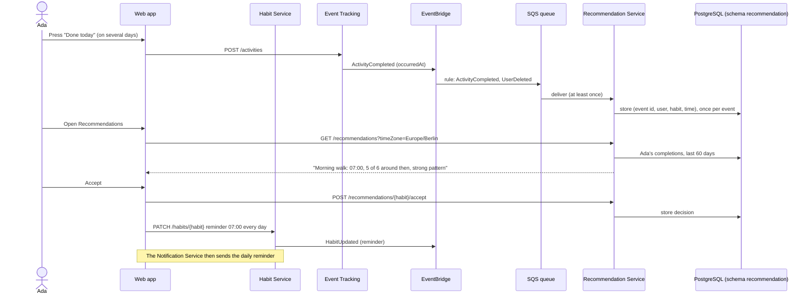
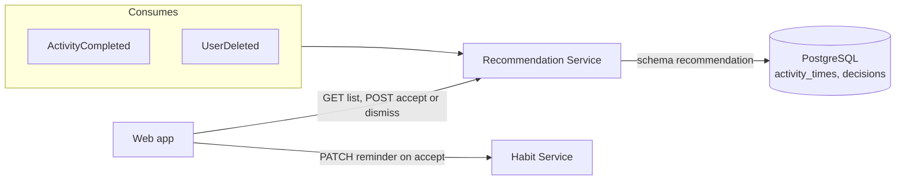

# 18. Recommendation Service (roadmap step 13)

Personalised **timing recommendations**: when in the day a person usually does a habit, offered as a
daily reminder they can accept. Code: [`services/recommendation`](../../services/recommendation).
API: [Recommendation API](../api/recommendation.md). Decision: [ADR-0023](../adr/0023-timing-recommendations.md).

## What it does, in one scenario

## How a recommendation is made

The algorithm is a pure function, [`suggestTime`](../../services/recommendation/src/domain/timing.ts):

1. Take the person's completions of one habit from the last **60 days** (look-back window).
2. Convert each instant to the **local hour** in the zone the browser sends (platform time zone
   database, so daylight saving needs no arithmetic of ours).
3. Count completions per hour. The busiest hour wins; a tie goes to the earlier hour, so the answer
   never depends on the order events arrived in.
4. Say nothing unless there are **at least 5 completions** and the winning hour holds **at least 40 %**
   of them. Below that there is no pattern, and an honest "no recommendation" beats a guess.
5. Confidence: 70 % or more is _high_, 50 % or more _medium_, otherwise _low_ (shown as tentative).

Recommendations are **computed on demand** from stored completions, so there is no stored
recommendation that can go stale. The only stored judgement is the person's decision.

## Boundaries

| Aspect           | Decision                                                                                                                                                        |
| ---------------- | --------------------------------------------------------------------------------------------------------------------------------------------------------------- |
| Owns             | `activity_times` (event id, user, habit, instant) and `decisions` (user, habit, suggested time, zone, accepted or dismissed)                                    |
| Consumes         | `ActivityCompleted` (stores when), `UserDeleted` (erases everything about the person)                                                                           |
| Publishes        | Nothing. Accepting sets the habit's reminder through the Habit API, called by the web app with the person's own token                                           |
| Privacy          | Only the signed-in person's own history, never anyone else's; no habit titles are stored; erased on `UserDeleted`; housekeeping deletes rows older than 60 days |
| Idempotency      | A completion is stored once per event id; deciding twice is harmless                                                                                            |
| Failure handling | Failed messages are retried and then dead-lettered like every consumer; `/readyz` checks the database                                                           |

## Layout

Same hexagonal layout as the other services: `domain/timing.ts` (pure), `application/` (use cases and
ports), `adapters/http`, `adapters/events`, `adapters/persistence` (migrations, repositories),
`config/`, `main.ts` as composition root.

## Tests

- Unit: the algorithm (time zones, daylight saving, ties, thresholds), configuration and its
  production guard rails, and the OpenAPI document staying in step with the code.
- Integration (real PostgreSQL via PGlite, real RS256 tokens): every endpoint, authentication,
  isolation between two people, idempotency, validation, the event handlers through the real
  consumer, erasure, and the database constraints.
- Platform checks that now include this service: event routing against the handlers it registers,
  the route inventory (no public route, rate-limited writes), and the Terraform and monitoring
  consistency tests.

## Not done

- The reminder is set by the web app after the decision is stored. If that second call fails, the
  person is told and can set the reminder by hand; there is no server-side retry (ADR-0023).
- "Missed" activities are not modelled: a missed day is a day with no completion. A person cannot yet
  mark a habit "missed" explicitly.
- No machine learning: a histogram of completion hours is explainable and testable, which is the
  point (ADR-0023).
