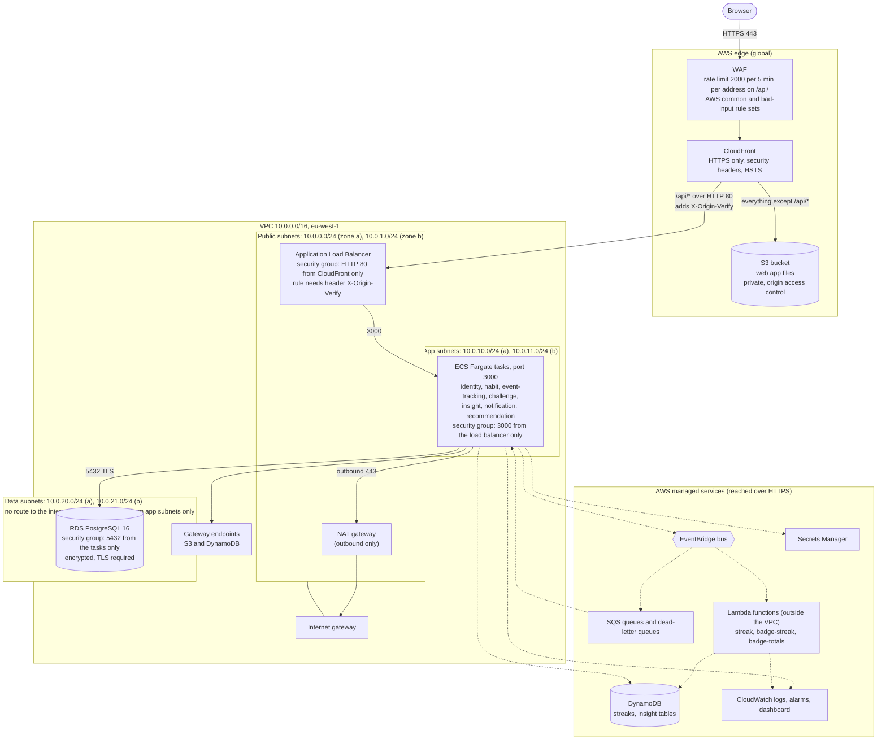

# 19. Network architecture

The network the platform runs in on AWS, exactly as described by the Terraform in
[`infra/terraform`](../../infra/terraform) (`network.tf`, `security_groups.tf`, `alb.tf`, `frontend.tf`,
`waf.tf`). Region `eu-west-1`, two Availability Zones.

## The picture

## Who may talk to whom

| From          | To              | Port | Allowed by                                                             |
| ------------- | --------------- | ---- | ---------------------------------------------------------------------- |
| Internet      | CloudFront      | 443  | Public. WAF in front. HTTP is redirected to HTTPS                      |
| CloudFront    | S3              | 443  | Origin access control; bucket policy allows only this distribution     |
| CloudFront    | Load balancer   | 80   | Load balancer security group: CloudFront's address list, nothing else  |
| Anyone else   | Load balancer   | any  | Refused. The listener answers 403 without the secret `X-Origin-Verify` |
| Load balancer | Tasks           | 3000 | Task security group accepts only the load balancer's group             |
| Tasks         | RDS             | 5432 | Database group accepts only the task group; the data-tier ACL as well  |
| Tasks         | AWS APIs, JWKS  | 443  | Outbound only, through the NAT gateway (or gateway endpoints)          |
| Internet      | Tasks, database | any  | No route and no rule: neither has a public address                     |
| Database      | Anywhere        | any  | No outbound rule at all                                                |

## Layers of protection

1. **WAF** at the edge: floods and known bad requests never reach the VPC.
2. **CloudFront** is the only public entrance: HTTPS, security headers, one origin for the site and the API.
3. **Security groups** name each tier's only allowed caller (group to group, not address ranges).
4. **Network ACL** on the data subnets: a second lock, PostgreSQL from the app subnets only.
5. **Private routing:** the data subnets have no route to the internet; the app subnets reach out
   only through the NAT gateway.
6. **TLS** from the browser to CloudFront and from the services to the database.

## Known limit

The hop from CloudFront to the load balancer is plain HTTP inside AWS's network, protected by the
address list and the secret header. Encrypting it needs a custom domain and certificate. See
[17 Terraform](17-terraform.md) and [ADR-0022](../adr/0022-terraform-structure.md).
