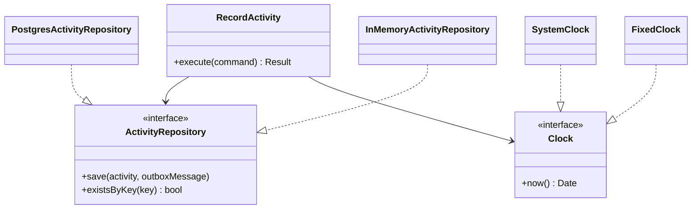
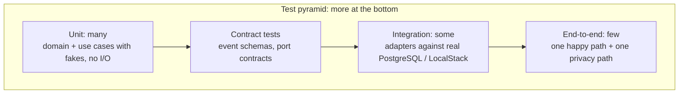

# Engineering Guidelines

Rules we follow in every workspace. Reviewers use this as the checklist.

## SOLID, applied to TeamPulse

| Principle                 | Meaning here                                   | Concrete example in this project                                                                                                                            |
| ------------------------- | ---------------------------------------------- | ----------------------------------------------------------------------------------------------------------------------------------------------------------- |
| **S**ingle Responsibility | A class has one reason to change               | `StreakCalculator` only computes streaks. Saving, publishing and HTTP are separate classes                                                                  |
| **O**pen/Closed           | Extend by adding code, not editing tested code | Badge kinds (`streak`, `total`, `milestone`) are separate `BadgeRule` implementations behind one interface; a new kind is a new class and one registry line |
| **L**iskov Substitution   | Implementations honour the port's contract     | `InMemoryHabitRepository` (tests) and `PostgresHabitRepository` pass the same contract test suite                                                           |
| **I**nterface Segregation | Small, role-specific ports                     | `HabitReader` and `HabitWriter` are separate; a read-only use case depends only on `HabitReader`                                                            |
| **D**ependency Inversion  | Core depends on abstractions it owns           | Use cases depend on `EventPublisher`, never on the AWS SDK; `main.ts` injects `EventBridgePublisher`                                                        |

## Beyond SOLID

- **Make illegal states unrepresentable**: value objects (`TeamId`, `Email`, `ActivityDate`)
  validate on creation; raw strings do not cross the domain boundary.
- **Errors are values in the domain**: use cases return `Result<T, DomainError>`; adapters map
  errors to HTTP status codes. Exceptions are for programmer errors and I/O failures.
- **Time and randomness are injected** (`Clock`, `IdGenerator`) so tests are deterministic.
- **Fail fast on configuration**: parse and validate environment variables once at startup.
- **No premature abstraction**: introduce a port when there is a second implementation or a test
  seam to protect, not before.
- **Small functions, clear names**, comments explain _why_, not _what_.
- **No `any`**; narrow `unknown` with schemas. No default exports in libraries.
- **Immutable by default**: `readonly` fields, `const`, no mutation of inputs.

## Testing strategy

| Level       | Scope                                    | Tooling (planned)                     | Runs                    |
| ----------- | ---------------------------------------- | ------------------------------------- | ----------------------- |
| Unit        | Domain and use cases, in-memory fakes    | Vitest                                | Every save, every PR    |
| Contract    | Event schemas; repository contract suite | Vitest + Zod                          | Every PR                |
| Integration | Repositories, SQS consumers, HTTP routes | Vitest + Testcontainers or LocalStack | Every PR (needs Docker) |
| End-to-end  | Browser through ALB to services          | Playwright                            | Nightly and pre-release |

Privacy has dedicated tests: "manager cannot read private habit", "cohort below K is suppressed",
"employee cannot call admin endpoint". These are release blockers.

## Git and review

- **Trunk-based** with short-lived branches: `feat/…`, `fix/…`, `docs/…`.
- **Conventional Commits**: `feat(habit): add team visibility`, `fix(event-tracking): …`.
- Pull requests stay small (one step or one concern) and include docs and tests.
- A PR is mergeable when CI is green, an ADR exists for any architectural change, and the
  checklist below is satisfied.

### Definition of done

- [ ] Behaviour covered by unit tests; adapters by integration tests
- [ ] Types strict, formatting clean, no lint warnings
- [ ] Authorization and privacy rules tested for new endpoints
- [ ] Logs structured, no sensitive content
- [ ] Docs and diagrams updated (`npm run docs:check` passes)
- [ ] ADR added or updated if a decision changed

## API conventions

- REST, JSON, base path `/api/v1/<service>`; plural nouns; ISO 8601 UTC timestamps.
- Errors use RFC 9457 `application/problem+json` with a stable `type` and the `correlationId`.
- Pagination via `limit` and opaque `cursor`; filtering by query parameters.
- Mutating calls that can be retried are made naturally idempotent with a unique key (Event Tracking:
  one completion per user, habit and day), so a retry returns the original result. A call with no
  natural key would take an `Idempotency-Key` header.
- Every service exposes `/healthz` and `/readyz`, and an OpenAPI document at `<base path>/openapi.json`
  generated from its route definitions. The generated file is committed under `docs/api/` and a
  test fails if it drifts from the code.
- Routes are declared with `defineRoute` from `@teampulse/http`: request and response schemas come
  from `@teampulse/contracts`, responses are parsed through their schema (an undeclared field never
  leaves the service), and handlers return `Result` values instead of throwing.
