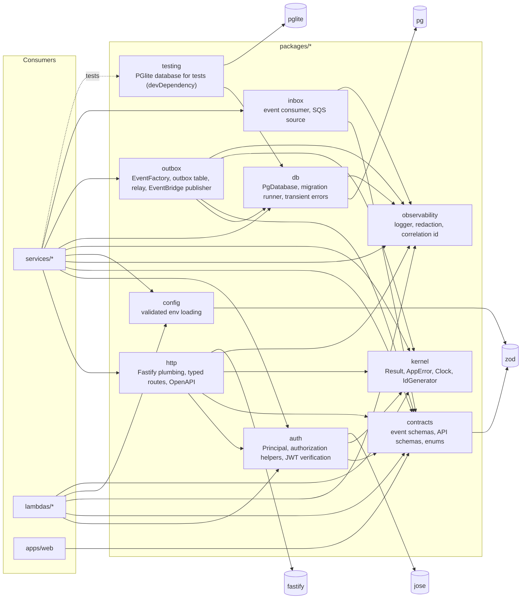

# Shared packages

Services share code **only** through these packages (ADR-0001). Each is small, has one purpose,
and the leaf packages are independent of each other, so no build-order cycles are possible.



`kernel`, `contracts`, `observability` and `config` do not depend on each other. `auth` builds on
`contracts` and `kernel`; `http` builds on those plus `observability`. Nothing depends on a service.

| Package                    | Purpose                                                                                                                        | Runtime dependencies                            |
| -------------------------- | ------------------------------------------------------------------------------------------------------------------------------ | ----------------------------------------------- |
| `@teampulse/kernel`        | `Result`, `AppError` taxonomy, `Clock`, `IdGenerator`, cursor paging, `deterministicUuid`, `startPeriodicTask`                 | none                                            |
| `@teampulse/contracts`     | Event and Identity API schemas, access-token claims, enums, RFC 9457 body                                                      | `zod`                                           |
| `@teampulse/observability` | JSON logger, redaction, pseudonymised user ids, correlation id                                                                 | none                                            |
| `@teampulse/config`        | `loadConfig`, `loadServiceConfig`, base config schema                                                                          | `zod`                                           |
| `@teampulse/auth`          | `Principal`, `requireRole`, `AccessTokenVerifier`; `/jwt`: JWKS verification                                                   | `jose`                                          |
| `@teampulse/http`          | `createServer`, `defineRoute`, `registerRoutes`, OpenAPI, problem+json                                                         | `fastify`                                       |
| `@teampulse/db`            | `PgDatabase` pool, `migrate`, `migrateSchema`, `isTransientDatabaseError`                                                      | `pg`                                            |
| `@teampulse/outbox`        | `EventFactory`, `Outbox` port, `PostgresOutbox`, `OutboxRelay`, `EventBridgePublisher`; `/aws`: SDK client, `startOutboxRelay` | `@aws-sdk/client-eventbridge` (only via `/aws`) |
| `@teampulse/inbox`         | `EventConsumer`, `MessageSource`, `decodeLambdaEvent`; `/aws`: `createSqsMessageSource`, `startEventConsumer`                  | `@aws-sdk/client-sqs` (only via `/aws`)         |
| `@teampulse/privacy`       | `release`, `releaseBreakdown`: K-anonymity with complementary suppression                                                      | none                                            |
| `@teampulse/testing`       | `PgliteDatabase`, `startPgWireServer` (devDependency only)                                                                     | `@electric-sql/pglite`                          |

`@teampulse/auth` has two entry points: the root (`Principal` and helpers, safe to import from the
application layer) and `@teampulse/auth/jwt` (token verification with `jose`, for adapters only).

## Using them

```ts
import { ok, err, notFoundError, type Result, type Clock } from '@teampulse/kernel';
import { createEvent, parseEvent } from '@teampulse/contracts';
import { createLogger, runWithCorrelationId } from '@teampulse/observability';
import { baseConfigSchema, loadServiceConfig, z } from '@teampulse/config';

const config = loadServiceConfig(baseConfigSchema.extend({ DATABASE_URL: z.url() }));
const logger = createLogger({
  service: 'habit-service',
  level: config.LOG_LEVEL,
  pseudonymSalt: config.LOG_PSEUDONYM_SALT,
});
```

## Design rules for packages

- **No cross-package imports.** If two packages need the same thing, it belongs in `kernel`.
- **Ports live in `kernel`, adapters live in services.** `Clock` is an interface; `SystemClock` and
  `FixedClock` are the only implementations shipped, because they are trivial and universal.
- **Fail loudly at the edge, never silently inside.** Config and event parsing validate at the
  boundary; everything past it can trust its types.
- **Privacy is a default, not an option.** The logger redacts wellness and credential keys unless
  you go out of your way, and it never prints a raw user id.

## Commands

```bash
npm run build       # tsc -b: compiles every package to dist/ (project references)
npm run typecheck   # build, then typecheck src and tests of each package
npm test            # Vitest, all workspaces
npm run lint        # ESLint including the architecture boundary rules
npm run verify      # everything CI will run
```
